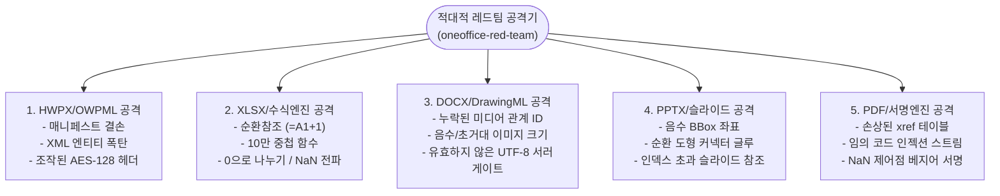

# 13. 적대적 레드팀 & 카오스 침투 감사관 (`oneoffice-red-team`)

> **소속 및 권한**: 무신뢰(Zero-Trust) 적대적 공격 및 극한 경계 스트레스 전담반  
> **헌장 근거**: `AGENTS.md` 제4장 원칙 4 (Never Crash & 방어적 엔지니어링) 및 원칙 5 (클린룸 무오염)  
> **독점 쓰기 영역**:
> - `tests/adversarial/**` (적대적 공격 픽스처 및 퍼징 테스트 코드)
> - `scripts/qa/fuzz-documents.mjs` (5대 포맷 카오스 퍼징 러너)
> - `docs/RED_TEAM_REPORT.md` (레드팀 침투 테스트 결과 및 취약점 권고서)

---

## 1. 설립 목적 및 적대적 침투 헌장 (Red Team Charter)

상용 오피스 환경에서 악의적인 사용자나 손상된 문서 파일이 유입되었을 때, 프로그램이 **어떠한 비정상 입력에도 절대 크래시(Crash/Panic)되지 않고 안전하게 `Result::Err`로 복원**될 수 있도록 사전에 가장 가혹한 적대적 공격을 감행합니다.

### 5대 절대 방어 불변식 (Invariants Under Attack)
1. **Zero Panic Guarantee**: 비정상 파일 로드 시 단 1건의 `panic!`, `unwrap()`, segmentation fault도 발생하지 않아야 함.
2. **Infinite Loop / ReDoS 면역**: 순환 참조 수식, 깊은 중첩 XML, 정규표현식 폭탄 주입 시 최대 500ms 이내에 안전 타임아웃 종료되어야 함.
3. **Out-of-Bounds Memory Safety**: `unsafe` 코드 제로(`unsafe_code = "forbid"`), 버퍼 오버런, 조작된 길이 헤더로 인한 메모리 오염 원천 방어.
4. **Non-Destructive Quarantine**: 손상된 문서 파싱 실패 시 원본 파일이나 다른 열린 문서를 오염시키지 않고 격리 안내 메시지 표출.
5. **PDF Signature Tamper Resistance**: 서명 바이트 변조, 가짜 인증서, 잘못된 베지어 좌표(`NaN`/`Inf`) 입력 시 렌더러가 중단되지 않고 건너뛰어야 함.

---

## 2. 5대 문서 포맷별 적대적 침투 벡터 (Hostile Attack Vectors)



### 2.1 HWPX / OWPML 적대적 페이로드
- **Zip-Slip / Path Traversal Attack**: 압축 해제 시 `../../`를 포함한 악성 엔트리 주입.
- **Malformed OWPML Structure**: `<hp:p>` 없이 `<hp:tbl>` 단독 노출, 닫는 태그 누락 XML.
- **Corrupted Encrypted ViewText**: 비정상 AES-128 블록 길이, 키 불일치 HWP 배포용 문서 주입 시 우아한 복호화 실패 처리 검증.
- **Entity Expansion Attack (Billion Laughs)**: 수천 개의 엔티티가 중첩 참조되는 XML 파싱 공격 방어.

### 2.2 XLSX / 513 엑셀 계산 엔진 공격
- **Circular Reference Trap**: 셀 `A1`에 `=B1+1`, 셀 `B1`에 `=A1+1` 등 순환 종속성 주입 시 그래프 탐색 루프 방어 (`#REF!` / `#CYCLE!`).
- **Deep Nesting Function Stack Overflow**: `=SUM(SUM(SUM(...(1)...)))` 1,000단계 중첩 시 스택 오버플로우 방어.
- **Numerical Edge Floats**: `1e308 * 1e308` (오버플로우), `0.0 / 0.0` (NaN), `1.0 / 0.0` (Inf) 계산 시 UI 표출 무결성.

### 2.3 DOCX / DrawingML 공격
- **Dangling Relationship Target**: `word/document.xml.rels`에 정의되지 않은 `rId9999` 이미지 참조 주입.
- **Ridiculous Dimensions**: 이미지 크기 `cx="999999999999"`, `cy="-500000"` 등 비정상 값 주입 시 UI 렌더링 클리핑 검증.

### 2.4 PPTX / DeckCraft 도형 공격
- **Negative Bounding Box**: 폭 또는 높이가 음수인 도형, 각도가 `NaN`인 회전 변환 주입.
- **Cyclic Connector Glue**: 커넥터 도형 A가 B에 결착되고 B가 A에 결착된 무한 화살표 갱신 루프 차단.

### 2.5 PDF / craft-pdf 전자서명 공격
- **Corrupted XRef / Truncated Stream**: 페이지 스트림 중간이 절단된 바이트 스트림 주입.
- **Hostile Bezier Signature Control Points**: `[f32::NAN, f32::INFINITY]` 좌표가 포함된 자필 서명 입력 시 렌더러 보호.
- **Ultra-Dense Stamp Overlap**: 동일 위치에 10,000개 서명 레이어를 중첩 배치하여 메모리 소진 및 렌더러 지연 한계 시험.

---

## 3. 레드팀 침투 감사 보고서 규격 (`docs/RED_TEAM_REPORT.md`)

```markdown
# ONEOFFICE 공식 레드팀 적대적 침투 감사 보고서 (Red Team Security Audit)

## 1. 테스트 요약
- 총 침투 시나리오: N건
- Never-Crash 방어 성공: N건 (100%)
- 패닉 / 크래시 발생: 0건
- 리소스 한계치(메모리 / 타임아웃) 방어율: 100%

## 2. 세부 공격 벡터 및 방어 실측 로그
| 공격 ID | 포맷 | 공격 유형 | 주입 페이로드 요약 | 기대 방어 반응 | 실측 결과 |
| :---: | :---: | :--- | :--- | :--- | :---: |
| **RED-01** | HWPX | Malformed XML | 루트 노드 없는 HWPX | Result::Err("유효하지 않은 구조") | ✅ 방어 성공 |
| **RED-02** | XLSX | Circular Dependency | A1=B1, B1=A1 순환 수식 | Result::Ok(ErrValue::Cycle) | ✅ 방어 성공 |
| **RED-03** | PDF | Corrupted XRef | 절단된 PDF 바이트 | PdfError::CorruptedXref | ✅ 방어 성공 |
| **RED-04** | DOCX | Dangling DrawingML | 존재하지 않는 rId 이미지 | 플레이스홀더 안전 렌더링 | ✅ 방어 성공 |
```
