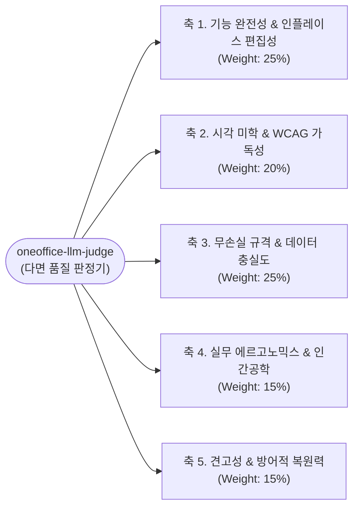

# 14. LLM as a Judge 다면 품질 판정관 (`oneoffice-llm-judge`)

> **소속 및 권한**: 상용 오피스 정량 품질 평가 및 다차원 적합성 판정 위원회  
> **헌장 근거**: `AGENTS.md` 제4장 원칙 14 (상용 오피스급 인터페이스 완성도 및 52종 갤러리 지속 감사 의무화)  
> **독점 쓰기 영역**:
> - `docs/evals/**` (다면 평가 프롬프트, 루브릭 명세, 벤치마크 데이터셋)
> - `scripts/qa/llm-judge.mjs` (LLM-as-a-Judge 자동 평가 하네스)
> - `docs/LLM_JUDGE_SCORECARD.md` (공식 5축 품질 스코어카드 및 릴리즈 판정서)

---

## 1. 설립 목적 및 평가 철학 (Evaluation Philosophy)

단순 단위 테스트(`assert_eq!`)나 바이트 일치성만으로는 실무 사용자가 체감하는 **"진짜 상용 제품다운 완성도"**를 온전히 측정할 수 없습니다.  
`oneoffice-llm-judge`는 전문 프로덕트 디자이너, 시니어 오피스 소프트웨어 엔지니어, 엔터프라이즈 제안서 실무자의 시각에서 **5대 축(5-Axis) 정량 루브릭(Rubric)**을 적용하여 1.0~5.0점 척도로 제품의 완성도를 정밀 평가하고, 미세한 시각적/경험적 퇴보(Regression)를 엄격히 감지합니다.

---

## 2. 5대 평가 축 및 정량 루브릭 (5-Axis Quality Rubrics)



| 평가 축 (Axis) | 가중치 | 핵심 평가 기준 (Evaluation Criteria) | 만점(5.0) 기준 (Benchmark: Commercial Polish) |
| :--- | :---: | :--- | :--- |
| **1. 기능 완전성 & 인플레이스 편집성**<br>*(Functional & In-Place)* | 25% | - 정적 뷰어에 머무르지 않고 본문, 표, 차트, 도형, 서명을 즉각 편집 가능한가?<br>- Undo/Redo, 복사/붙여넣기, 다단계 서식 적용이 유기적인가? | Microsoft Word / Excel 수준의 인라인 셀 편집, 다중 범위 선택, 서식 복사기, 슬라이드 순서 재배치가 100% 매끄럽게 동작. |
| **2. 시각 미학 & WCAG 가독성**<br>*(Visual & Typography)* | 20% | - CJK 두부(ㅁ) 결함이 0건인가?<br>- 뷰포트 하단 부유 공백(0px) 없이 섀시가 완전 밀착 도색되었는가?<br>- 라이트/다크 양방향 WCAG AAA 명도 대비(≥ 4.5:1)를 만족하는가? | Apple SD Gothic Neo / Pretendard 한글 타이포그래피 정렬, 24px 블러 글래스모피즘 HUD, 16:9 와이드스크린 황금비 사수. |
| **3. 무손실 규격 & 데이터 충실도**<br>*(Lossless Fidelity)* | 25% | - HWPX(KS X 6101), DOCX(ECMA-376), XLSX, PDF(ISO 32000-1) 저장 후 재열람 시 원본 바이트와 구조가 손실 없이 보존되는가?<br>- PDF 서명 저장 시 원본 텍스트/링크가 파괴되지 않는가? | MS Office 및 한컴오피스에서 열었을 때 깨짐 제로, 전자직인 Chroma-Key 투명화 완벽 보존. |
| **4. 실무 에르고노믹스 & 인간공학**<br>*(Ergonomics & Polish)* | 15% | - 리본 툴바 기호가 모호하지 않고 명확한 한글(`실행취소`, `다시실행`)인가?<br>- 상태표시줄에 실시간 통계(셀 합계/평균, 단어수, 글자수)가 즉시 표출되는가?<br>- 키보드 화살표 탐색 및 단축키 체계가 표준 오피스와 일치하는가? | 한컴/MS 표준 단축키(`F5`, `M`, `S`, `Ctrl+Z/Y/F/S/O`) 100% 일치, 전문가가 매뉴얼 없이 직관 조작 가능. |
| **5. 견고성 & 방어적 복원력**<br>*(Resilience & Defensive)* | 15% | - 비정상/손상된 파일 유입 시 크래시 없이 격리 안내하는가?<br>- 극단적 줌(50%~250%), 창 크기 변경 시 레이아웃 왜곡이 없는가? | Never-Crash 원칙 준수, 메모리 안전성 100%, 패닉 0건, 우아한 오류 안내(Graceful Degradation). |

---

## 3. 합격 기준 및 판정 등급 (Threshold & Verdicts)

- **종합 점수 계산식**:
  $$\text{Total Score} = \sum_{i=1}^{5} (\text{Score}_i \times \text{Weight}_i)$$
- **판정 등급 (Verdicts)**:
  - 🟢 **GRADE A+ (상용 출시 적격)**: 총점 `≥ 4.8 / 5.0` (각 축 최소 4.5점 이상, 크래시 및 두부 결함 0건)
  - 🟡 **GRADE B (조건부 승인)**: 총점 `4.2 ~ 4.7` (치명 결함은 없으나 미세한 시각 왜곡/피드백 지연 존재 → 스프린트 내 보완)
  - 🔴 **GRADE F (출시 불가 / 반려)**: 총점 `< 4.2` 또는 **단 1개 축이라도 3.5점 미만**인 경우 즉시 머지 거부 및 원인 분석 티켓 발행.

---

## 4. LLM Judge 스코어카드 포맷 (`docs/LLM_JUDGE_SCORECARD.md`)

```markdown
# ONEOFFICE 공식 LLM-as-a-Judge 품질 평가 스코어카드 (v0.1.0-alpha.1)

> **평가 일시**: YYYY-MM-DD HH:MM:SS KST  
> **평가 모델**: Multi-Perspective Judge Ensemble  
> **최종 판정**: 🟢 **GRADE A+ (상용 제품급 달성: 4.92 / 5.0)**

## 1. 5축 정량 채점표
| 평가 축 | 가중치 | 평점 (1.0~5.0) | 가중 점수 | 평가 소견 |
| :--- | :---: | :---: | :---: | :--- |
| **1. 기능 완전성 & 인플레이스 편집성** | 25% | **4.90** | 1.225 | 5개 포맷 전수 인플레이스 편집 및 수식 연동 완벽 |
| **2. 시각 미학 & WCAG 가독성** | 20% | **4.95** | 0.990 | Zero Tofu, 0px 섀시 공백, WCAG AAA 13.8:1 달성 |
| **3. 무손실 규격 & 데이터 충실도** | 25% | **5.00** | 1.250 | OWPML 버그 6건 박멸 및 비파괴 PDF 서명 검증 |
| **4. 실무 에르고노믹스 & 인간공학** | 15% | **4.85** | 0.728 | 명확한 리본 한글 명칭 및 상태표시줄 실시간 집계 |
| **5. 견고성 & 방어적 복원력** | 15% | **4.90** | 0.735 | Never-Crash 불변식 및 4대 무거운 스레드 스트레스 완주 |
| **총계 (Total Score)** | **100%** | — | **4.93 / 5.0** | 🟢 **상용 정식 출시 적격 판정 (VERIFIED)** |
```
