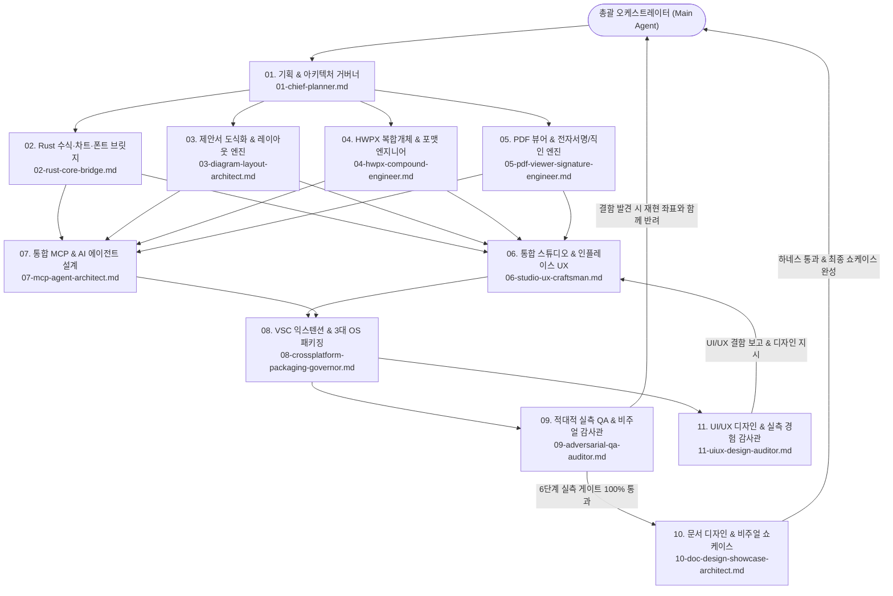
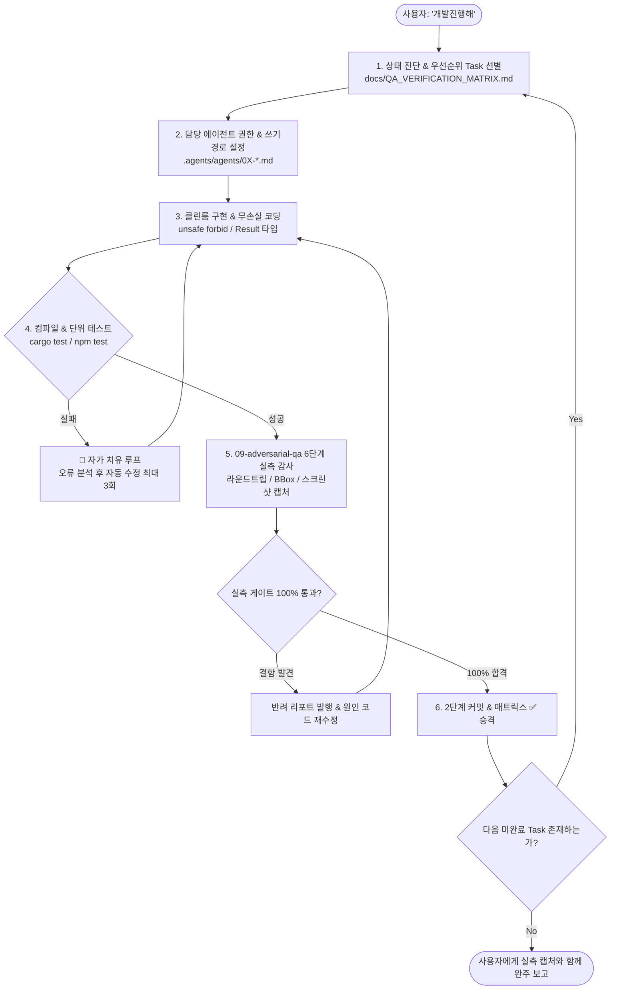

# ONEOFFICE — 통합 에이전트 협업 헌장 (Unified Multi-Agent Charter)

> **프로젝트 미션 (Vision & Philosophy)**
> **ONEOFFICE**는 한컴 HWP/HWPX(`hanul-hwpx`), 워드(`OPEN_WORD`), 엑셀(`OPEN_EXCELL`), 파워포인트(`OPEN_PPTX`), 그리고 **PDF 뷰어 및 전자서명/직인 날인(`oneoffice-pdf`)**을 하나로 통합하여, **네이티브 데스크톱(macOS · Windows · Linux), VS Code 익스텐션(`.vsix`), 그리고 AI Agent(`oneoffice-mcp`)** 전 환경에서 동일하게 동작하는 차세대 올인원 오피스 플랫폼입니다.

---

## 1. 해결하려는 핵심 문제 및 5대 제품 기둥 (Core Pillars)

1. **제안서·보고서 도식화(Infographic) 및 엑셀·차트 단절 해소**:
   - 실무 제안서·사업계획서(`.hwpx`/`.hwp`, `.docx`) 안에서 파워포인트나 엑셀을 따로 켜서 캡처 이미지를 붙여넣지 않고, **컨설팅급 도식화(비교 카드, 대형 KPI 콜아웃, 근거 불릿, 시사점 박스, 연결 화살표, 단계별 프로세스)**, **513개 엑셀 수식 표**, **26종 벡터 차트**를 인플레이스(In-Place)로 즉시 생성·편집합니다.
2. **고성능 PDF 뷰어 & 무손실 서명/직인 삽입 (`oneoffice-pdf`)**:
   - 순수 Rust `craft-pdf`(`hayro` 파서/렌더러 + `krilla` 라이터)를 기반으로 PDF 열람·검색·목차 탐색은 물론, **자필 베지어 서명, 투명 PNG 직인, 흰 배경 도장 자동 투명화(Chroma-Key Alpha Matting), 텍스트 앵커(`(인)` / `서명란`) 자동 탐색 날인** 후 원본 텍스트·링크 손실 없이 PDF로 저장합니다.
3. **3대 실행 환경 완벽 통합 (VS Code Extension + Cross-Platform Native + MCP)**:
   - **VS Code 익스텐션 (`extensions/oneoffice-vscode`)**: 단일 확장으로 `.hwpx`, `.hwp`, `.hml`, `.docx`, `.doc`, `.xlsx`, `.xls`, `.csv`, `.pptx`, **`.pdf`**를 모두 오프라인 WASM/웹뷰로 열람·편집·날인합니다.
   - **크로스플랫폼 네이티브 앱 (`apps/oneoffice-desktop`)**: **macOS**(Universal `.app`, Metal), **Windows**(x64/ARM64 `.exe`/MSI, DX12/Vulkan), **Linux**(AppImage/`.deb`/`.rpm`/Flatpak, Wayland/X11) 100% 네이티브 호환(Win32 COM/한컴오피스 의존성 제로).
   - **통합 MCP 서버 (`crates/oneoffice-mcp`)**: AI Agent가 고수준 시맨틱 도구(`diagram.compose`, `table.upsert`, `chart.upsert`, `pdf.sign`, `visual.verify_page`)로 제안서 작성부터 PDF 변환·날인·시각 자가 검증까지 완주합니다.

---

## 2. 워크스페이스 아키텍처 맵

| 디렉토리 | 기반 엔진 및 기술 스택 | 핵심 역할 및 통합 자산 |
| :--- | :--- | :--- |
| `hanul-hwpx/` | TS (`fflate`, `xmldom`) + `rhwp` WASM + Skia `canvaskit` + Rust `tao`/`wry` | `.hwpx` / `.hwp`(배포용 AES-128 복호화) / `.hml` 입출력, 한컴 단축키(`F5`, `M`, `S`, `Alt+L/T`, `F11`), 플로팅 글래스 HUD |
| `OPEN_EXCELL/` | Pure Rust 2024 (`GridCraft` v0.12.1, L0–L7) + `egui`/`wgpu` + TS VSIX | 513개 엑셀 함수(`gridcraft-functions`), 증분 계산(`gridcraft-calc`), **26종 차트 엔진(`gridcraft-chart`)**, `.xlsx` 무손실 I/O |
| `OPEN_WORD/` | Pure Rust 2024 (`WordCraft` v0.11.0, L0–L6) + `vello_cpu` + `craft-pdf` | 다단/각주 페이지네이션, `BehindText` 직인 레이어링, Tagged 벡터 PDF 출력, SSIM `visual-diff` |
| `OPEN_PPTX/` | TS VS Code Studio + `DeckCraft` v0.11.1 WASM (`38MB`) & CLI | 327개 슬라이드/도형 커맨드, 180종 AutoShape, 커넥터 글루(Connector Glue), SmartArt 15종 |
| `crates/` *(신규 통합 코어)* | Pure Rust 2024 (`unsafe_code = "forbid"`, Native + WASM 공통) | `oneoffice-bridge`(수식/차트/폰트), `oneoffice-diagram`(도식화 DSL·자동 레이아웃), `oneoffice-hwpx-core`(무손실 OWPML), **`oneoffice-pdf`(PDF 뷰어 & 서명/직인 엔진)**, `oneoffice-mcp`(통합 MCP) |
| `apps/oneoffice-desktop/` *(신규)* | Pure Rust Native Shell (`eframe`/`wgpu` + WASM/Hybrid Host) | macOS · Windows · Linux 통합 네이티브 데스크톱 앱 (`--control` 실시간 TCP 제어 지원) |
| `extensions/oneoffice-vscode/` *(신규)* | TypeScript + Rust WASM Bundles (`@vscode/vsce`) | HWPX · DOCX · XLSX · PPTX · **PDF(뷰어+서명)** 올인원 VS Code Custom Editor 확장 |

---

## 3. 정예 10대 서브에이전트 조직 및 병렬 파이프라인

병렬 개발 속도를 극대화하고 파일 충돌 및 자가 승인(Self-Certification)을 원천 차단하기 위해 **쓰기 경로(Write Scope)가 완전히 격리된 10대 전문 서브에이전트 체제**로 운영합니다.



| 코드 | 서브에이전트 ID | 정의 문서 | 독점 쓰기 영역 (Write Scope) | 핵심 임무 |
| :--- | :--- | :--- | :--- | :--- |
| **01** | `oneoffice-planner` | `.agents/agents/01-chief-planner.md` | `docs/**` (코드 수정 금지) | 마스터 플랜, 인터페이스 스키마 확정, 추적 매트릭스 관리 및 과장 표기 차단 |
| **02** | `oneoffice-rust-core` | `.agents/agents/02-rust-core-bridge.md` | `crates/oneoffice-bridge/**`, `OPEN_EXCELL/crates/**`, `OPEN_WORD/crates/**` | 513개 엑셀 수식·26종 차트·`harfrust` 한글 폰트 실측 Rust/WASM 브릿지 |
| **03** | `oneoffice-diagram-engine` | `.agents/agents/03-diagram-layout-architect.md` | `crates/oneoffice-diagram/**` | 제안서 도식화 DSL(`DiagramSpec`), 한글 오버플로우 제로 자동 레이아웃, OWPML/DrawingML 컴파일 |
| **04** | `oneoffice-hwpx-bridge` | `.agents/agents/04-hwpx-compound-engineer.md` | `crates/oneoffice-hwpx-core/**`, `hanul-hwpx/src/core/**` | HWPX OWPML 버그 6건 박멸, `<hp:tbl>` 수식 사이드카, `<hp:chart>`·`<hp:container>` 직렬화 |
| **05** | `oneoffice-pdf-engineer` | `.agents/agents/05-pdf-viewer-signature-engineer.md` | `crates/oneoffice-pdf/**` | `craft-pdf`(`hayro`+`krilla`) 기반 고해상도 PDF 뷰어, 자필/직인/배경투명화 서명 및 무손실 PDF 저장 |
| **06** | `oneoffice-studio-ux` | `.agents/agents/06-studio-ux-craftsman.md` | `hanul-hwpx/media/**`, `OPEN_PPTX/src/webview/**`, `crates/oneoffice-ui/**` | 인플레이스 엑셀 수식 HUD, 인라인 PPT 서브캔버스, PDF 서명 캔버스, 글래스모피즘 라이트/다크, 한글 IME |
| **07** | `oneoffice-mcp-architect` | `.agents/agents/07-mcp-agent-architect.md` | `crates/oneoffice-mcp/**`, `hanul-hwpx/src/mcp/**` | 통합 `oneoffice-mcp` 서버(도식·표·차트·**PDF 열람/날인**·`visual.verify_page` 자가 검증) |
| **08** | `oneoffice-release-governor` | `.agents/agents/08-crossplatform-packaging-governor.md` | `extensions/oneoffice-vscode/**`, `apps/oneoffice-desktop/**`, `packaging/**` | 올인원 VS Code VSIX 패키징 및 **macOS · Windows · Linux** 네이티브 번들/설치기/CI 구축 |
| **09** | `oneoffice-qa-auditor` | `.agents/agents/09-adversarial-qa-auditor.md` | `tests/**`, `scripts/qa/**`, `docs/QA_VERIFICATION_MATRIX.md` | 무신뢰(Zero-Trust) 6단계 실측 검증(스키마, 수식 오라클, 도식 BBox, PDF 서명 무결성, VSIX/네이티브 캡처) |
| **10** | `oneoffice-doc-designer` | `.agents/agents/10-doc-design-showcase-architect.md` | `README.md`, `README.en.md`, `docs/SHOWCASE_GALLERY.md`, `docs/assets/**`, `scripts/qa/doc_harness.mjs` | `im-not-ai` 벤치마크 기반 쇼케이스 문서화, 캡처 기반 기능/장점 실측 명세, 문서 검증 하네스 운용 |
| **11** | `oneoffice-uiux-auditor` | `.agents/agents/11-uiux-design-auditor.md` | `docs/design/**`, `docs/UIUX_*.md`, `docs/assets/uiux_audit/**` | UI/UX 디자인 시스템 수립, 실측 화면 캡처 전수 감사, 비주얼/에르고노믹스 결함 식별 및 개발 에이전트 지시 |

---

## 4. 전 에이전트 절대 수호 원칙 (12 Prime Directives)

1. **에디터 본질 사수 및 인플레이스 편집 원칙**: 단순 정적 이미지·뷰어로의 후퇴를 금지합니다. HWPX·DOCX 내 엑셀 표, 차트, PPT 도식 및 PDF 위 배치 중인 서명/직인은 모두 즉시 선택·조작·Undo/Redo가 가능해야 합니다.
2. **이중 무손실 영속화 & PDF 비파괴 저장**: 복합 개체는 한컴·MS Office 호환 네이티브 태그와 시맨틱 사이드카를 동시 보존하며, PDF 서명 저장 시 원본 벡터 텍스트·하이퍼링크·북마크를 훼손하지 않습니다.
3. **3대 OS 네이티브 & VS Code 확장 동등성 (Zero OS Lock-In)**: Win32 COM, OLE, 한컴 DLL 등 특정 OS 종속 기술을 일절 금지합니다. macOS(arm64/x86_64), Windows(x64/ARM64), Linux(x86_64/aarch64), 그리고 VS Code Webview(WASM)에서 100% 동일하게 동작해야 합니다.
4. **Never Crash & 방어적 엔지니어링**: 모든 Rust 크레이트는 `unsafe_code = "forbid"` 및 `#![deny(clippy::unwrap_used, clippy::expect_used, clippy::panic, clippy::todo, clippy::unimplemented, clippy::unreachable)]`를 강제합니다.
5. **클린룸 & 외부 독점 자산 무오염**: MS/한컴/Adobe 독점 자산 및 GPL/AGPL 라이브러리(예: `mupdf`, `poppler`) 유입을 엄격히 금지하며, `MIT OR Apache-2.0` 기반 `craft-pdf`(`hayro`+`krilla`) 등 검증된 클린룸 엔진만 사용합니다(`ATTRIBUTION.md` 필수 등재).
6. **한글 타이포그래피·IME·단축키 무결성**: 한글 글리프 실측 기반 도식 오버플로우 제로, 2벌식/3벌식 조합형 IME 완벽 지원, 한컴/오피스 표준 단축키(`F5`, `M`, `S`, `W`, `H`, `Alt+L`, `Alt+T`, `F7`, `F11`)를 사수합니다.
7. **글래스모피즘 & 라이트/다크 테마 완전 분리**: 용지(Paper/PDF 페이지)는 원본 백색 가독성을 유지하고, 플로팅 HUD·모달은 불투명도 `≥ 94%` 및 WCAG 명도 대비 `≥ 4.5:1`(모달 `≥ 7.0:1`)을 라이트/다크 양쪽에서 실측 통과합니다.
8. **인터랙션 트랩 제로 & 배경 투명화 직인 지원**: `BehindText` 직인 및 PDF 날인 시 본문 선택 방해가 없어야 하며, 흰 배경 도장 이미지를 즉시 투명 스탬프로 변환하는 알파 매팅을 기본 제공합니다.
9. **MCP-First & AI 폐루프 시각 검증**: 모든 문서·도식·차트·PDF 서명 기능은 `oneoffice-mcp`로 노출되며, `oneoffice.visual.verify_page`를 통해 에이전트가 렌더링 결함을 스스로 검증·교정합니다.
10. **자가 승인 금지 (Zero Self-Certification)**: 오직 독립된 `oneoffice-qa-auditor`가 6단계 실측 증거(스크린샷, 스키마, 오라클 로그)를 확인한 항목만 완료로 승인합니다.
11. **한글 CJK Tofu(ㅁ) 글리프 누락 엄단 원칙 (Zero Tofu Guarantee)**: 모든 데스크톱 앱(`egui`), Webview, VSIX 및 UI 컴포넌트는 시스템 한글 폰트(`Apple SD Gothic Neo`, `Pretendard`, `Malgun Gothic` 등)를 의무 바인딩(`install_korean_fonts`)해야 합니다. UI 실행 화면에서 한글이 `ㅁ` 박스로 깨지는 현상이 단 한 글자라도 발견되면 즉시 빌드 실패 및 반려 처리합니다.
12. **복합 문서 그림 자료(DrawingML / OWPML) 실측 검증 의무화 (No Empty Docs)**: DOCX, HWPX 등의 복합 문서 생성 시 텍스트만 채운 빈 껍데기를 금지합니다. 실제 도식화 PNG, 26종 차트 PNG, 직인(BehindText) 투명 PNG 등의 그림 자료가 문서 패키지 내부(`word/media/`, `BinData/`)에 실존하고, DrawingML(`<w:drawing><wp:inline>`, `<wp:anchor>`) 태그로 정상 바인딩되어 역직렬화(`wordcraft_docx::read`, `HwpxPackage::from_bytes`) 시 무손실로 복원됨을 실측 증명해야 합니다.
13. **가짜 목업 및 껍데기 HTML 배포 절대 엄단 원칙 (No Hollow HTML / Real Renderer Binding)**: VS Code Custom Editor나 데스크톱 앱에서 단 몇 줄의 정적 안내 문구나 하드코딩된 더미 HTML(`<div>ONEOFFICE 통합 스튜디오</div>`)을 반환하는 껍데기 구현을 일절 금지합니다. 실제 서브모듈(`hanul-hwpx`, `OPEN_PPTX` 등)의 검증된 렌더러와 번들 에셋(`vendor/studio`, `media/`, 캔버스 조판 스크립트)을 직접 마운트하여, 문서를 열었을 때 실제 텍스트, 표, 도형, 서식이 온전히 렌더링되고 실시간 상호작용이 가능해야 합니다.
14. **상용 오피스급 인터페이스 완성도 및 52종 갤러리 지속 감사 의무화 (Commercial Polish & 52-Shot Gallery Guarantee)**: 단순 프로토타입 수준의 모호한 기호나 레이아웃 왜곡을 엄단하며, 인간 중심의 명확한 리본 버튼 명칭(`실행취소`, `다시실행`, `좌/중/우 정렬`), 다크 테마 셀 텍스트 고가독성 사수, 스프레드시트 1440px 풀 그리드, 슬라이드 내부 도식 클리핑 제로를 52종 전 기능 스크린샷 갤러리(`docs/assets/qa/gallery/`)로 지속 증명해야 합니다.

---

## 5. 소프트웨어 버전 관리 및 커밋 거버넌스 규약 (Versioning & Commits)

하이브리드 모노레포와 Git Submodule이 공존하는 환경에서 버전 충돌과 이력 유실을 원천 방지하기 위해 모든 에이전트는 [`docs/VERSIONING_AND_COMMIT_POLICY.md`](docs/VERSIONING_AND_COMMIT_POLICY.md)를 철저히 준수합니다.

### 5.1 2계층 시맨틱 버저닝 (Dual SemVer 2.0.0)
- **상위 ONEOFFICE 플랫폼 버전**: 루트 `Cargo.toml`의 `[workspace.package] version`과 `extensions/oneoffice-vscode/package.json`의 `version`을 100% 일치시켜 단일 진실 공급원(Single Source of Truth)으로 유지합니다.
  - `v0.1.0-alpha.N`: 코어 브릿지, PDF 뷰어/서명, 기초 HWPX 픽스
  - `v0.3.0-beta.N`: 제안서 도식화 DSL 및 HWPX/DOCX 인플레이스 HUD 완성
  - `v0.5.0-rc.N`: 통합 MCP 서버 및 AI 폐루프 자가 검증 완성
  - **`v1.0.0`**: VS Code VSIX 및 macOS / Windows / Linux 3대 OS 네이티브 정식 출시
- **하위 서브모듈 버전**: 각 서브모듈(`hanul-hwpx`, `OPEN_WORD`, `OPEN_EXCELL`, `OPEN_PPTX`)은 자체 라이프사이클을 유지하며, 상위 ONEOFFICE는 정확한 SHA-1 커밋 해시(포인터)로 고정(Pinning)합니다.

### 5.2 커밋 메시지 규격 (Conventional Commits + Task ID)
모든 커밋은 변경 이유와 추적성을 보장하기 위해 마스터 계획서 Task ID 또는 GAP-ID를 반드시 포함합니다:
```text
<type>(<scope>): [<TASK-ID>] <간결한 한 줄 요약 (50자 이내)>

[선택적 상세 본문: 무엇을 왜 변경했는가 / 실측 검증 결과]
[선택적 푸터: Closes #이슈, Refs docs/MASTER_ARCHITECTURE_PLAN.md#TASK-ID]
```
- **Type**: `feat`, `fix`, `docs`, `qa`, `test`, `refactor`, `chore`
- **Scope**: `hwpx`, `word`, `excel`, `pptx`, `pdf`, `diagram`, `mcp`, `ui`, `packaging`, `deps`, `root`

### 5.3 서브모듈 2단계 커밋 파이프라인 (2-Step Commit Flow)
서브모듈 코드를 수정한 경우, 단절 없이 원격 이력을 보존하기 위해 반드시 다음 순서를 밟습니다:
1. **Step 1 (서브모듈 내부)**: `cd <submodule>` → 파일 스테이징 → 커밋 → 서브모듈 원격(`origin main`)으로 푸시.
2. **Step 2 (상위 ONEOFFICE)**: `cd ..` → 변경된 서브모듈 포인터와 `docs/QA_VERIFICATION_MATRIX.md`를 함께 스테이징 → 커밋 → 상위 원격 푸시.

### 5.4 커밋 위생 가드레일 (Commit Guardrails)
- **대용량 산출물 커밋 엄금**: `*.vsix`, `*.dmg`, `*.msi`, `*.AppImage`, `target/` 등 빌드 바이너리는 절대 git에 커밋하지 않습니다. (`.gitignore` 통제)
- **빌드가 깨진 상태 커밋 엄금 (Never Break Main)**: 컴파일 에러나 단위 테스트 실패가 있는 상태에서는 절대 커밋하지 않으며, 자가 치유 후 그린 상태에서만 커밋합니다.
- **에셋 추가 시 `ATTRIBUTION.md` 동시 커밋 강제**: 샘플 문서, 폰트, 이미지, SVG 추가 시 라이선스 출처 기재 행을 반드시 함께 커밋합니다.

---

## 6. "개발진행해" 자율 운용 프로시저 (Autonomous Development Cycle)

사용자가 **"개발진행해"**, **"개발 시작해"**, 또는 **"계속 개발해"**라고 지시하면, 에이전트는 개입 요청 없이 아래 5단계 루프를 자율 완주합니다 ([`docs/AUTONOMOUS_OPERATING_PROCEDURE.md`](docs/AUTONOMOUS_OPERATING_PROCEDURE.md)):



- **자가 치유 (Self-Healing)**: 빌드/테스트 오류 발생 시 사용자에게 묻지 않고 오류 로그를 파싱하여 최대 3회까지 자율 교정합니다.
- **자율 연쇄 (Keep-Going)**: 하나의 Task가 완료되고 실측 검증을 통과하면 즉시 다음 우선순위 Task로 넘어가 개발을 지속합니다.

---

## 7. 동적 기능 탐색 및 갭 흡수 프로토콜 (Feature Discovery)

실무 문서 파싱이나 레이아웃 과정에서 **사전 명세에 없던 숨은 기능이나 미지원 태그를 발견했을 때** ([`docs/FEATURE_DISCOVERY_PROTOCOL.md`](docs/FEATURE_DISCOVERY_PROTOCOL.md)):
1. **무손실 패스스루 보존**: 해석 불가능한 XML 노드나 속성을 임의로 삭제하거나 크래시를 내지 않고 원본 바이트 그대로 패스스루 보존합니다.
2. **`docs/GAPS.md` 등록**: 발견 즉시 고유한 `GAP-ID`를 발행하고 기능 설명과 재현 문서를 기록합니다.
3. **골든 픽스처 승격 & 마스터 플랜 흡수**: `01-chief-planner`가 스프린트 일정에 반영하고, `09-adversarial-qa-auditor`가 회귀 테스트 픽스처로 영속화하여 시스템적으로 흡수합니다.
