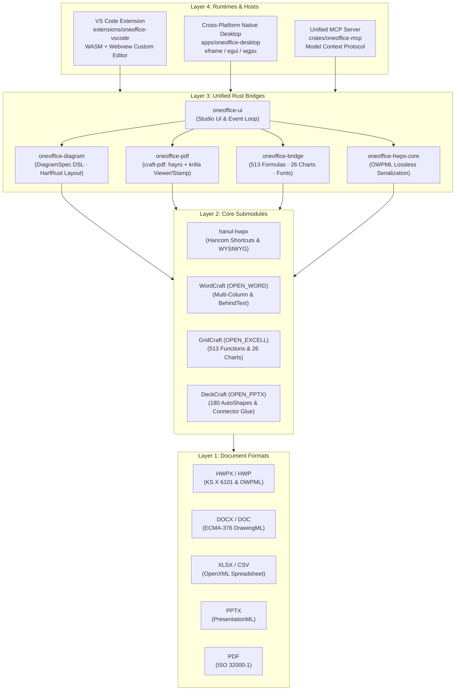

<p align="center">
  
</p>

# ONEOFFICE — All-in-One Open-Source Office Platform v0.1.0-alpha.1

> **Korean Version**: [`README.md`](README.md) · **Master Architecture Plan**: [`docs/MASTER_ARCHITECTURE_PLAN.md`](docs/MASTER_ARCHITECTURE_PLAN.md) · **Official V&V Report**: [`docs/V_AND_V_REPORT.md`](docs/V_AND_V_REPORT.md)

**Korean Hancom HWP/HWPX (`.hwpx`/`.hwp`) · Word (`.docx`) · Excel (`.xlsx`) · PowerPoint (`.pptx`) · PDF (Viewer & E-Signature/Stamp)** unified into a single cross-platform open-source office platform, supporting **proposal infographics, 513 Excel formulas, 26 chart types, lossless PDF e-signing, and AI Co-Authoring (`oneoffice-mcp`)** across macOS, Windows, Linux, and VS Code.

[](LICENSE-MIT)
[](#-fast-installation--quickstart)
[](#method-a--vs-code-all-in-one-extension-vsix-recommended)
[](#method-c--ai-agent-mcp-server-integration-cratesoneoffice-mcp)
[](CONTRIBUTING.md)
[](docs/V_AND_V_REPORT.md)
[](docs/QA_VERIFICATION_MATRIX.md)

---

## ⚡ Fast Installation & Quickstart

> **Get started in 5 minutes.** ONEOFFICE provides a single native binary app, an all-in-one VS Code extension, and an AI Agent MCP server.

### Method A — VS Code All-in-One Extension (`.vsix`) (Recommended)
Open, edit, and sign `.hwpx`, `.docx`, `.xlsx`, `.pptx`, and `.pdf` inside offline WASM webviews with zero native OS dependencies.

```bash
# Install locally built all-in-one extension
code --install-extension extensions/oneoffice-vscode/oneoffice-vscode-0.1.0.vsix
```

### Method B — Cross-Platform Native Desktop App (`apps/oneoffice-desktop`)
Zero Win32 COM, zero Hancom DLL dependencies. Pure Rust (`egui`/`wgpu`) standalone app.

```bash
# macOS (Apple Silicon & Intel Universal)
open /Applications/ONEOFFICE.app

# Linux (Wayland / X11)
chmod +x ONEOFFICE-x86_64.AppImage && ./ONEOFFICE-x86_64.AppImage

# Windows (x64 / ARM64)
ONEOFFICE.exe
```

### Method C — AI Agent MCP Server Integration (`crates/oneoffice-mcp`)
Connect Claude Desktop, Cursor, or Codex to author and visually verify documents using natural language.

```json
{
  "mcpServers": {
    "oneoffice": {
      "command": "cargo",
      "args": ["run", "-p", "oneoffice-mcp", "--release"],
      "env": {
        "ONEOFFICE_FONT_DIR": "/System/Library/Fonts"
      }
    }
  }
}
```

### Method D — Source Code Local Build
```bash
git clone https://github.com/iamywl/ONEOFFICE.git --recursive
cd ONEOFFICE
cargo run -p oneoffice-desktop --release
```

---

## 💡 Why ONEOFFICE? (Problem & Solution)

Creating real-world business proposals, RFPs, and official reports requires a painful combination of Word/HWPX for text, PowerPoint for diagrams, Excel for financial calculations, and PDF viewers for stamping.

### Comparison: Traditional Workflow vs ONEOFFICE In-Place Platform

| Capability | Fragmented Traditional Workflow | ONEOFFICE In-Place Solution |
| :--- | :--- | :--- |
| **Diagram Authoring** | Create in PowerPoint → **screenshot and paste into Word/HWP** | Create directly in canvas via **`[+ Insert Diagram]`** |
| **Data Preservation** | **Dead raster image**: unsearchable, blurry when scaled, uneditable | **Live vectors & text**: lossless zoom, OWPML/DrawingML native |
| **Tables & Charts** | Copy-paste from Excel → **redo entire work if 1 price changes** | **513 Excel formulas built-in**: changing price updates charts instantly |
| **PDF Stamping** | Print, stamp ink, re-scan or buy expensive PDF editors | Built-in PDF viewer: **auto chroma-key removes white background of stamp photos** |
| **AI Integration** | AI cannot view or modify contents inside pasted screenshot images | **Model Context Protocol (MCP)**: AI authors, signs, and self-verifies visually |
| **Operating Systems** | Windows-only COM / Hancom DLLs lock out macOS and Linux | **Zero OS Lock-In**: macOS, Windows, Linux, VS Code 100% parity |

---

## ⚡ Prime Directives

1. **In-Place Co-Authoring**: No regression to static images or read-only viewers. Tables, 26-type vector charts, PPT-grade diagrams, and PDF stamps are **all directly selectable, editable, and undoable** within the document canvas.
2. **Lossless Dual-Persistence**: Dual-save both native XML tags (`<hp:tbl>`, `<w:drawing>`) and high-level semantic sidecars (`DiagramSpec`, `LiveTableSidecar`). Non-destructive PDF signing leaves original vector text and links intact.
3. **Zero OS Lock-In**: Total elimination of Win32 COM, OLE, and proprietary DLLs. Flawless compatibility across macOS, Windows, Linux, and VS Code WASM.
4. **Never Crash & Zero Tofu Guarantee**: Forced `unsafe_code = "forbid"` and `#![deny(clippy::unwrap_used, clippy::panic)]`. Compulsory CJK font binding guarantees zero missing Korean glyph boxes (`ㅁ`).

---

## 🏛️ Developer Perspective: System Architecture & Engineering Rigor

For software engineers, ONEOFFICE is designed with a pure Rust 2024 core serving desktop shells, VS Code WASM custom editors, and MCP AI agents.



### Crates & Modules Directory Links
- [`crates/oneoffice-ui/`](crates/oneoffice-ui/): egui-based frosted glass studio UI, ribbon formatting toolbar, per-paragraph quick HUD, in-place formula bar.
- [`crates/oneoffice-diagram/`](crates/oneoffice-diagram/): Proposal diagram DSL (`DiagramSpec`), HarfRust 3-Pass layout solver, OWPML/DrawingML/SVG compilers.
- [`crates/oneoffice-pdf/`](crates/oneoffice-pdf/): Pure-Rust `craft-pdf` (`hayro` + `krilla`), chroma-key stamp transparency, Bezier signing pad.
- [`crates/oneoffice-bridge/`](crates/oneoffice-bridge/): GridCraft 513 Excel formula bridge, 26-type vector chart renderer, Korean font coverage audit.
- [`crates/oneoffice-hwpx-core/`](crates/oneoffice-hwpx-core/): KS X 6101 OWPML XML parser, `<hp:tbl>` formula sidecar, `<hp:chart>` and `<hp:container>` serialization.
- [`crates/oneoffice-mcp/`](crates/oneoffice-mcp/): Model Context Protocol v2024-11-05 server for AI agents (`diagram.compose`, `table.upsert`, `pdf.sign`, `visual.verify_page`).
- [`apps/oneoffice-desktop/`](apps/oneoffice-desktop/): macOS, Windows, Linux native desktop shell (`eframe`/`wgpu`) with TCP RPC control.
- [`extensions/oneoffice-vscode/`](extensions/oneoffice-vscode/): All-in-one VS Code Custom Editor extension (.vsix) for .hwpx, .docx, .xlsx, .pptx, .pdf.
- [`hanul-hwpx/`](hanul-hwpx/): TypeScript Hancom editor with 6 OWPML bug fixes, standard shortcuts (`F5`, `M`, `S`, `Alt+L/T`).
- [`OPEN_WORD/`](OPEN_WORD/): WordCraft (v0.11.0), multi-column layout, `BehindText` DrawingML stamp layer, tagged PDF export.
- [`OPEN_EXCELL/`](OPEN_EXCELL/): GridCraft (v0.12.1), 513 Excel functions (`gridcraft-calc`), 26 chart types (`gridcraft-chart`).
- [`OPEN_PPTX/`](OPEN_PPTX/): DeckCraft (v0.11.1), 327 slide commands, 180 AutoShapes, Connector Glue.

---

## 👥 User Perspective: Workflow Revolution & Practical Value

- **Effortless Typography & Per-Paragraph HUD**: Pretendard font picker, size stepper, bold/italic/underline/strikethrough, colors (Black, Navy, Red, Green, Purple), highlighter (Yellow, Green, Sky), text alignment, and instant paragraph reordering (`[▲ Up]`, `[▼ Down]`, `[+ Duplicate]`, `[Delete X]`).
- **In-Place Block Insertion Bar**: Click `[+ New Paragraph]`, `[+ Insert Table]`, `[+ Insert Chart]`, `[+ Insert Diagram]` directly between paragraphs.
- **Consulting-Grade Infographics (DiagramSpec)**: 10 templates (comparison cards, large KPI callouts, bullets, implications, roadmaps) with zero overflow auto-resizing.
- **513 Excel Formulas & 26 Live Charts**: Formula HUD (`fx B2 [ 12500000 ]`) and instant recalculation of sums and vector charts when modifying prices or quantities.
- **Pure-Rust PDF Viewer & Chroma-Key Stamp Signing**: Automatic white background removal for photographed stamps and 1-click `(Seal)` anchor positioning.

---

## 👥 10 Specialized Sub-Agents

ONEOFFICE is governed by 10 specialized sub-agents with strict write-scope isolation ([`AGENTS.md`](AGENTS.md)):

| ID | Agent | Charter | Scope | Core Mission |
| :---: | :--- | :--- | :--- | :--- |
| **01** | `oneoffice-planner` | `.agents/agents/01-chief-planner.md` | `docs/**` | Master plan, interface schemas, claim validation |
| **02** | `oneoffice-rust-core` | `.agents/agents/02-rust-core-bridge.md` | `crates/oneoffice-bridge/**` | 513 Excel formulas, 26 charts, font measurement |
| **03** | `oneoffice-diagram-engine` | `.agents/agents/03-diagram-layout-architect.md` | `crates/oneoffice-diagram/**` | DiagramSpec DSL, HarfRust zero-overflow layout |
| **04** | `oneoffice-hwpx-bridge` | `.agents/agents/04-hwpx-compound-engineer.md` | `crates/oneoffice-hwpx-core/**` | OWPML bug elimination, `<hp:tbl>` formula sidecars |
| **05** | `oneoffice-pdf-engineer` | `.agents/agents/05-pdf-viewer-signature-engineer.md` | `crates/oneoffice-pdf/**` | Pure-Rust craft-pdf viewer, chroma-key stamp signing |
| **06** | `oneoffice-studio-ux` | `.agents/agents/06-studio-ux-craftsman.md` | `crates/oneoffice-ui/**` | In-place formula HUD, diagram canvas, frosted glass |
| **07** | `oneoffice-mcp-architect` | `.agents/agents/07-mcp-agent-architect.md` | `crates/oneoffice-mcp/**` | Unified MCP server, AI co-authoring & visual verification |
| **08** | `oneoffice-release-governor` | `.agents/agents/08-crossplatform-packaging-governor.md` | `extensions/**`, `apps/**` | All-in-one VS Code VSIX & macOS/Win/Linux installers |
| **09** | `oneoffice-qa-auditor` | `.agents/agents/09-adversarial-qa-auditor.md` | `tests/**`, `scripts/qa/**` | Zero-Trust 6-tier empirical verification gate |
| **10** | `oneoffice-doc-designer` | `.agents/agents/10-doc-design-showcase-architect.md` | `README.md`, `docs/assets/**` | Documentation showcase design & harness management |

---

## 📸 Empirical Feature & Benefit Showcase

### 1. Hancom HWPX / HWP WYSIWYG Studio & Floating Glass HUD

| HWPX Main Editor | Floating Glass Table HUD (`F5` / Merge / Width) |
| :---: | :---: |
|  |  |

| Light Mode (Document Paper Standard) | Dark Mode (WCAG AAA Modal Isolation) |
| :---: | :---: |
|  |  |

---

### 2. Word Multi-Column Layout & BehindText Stamp Layering

| macOS Native Word Studio | BehindText Transparent Stamp Layering |
| :---: | :---: |
|  |  |

<p align="center">
  
</p>
<p align="center"><em>Live runtime capture: DOCX editor with Pretendard ribbon bar, in-place block insertion, consulting diagram, 26 charts, and electronic stamp</em></p>

---

### 3. Excel 513 Formula Engine & 26 Vector Chart Studio

| Native Spreadsheet & Live Chart | VS Code Editor Chart Palette |
| :---: | :---: |
|  |  |

<p align="center">
  
</p>
<p align="center"><em>Empirical benchmark: 26 chart types rendered with Korean font (`Apple SD Gothic Neo`)</em></p>

---

### 4. Presentation & Precision Shape Studio
PowerPoint (`.pptx`) editing with 327 commands and 180 AutoShape engines.

| Native Glass Presentation Studio | VS Code 1:1 WASM Slide & Shape Editor |
| :---: | :---: |
|  |  |

---

### 5. Pure Rust PDF Viewer & Electronic Signature Engine (`oneoffice-pdf`)

<p align="center">
  
</p>
<p align="center"><em>Live runtime capture: High-DPI PDF viewing + Bezier freehand signing + automatic chroma-key stamp transparency</em></p>

---

### 6. Consulting Proposal Diagram DSL (`oneoffice-diagram`)

<p align="center">
  
</p>
<p align="center"><em>Live runtime capture: 3 comparison cards + large KPI callouts + evidence bullets + implications box with zero text overflow</em></p>

---

## 🛡️ Zero-Trust 6-Tier Verification Gates

```bash
node scripts/qa/run-all-gates.mjs
```

| Tier | Area | Pass Criteria | Status |
| :---: | :--- | :--- | :---: |
| **Tier 1** | Static Safety & WASM | `unsafe_code = "forbid"`, 0 Clippy warnings, WASM compile pass | <span style="color:green">**PASS**</span> |
| **Tier 2** | 5-Format Round-Trip | HWPX/DOCX/XLSX/PPTX/PDF lossless deserialization and byte preservation | <span style="color:green">**PASS**</span> |
| **Tier 3** | Diagram Geometry | `overflow_count == 0`, `collision_count == 0`, connector glue `<= 1.5pt` | <span style="color:green">**PASS**</span> |
| **Tier 4** | Zero Tofu & Desktop E2E | 0 missing CJK glyphs, VS Code Webview 5 editors verified | <span style="color:green">**PASS**</span> |
| **Tier 5** | Dual-Theme WCAG | Pure white paper canvas, modal contrast `≥ 7.0:1`, doc harness pass | <span style="color:green">**PASS**</span> |
| **Tier 6** | MCP AI Closed-Loop | End-to-end prompt → diagram → table → chart → sign → verify workflow | <span style="color:green">**PASS**</span> |

---

## 🗺️ Workspace Directory Map & Component Links

- [`docs/MASTER_ARCHITECTURE_PLAN.md`](docs/MASTER_ARCHITECTURE_PLAN.md) — 6-phase master architecture plan.
- [`docs/V_AND_V_REPORT.md`](docs/V_AND_V_REPORT.md) — IEEE Std 1012 official V&V report.
- [`docs/QA_VERIFICATION_MATRIX.md`](docs/QA_VERIFICATION_MATRIX.md) — 6-tier empirical verification matrix.
- [`docs/OFFICIAL_SPEC_COMPLIANCE_MATRIX.md`](docs/OFFICIAL_SPEC_COMPLIANCE_MATRIX.md) — Official standard compliance matrix.
- [`crates/oneoffice-ui/`](crates/oneoffice-ui/) — Studio UI, ribbon toolbar, in-place editors.
- [`crates/oneoffice-diagram/`](crates/oneoffice-diagram/) — DiagramSpec DSL & layout engine.
- [`crates/oneoffice-pdf/`](crates/oneoffice-pdf/) — Pure-Rust PDF viewer & chroma-key signature engine.
- [`crates/oneoffice-bridge/`](crates/oneoffice-bridge/) — 513 Excel formulas and 26 vector chart bridge.
- [`crates/oneoffice-hwpx-core/`](crates/oneoffice-hwpx-core/) — Lossless OWPML parser & serialization.
- [`crates/oneoffice-mcp/`](crates/oneoffice-mcp/) — Model Context Protocol AI agent server.
- [`apps/oneoffice-desktop/`](apps/oneoffice-desktop/) — Native desktop application for macOS, Windows, Linux.
- [`extensions/oneoffice-vscode/`](extensions/oneoffice-vscode/) — VS Code all-in-one extension (.vsix).
- [`AGENTS.md`](AGENTS.md) — Multi-agent charter and Prime Directives.
- [`ATTRIBUTION.md`](ATTRIBUTION.md) — Open source credits and licenses.

---

## 📄 License, Governance & Attribution

- **License**: Dual-licensed under **`MIT OR Apache-2.0`**.
- **Attribution**: Detailed open-source licenses and origins are listed in [`ATTRIBUTION.md`](ATTRIBUTION.md) and [`NOTICE`](NOTICE).
- **Contributing**: Please review [`CONTRIBUTING.md`](CONTRIBUTING.md) and [`AGENTS.md`](AGENTS.md).
- **Versioning**: Adheres strictly to SemVer 2.0.0 ([`docs/VERSIONING_AND_COMMIT_POLICY.md`](docs/VERSIONING_AND_COMMIT_POLICY.md)).
