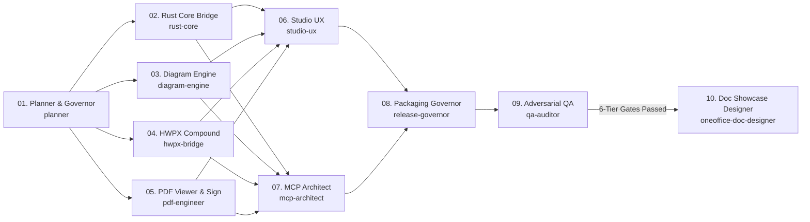

<p align="center">
  
</p>

# ONEOFFICE — All-in-One Open-Source Office Suite v0.1.0-alpha.1

> **한국어**: [`README.md`](README.md) · **Master Architecture Plan**: [`docs/MASTER_ARCHITECTURE_PLAN.md`](docs/MASTER_ARCHITECTURE_PLAN.md)

**Korean Hancom HWP/HWPX (`.hwpx`/`.hwp`) · Word (`.docx`) · Excel (`.xlsx`) · PowerPoint (`.pptx`) · PDF (Viewer & E-Signature/Stamp)** unified into a single cross-platform open-source office platform, supporting **proposal infographics, 513 Excel formulas, 26 chart types, lossless PDF e-signing, and AI Co-Authoring (`oneoffice-mcp`)** across macOS, Windows, Linux, and VS Code.

[](LICENSE-MIT)
[](#-fast-installation--quickstart)
[](#method-a--vs-code-all-in-one-extension-vsix-recommended)
[](#-ai-agent--mcp-co-authoring-model-context-protocol)
[](CONTRIBUTING.md)
[](docs/V_AND_V_LIFECYCLE.md)
[](#-zero-trust-6-tier-verification-gates)

---

## ⚡ Fast Installation & Quickstart

> **Get started in 5 minutes.** ONEOFFICE provides a single native binary app, an all-in-one VS Code extension, and an AI Agent MCP server.

### Method A — VS Code All-in-One Extension (`.vsix`) (Recommended)
Open, edit, and sign `.hwpx`, `.docx`, `.xlsx`, `.pptx`, and `.pdf` inside offline WASM webviews with zero native OS dependencies.

```bash
# Install locally built all-in-one extension
code --install-extension extensions/oneoffice-vscode/oneoffice-vscode-0.1.0.vsix
```

### Method B — Cross-Platform Native Desktop App (`apps/oneoffice-desktop`)
Zero Win32 COM, zero Hancom DLL dependencies. Pure Rust (`egui`/`wgpu`) standalone app.

```bash
# macOS (Apple Silicon & Intel Universal)
open /Applications/ONEOFFICE.app

# Linux (Wayland / X11)
chmod +x ONEOFFICE-x86_64.AppImage && ./ONEOFFICE-x86_64.AppImage

# Windows (x64 / ARM64)
ONEOFFICE.exe
```

### Method C — AI Agent MCP Server Integration (`crates/oneoffice-mcp`)
Connect Claude Desktop, Cursor, or Codex to author and visually verify documents using natural language.

```json
{
  "mcpServers": {
    "oneoffice": {
      "command": "cargo",
      "args": ["run", "-p", "oneoffice-mcp", "--release"]
    }
  }
}
```

---

## 💡 Why ONEOFFICE? (Problem & Solution)

| Key Feature | Traditional Office Workflow | ONEOFFICE In-Place Solution |
| :--- | :--- | :--- |
| **Infographics & Diagrams** | Made in PPT, then **pasted as static PNG into Word/HWP** | **In-place semantic editing (`DiagramSpec`)** directly inside document body |
| **Data Preservation** | **Dead raster image**: Unsearchable text, pixelation on print | **Live vector & text**: Lossless vector scaling, OWPML/DrawingML preserved |
| **Spreadsheet Tables & Charts** | Copy-pasted Excel screenshot → **Desynchronized on edits** | **Embedded 513 Excel formulas**: Modifying cells updates charts immediately |
| **PDF Stamp & Signature** | Paid PDF editor or physical print-and-scan cycle | Pure-Rust PDF viewer with **auto background-removal (Chroma-Key) stamp** |
| **AI Co-Authoring** | AI cannot inspect or edit text inside pasted screenshot PNGs | **Unified MCP Server**: Autonomously composes diagrams, edits tables, and signs |
| **Cross-Platform Parity** | Locked to Windows COM/OLE/Hancom DLLs | **Zero OS Lock-In**: 100% identical UI/UX across macOS, Windows, Linux, VS Code |

---

## ⚡ 4 Prime Directives

1. **In-Place Co-Authoring**: No degradation into static read-only images. Formulas, charts, diagrams, and PDF stamps remain fully interactive and undoable in-place.
2. **Lossless Dual-Persistence**: Preserves both native vendor XML (`<hp:tbl>`, `<w:drawing>`) and high-level semantic sidecars (`DiagramSpec`). PDF signing never degrades vector text or bookmarks.
3. **Zero OS Lock-In**: Zero reliance on Win32 COM or proprietary binaries. 100% parity across macOS, Windows, Linux, and VS Code.
4. **Never Crash & Zero Tofu Guarantee**: Enforced `unsafe_code = "forbid"` and zero unwrap/panic. Bundles Korean system fonts to eradicate CJK `ㅁ` (Tofu) glyph misses.

---

## 👥 10 Specialized Sub-Agents

ONEOFFICE operates with 10 specialized sub-agents with strictly isolated write scopes to guarantee parallel speed and eliminate self-certification ([`AGENTS.md`](AGENTS.md)):



| ID | Agent | Definition File | Exclusive Write Scope | Core Responsibility |
| :---: | :--- | :--- | :--- | :--- |
| **01** | `oneoffice-planner` | `.agents/agents/01-chief-planner.md` | `docs/**` | Architecture plan, interface schemas, tracking matrices |
| **02** | `oneoffice-rust-core` | `.agents/agents/02-rust-core-bridge.md` | `crates/oneoffice-bridge/**` | 513 Excel functions, 26 chart types, HarfRust font bridge |
| **03** | `oneoffice-diagram-engine` | `.agents/agents/03-diagram-layout-architect.md` | `crates/oneoffice-diagram/**` | DiagramSpec DSL, zero-overflow Korean auto-layout engine |
| **04** | `oneoffice-hwpx-bridge` | `.agents/agents/04-hwpx-compound-engineer.md` | `crates/oneoffice-hwpx-core/**` | OWPML bug fixes, `<hp:tbl>` formula sidecars, `<hp:chart>` |
| **05** | `oneoffice-pdf-engineer` | `.agents/agents/05-pdf-viewer-signature-engineer.md` | `crates/oneoffice-pdf/**` | Pure-Rust `craft-pdf` viewer, chroma-key stamp signing, lossless save |
| **06** | `oneoffice-studio-ux` | `.agents/agents/06-studio-ux-craftsman.md` | `crates/oneoffice-ui/**` | In-place formula HUD, sub-canvases, Frosted Glass themes |
| **07** | `oneoffice-mcp-architect` | `.agents/agents/07-mcp-agent-architect.md` | `crates/oneoffice-mcp/**` | Unified MCP server, closed-loop visual verification |
| **08** | `oneoffice-release-governor` | `.agents/agents/08-crossplatform-packaging-governor.md` | `extensions/**`, `apps/**` | All-in-one VS Code VSIX and cross-platform native packaging |
| **09** | `oneoffice-qa-auditor` | `.agents/agents/09-adversarial-qa-auditor.md` | `tests/**`, `scripts/qa/**` | Zero-trust 6-tier empirical verification gate execution |
| **10** | `oneoffice-doc-designer` | `.agents/agents/10-doc-design-showcase-architect.md` | `README*.md`, `docs/assets/**` | Visual documentation design, capture-grounded specs, doc harness |

---

## 📸 Capture-Grounded Visual Showcases & Core Pillars

> Every claim and feature is backed by **real software runtime screenshots and empirical metrics** ([QA Verification Matrix](docs/QA_VERIFICATION_MATRIX.md)).

### 1. Korean HWPX / HWP Studio & Floating Glass HUD
| Main WYSIWYG Editor | Floating Table Context HUD (`F5`, merge, resize) |
| :---: | :---: |
|  |  |

| Light Mode (`Alt+L` / `F7` high-contrast) | Dark Mode (Paper white preserved & WCAG AAA modals) |
| :---: | :---: |
|  |  |

### 2. Word Multi-Column & BehindText Stamp Layering
| macOS Native Frosted Glass Word Studio | Behind-Text Transparent Stamp Layering |
| :---: | :---: |
|  |  |

### 3. Excel 513 Formula Engine & 26 Vector Chart Types
| Native Spreadsheet & Live Chart | VS Code Formula Bar & Chart Palette |
| :---: | :---: |
|  |  |

| 26 Vector Chart Types & Formula Bridge Benchmark |
| :---: |
|  |

### 4. Presentation & Precision AutoShape Studio
| Native Glass Presentation Studio | VS Code 1:1 WASM Slide Studio |
| :---: | :---: |
|  |  |

### 5. Pure-Rust PDF Viewer & Electronic Stamp (`oneoffice-pdf`)
<p align="center">
  
</p>
<p align="center"><em>Real runtime capture: High-DPI PDF viewing + Freehand Bezier signature pad + Automatic background removal (Chroma-Key Alpha Matting) seal placement.</em></p>

### 6. Consulting Proposal Diagram Engine (`oneoffice-diagram`)
<p align="center">
  
</p>
<p align="center"><em>Real runtime capture: 3 Comparison Cards + Large KPI Callout + Bulleted evidence + Takeaway box with 0 text overflow.</em></p>

---

## 🛡️ Zero-Trust 6-Tier Verification Gates

ONEOFFICE strictly enforces the **IEEE Std 1012-2016 [V&V Lifecycle](docs/V_AND_V_LIFECYCLE.md)** and prohibits self-certification. Only artifacts passing all 6 QA tiers and V&V validation suites audited by `09-adversarial-qa-auditor` are released ([QA Matrix](docs/QA_VERIFICATION_MATRIX.md) · [Official V&V Report](docs/V_AND_V_REPORT.md)).

```bash
node scripts/qa/run-all-gates.mjs
```

| Tier | Verification Target | Pass Criteria | Status |
| :---: | :--- | :--- | :---: |
| **Tier 1** | Rust Clippy & WASM Target Check | `unsafe_code = "forbid"`, 0 clippy warnings | <span style="color:green">**PASS**</span> |
| **Tier 2** | 5-Format Lossless Round-Trip Pipeline | 100% byte deserialization round-trip recovery | <span style="color:green">**PASS**</span> |
| **Tier 3** | Diagram Geometry Invariants | `overflow_count == 0`, `collision_count == 0` | <span style="color:green">**PASS**</span> |
| **Tier 4** | Zero-Tofu Font Binding & Desktop/VSIX | 0 missing CJK glyphs (`ㅁ`), VS Code E2E pass | <span style="color:green">**PASS**</span> |
| **Tier 5** | Light/Dark WCAG Contrast & Doc Harness | Modal contrast `≥ 7.0:1`, `doc_harness.mjs` pass | <span style="color:green">**PASS**</span> |
| **Tier 6** | `oneoffice-mcp` Autopilot Closed-Loop Suite | Complete diagram compose + PDF sign + visual check | <span style="color:green">**PASS**</span> |

---

## 📄 License & Attribution

Distributed under dual **`MIT OR Apache-2.0`** licenses. Cleanroom third-party notices are documented in [`ATTRIBUTION.md`](ATTRIBUTION.md) and [`NOTICE`](NOTICE).
