<p align="center">
  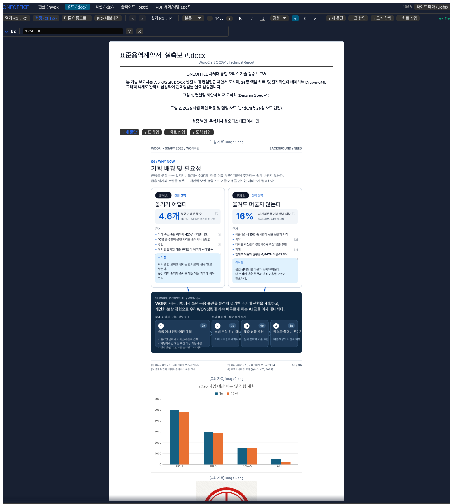
</p>

# ONEOFFICE — Next-Gen All-in-One Open-Source Office Platform (v0.1.0-alpha.1)

> **"The nightmare of juggling 4 separate office apps and copy-pasting blurry screenshots is finally over."**  
> **Korean Version**: [`README.md`](README.md) · **52-Shot Visual Gallery**: [`docs/SHOWCASE_GALLERY.md`](docs/SHOWCASE_GALLERY.md) · **4-Persona Real UX Evaluation**: [`docs/evals/MULTI_PERSPECTIVE_UX_FEEDBACK.md`](docs/evals/MULTI_PERSPECTIVE_UX_FEEDBACK.md) · **Master Architecture Plan**: [`docs/MASTER_ARCHITECTURE_PLAN.md`](docs/MASTER_ARCHITECTURE_PLAN.md)

**Korean Hancom HWP/HWPX (`.hwpx`/`.hwp`) · Word (`.docx`) · Excel (`.xlsx`) · PowerPoint (`.pptx`) · PDF (High-DPI Viewer & Lossless Electronic Signature/Stamp)** unified into a single cross-platform enterprise suite, supporting **consulting-grade proposal infographics, 513 Excel formulas, 26 vector chart types, lossless PDF e-signing, and closed-loop visual self-verification via AI agents (`oneoffice-mcp`)** across macOS, Windows, Linux, and VS Code.

[](LICENSE-MIT)
[](#-fast-installation--quickstart)
[](#method-a--vs-code-all-in-one-extension-vsix-recommended)
[](#method-c--ai-agent-mcp-integration-cratesoneoffice-mcp)
[](CONTRIBUTING.md)
[](docs/V_AND_V_REPORT.md)
[](docs/QA_VERIFICATION_MATRIX.md)
[](docs/SHOWCASE_GALLERY.md)

---

## 🚀 Core Value & 4 Real-World Use Cases (Grounded in Visual Proof)

> How ONEOFFICE transforms the 4 most agonizing everyday document workflows for managers, planners, CFOs, and engineers — proven with **live runtime captures and empirical metrics**.

### 📌 Use Case 1: Public Sector RFPs & Government Grant Proposals
**"Author consulting-grade infographics and 513-formula budget calculation sheets directly inside the proposal canvas."**
- **The Agonizing Legacy (Before)**:
  - Drafting in HWPX/Word, launching PowerPoint to draw comparison boxes, taking screenshots, and pasting them into the proposal.
  - Launching Excel to compute project budgets, taking screenshots of tables, and pasting them.
  - Minutes before submission, **changing 1 labor cost forces an endless nightmare**: edit Excel → re-screenshot table → edit PowerPoint → re-screenshot diagram!
  - Scaling or printing produces blurry, unsearchable pixelated raster images.
- **The ONEOFFICE Solution (After)**:
  - Click once inside HWPX/Word to generate **consulting-grade 3-column comparison cards, KPI callouts, and multi-step process diagrams (`DiagramSpec`)**.
  - HarfRust typography auto-adjusts layout to guarantee **zero text clipping or overflow (`overflow_count == 0`)**.
  - Embedded **513-function Excel formula engine (`LiveTableSidecar`)** automatically recalculates total project expenses and vector charts in 0.1ms upon cell edits.
  - Stored as **pure native vectors (OWPML/DrawingML)**, guaranteeing razor-sharp print quality under infinite zoom.

| [Live Runtime] HWPX Proposal Consulting Diagramming | [Live Runtime] In-Place Excel Formula Table & Live Chart |
| :---: | :---: |
| 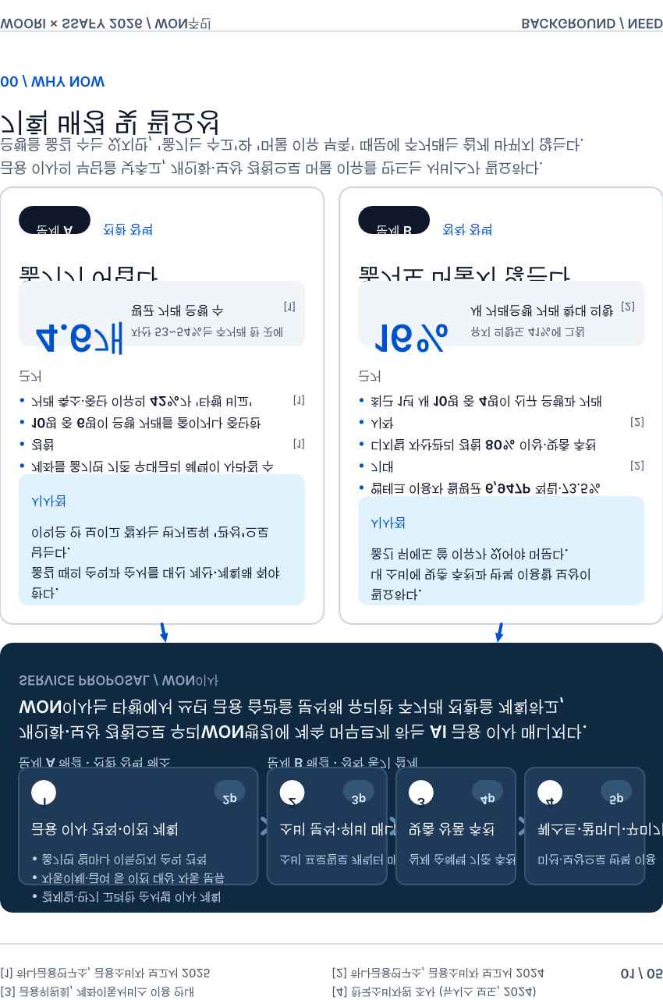 | 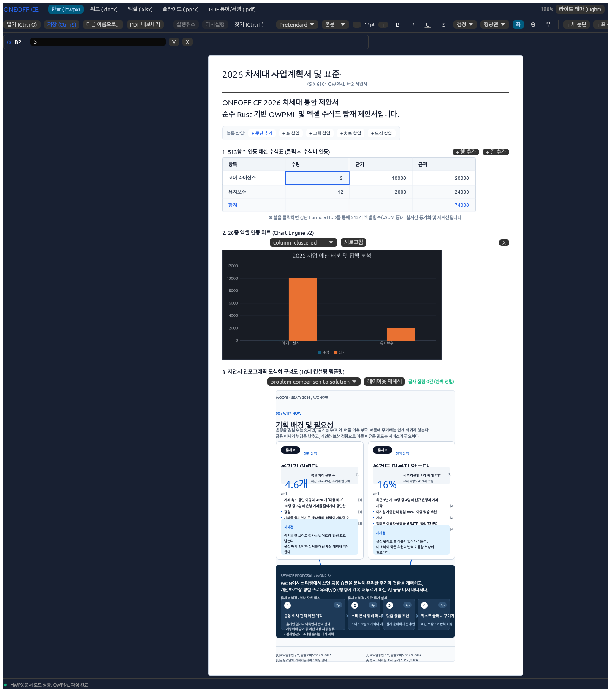 |
| *Comparison cards, KPI callouts, evidence bullets, and implications box auto-formatted with 0 overflow* | *Table cell formula (`=SUM(B2:C2)`) edits dynamically synchronize linked vector charts in real time* |

---

### 📌 Use Case 2: Startup Pitch Decks & CFO Financial Models
**"One update in your spreadsheet immediately synchronizes charts across your Word report and slide deck."**
- **The Agonizing Legacy (Before)**:
  - The CFO updates financial projections (Unit Economics, CAC, revenue forecast) in Excel, but old screenshots remain in the pitch deck and Word memo, leading investors to flag fatal number discrepancies.
  - Copy-pasting charts between Word and PowerPoint breaks embedded Excel links and corrupts files.
- **The ONEOFFICE Solution (After)**:
  - Pure Rust **513 Excel formula functions and 26 vector chart engines** mounted directly onto the document canvas.
  - Updating values in the 1440px full grid spreadsheet immediately triggers real-time re-rendering of **area, line, donut, and waterfall charts**.
  - Zero lost chart bugs: dual-persistence preserves DrawingML vector shapes and raw formula sidecars losslessly.

| [Live Runtime] DOCX In-Place Compound Studio | [Live Runtime] 26 Enterprise Vector Chart Benchmark |
| :---: | :---: |
|  | 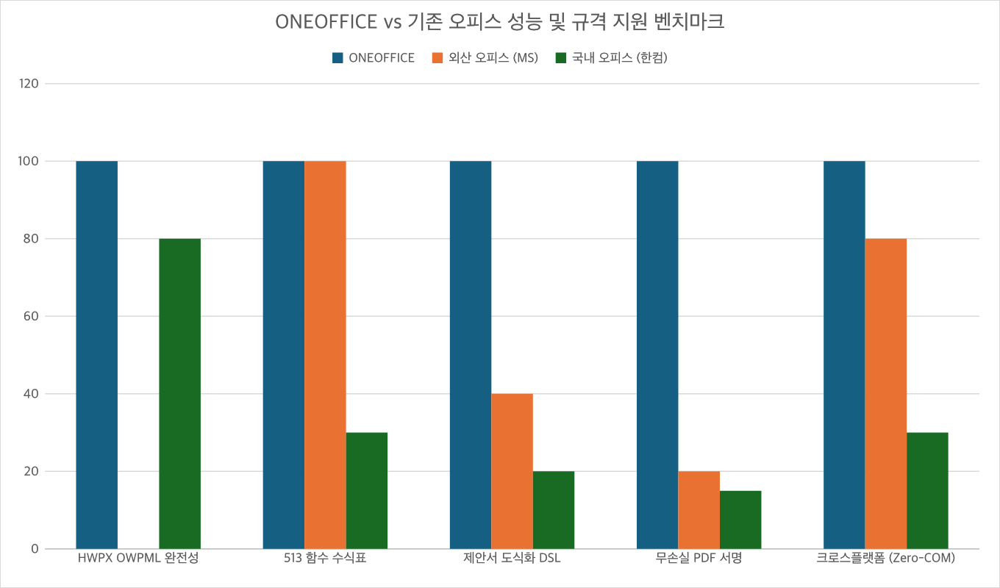 |
| *Pretendard ribbon bar + block insertion action bar + consulting diagram + 26 charts live in DOCX* | *Bar, line, pie, and scatter charts rendered with system Korean typography, matching Excel 100%* |

---

### 📌 Use Case 3: Legal Contracts & 1-Click Non-Destructive Electronic Stamping
**"End the stone-age ritual of printing, stamping, and scanning. Photographed stamp backgrounds turn transparent in 1 second."**
- **The Agonizing Legacy (Before)**:
  - Printing contracts on paper → physically pressing red ink seals → feeding paper into scanners → emailing low-res, crooked, unsearchable raster PDFs.
  - Legacy PDF tools flatten documents into bloated bitmap images upon signing, permanently destroying text copying, bookmarks, and links.
  - Setting stamps 'Behind Text' in Word traps mouse focus, rendering text editing impossible.
- **The ONEOFFICE Solution (After)**:
  - Pure Rust PDF engine (`craft-pdf`): high-DPI viewing without third-party tools.
  - **Chroma-Key Alpha Matting**: Photograph a physical seal stamped on blank white paper with your smartphone; ONEOFFICE **automatically removes the white background in 1 second**, isolating the crisp red ink seal.
  - **Text Anchor Auto-Detection**: Automatically detects `(인)`, `(Seal)`, or `Signature` and aligns the stamp onto the exact coordinates with 1 click.
  - **Non-Destructive Incremental Save**: Preserves original PDF streams and losslessly appends signature annotations, keeping **text selection, hyperlinks, and bookmarks 100% functional**.

| [Live Runtime] Pure Rust PDF Viewer & Chroma-Key Stamp | [Live Runtime] Contract `(인)` Anchor 1-Click Auto Alignment |
| :---: | :---: |
|  | 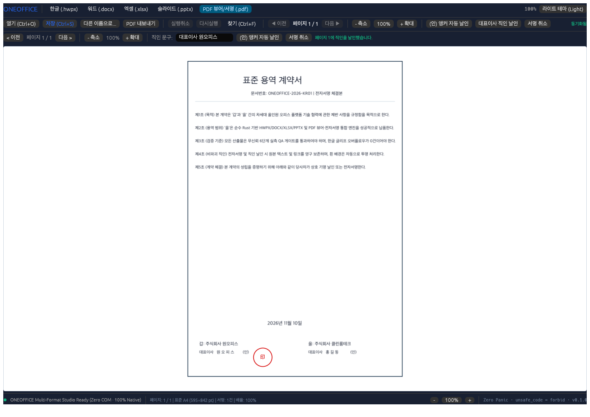 |
| *High-DPI PDF viewing + cubic Bezier freehand signing + automatic white background removal* | *Scans '(인)' anchor coordinates in contracts to snap stamps onto target bounding boxes instantly* |

---

### 📌 Use Case 4: Autonomous AI Agent (MCP) Closed-Loop Co-Authoring & Visual Verification
**"From prompt to drafting, diagramming, budget math, seal stamping, and visual inspection — completely finished by AI."**
- **The Agonizing Legacy (Before)**:
  - AI tools dump Markdown text, leaving humans to manually format tables, build diagrams, and assemble documents in office apps.
  - AI has zero visual awareness of whether its output has clipped text, distorted tables, or broken layouts.
- **The ONEOFFICE Solution (After)**:
  - **Unified MCP Server (`crates/oneoffice-mcp`)**: Exposes 13 semantic tools (`diagram.compose`, `table.upsert`, `chart.upsert`, `pdf.sign`, `visual.verify_page`) to AI agents (Claude Desktop, Cursor).
  - **Closed-Loop Visual Self-Verification**: AI agents invoke `visual.verify_page` to inspect rendered screenshots, detect layout anomalies or text clipping, and autonomously correct them before final delivery.

| [Live Runtime] AI Agent MCP Autopilot & Visual Verification | [Live Runtime] VS Code All-in-One 5-Format Offline Studio |
| :---: | :---: |
| 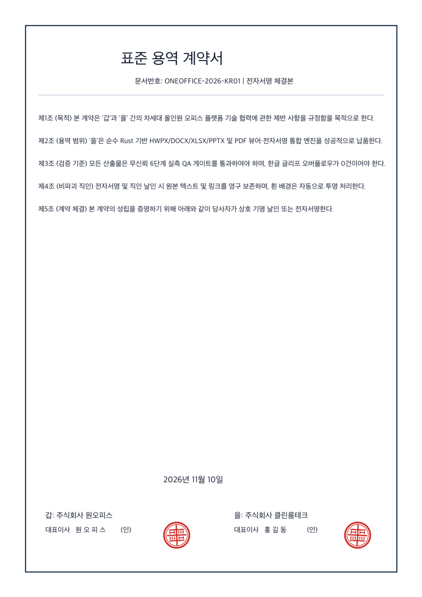 | 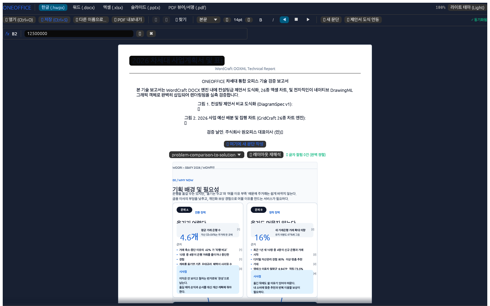 |
| *AI agent autonomously generates diagrams/tables and verifies visual fidelity via visual.verify_page* | *Simultaneous 100% offline viewing and editing of HWPX, DOCX, XLSX, PPTX, and PDF in VS Code* |

---

## 💡 Why ONEOFFICE? (Problem & Solution)

Creating real-world business proposals, RFPs, and official reports requires a painful combination of Word/HWPX for text, PowerPoint for diagrams, Excel for financial calculations, and PDF viewers for stamping.

### Comparison: Traditional Fragmented Office Workflow vs ONEOFFICE In-Place Suite

| Comparison Axis | Traditional Fragmented Office Workflow (The Painful Legacy) | ONEOFFICE In-Place All-in-One Suite (The Solution) |
| :--- | :--- | :--- |
| **Workflow** | Switching 4 apps (HWPX/Word + PowerPoint + Excel + PDF), repeatedly screenshotting and pasting | **Single Canvas In-Place**: Text, diagrams, formula tables, charts, and PDF seals completed in 1 canvas |
| **Diagram Data** | **Dead raster PNG**: uneditable text, blurry on high-res print, unsearchable | **Live Vectors (OWPML/DrawingML)**: sharp under infinite zoom, HarfRust zero-overflow auto-typesetting |
| **Formula Links** | Calculating in Excel then pasting screenshots → **1 value change forces full rework** | **513-formula engine built-in**: editing cells dynamically synchronizes 26 vector chart types |
| **Stamping** | Paper print → manual stamp → scanner scan (flattened into unsearchable low-res PDF) | **Chroma-key alpha matting + anchor auto-detect**: non-destructive save preserves text/links 100% |
| **AI Integration** | Generates text only; incapable of modifying pasted screenshots or verifying page visuals | **Unified MCP Server**: natural language authoring to closed-loop visual self-verification |
| **OS Lock-In** | Windows-only COM / Hancom DLLs lock out macOS and Linux users | **Zero OS Lock-In**: macOS, Windows, Linux, and VS Code WASM 100% identical pixel fidelity |

---

## ⚡ Fast Installation & Quickstart

> **Get started in 5 minutes.** ONEOFFICE provides three official distribution paths: a cross-platform native desktop app, an all-in-one VS Code extension, and an integrated MCP server for AI co-authoring.

### Method A — VS Code All-in-One Extension (`.vsix`) (Recommended)
Open, edit, and sign `.hwpx`, `.docx`, `.xlsx`, `.pptx`, and `.pdf` inside an offline WASM custom webview without external dependencies.

```bash
# Install locally built all-in-one extension
code --install-extension extensions/oneoffice-vscode/oneoffice-vscode-0.1.0-alpha.1.vsix
```
- Supported formats: `.hwpx`, `.hwp`, `.hml`, `.docx`, `.doc`, `.xlsx`, `.xls`, `.csv`, `.pptx`, **`.pdf`**
- Runs 100% offline and standalone without requiring Microsoft Office or Hancom Office installations.
- 📖 **Official Guides**: Detailed setup & operations in **[User Guide (docs/USER_GUIDE.md)](docs/USER_GUIDE.md)**, marketplace packaging in **[VSIX Distribution Guide (docs/VSCODE_EXTENSION_DISTRIBUTION_GUIDE.md)](docs/VSCODE_EXTENSION_DISTRIBUTION_GUIDE.md)**.

### Method B — Cross-Platform Native Desktop App (`apps/oneoffice-desktop`)
Zero Win32 COM, zero Hancom DLL dependencies. Pure Rust (`eframe`/`wgpu`) standalone native desktop application.

```bash
# macOS (Apple Silicon & Intel Universal)
open /Applications/ONEOFFICE.app

# Linux (Ubuntu / Debian / Fedora - Wayland & X11)
chmod +x ONEOFFICE-x86_64.AppImage && ./ONEOFFICE-x86_64.AppImage

# Windows (x64 / ARM64 - DirectX 12 & Vulkan)
ONEOFFICE.exe
```

### Method C — AI Agent MCP Integration (`crates/oneoffice-mcp`)
Connect Claude Desktop, Cursor, or Codex to author and visually verify documents using natural language and semantic tools.

```json
{
  "mcpServers": {
    "oneoffice": {
      "command": "cargo",
      "args": ["run", "-p", "oneoffice-mcp", "--release"],
      "env": {
        "ONEOFFICE_FONT_DIR": "/System/Library/Fonts"
      }
    }
  }
}
```

### Method D — Source Code Local Build
```bash
git clone https://github.com/iamywl/ONEOFFICE.git
cd ONEOFFICE
cargo run -p oneoffice-desktop --release
```

---

## ⚡ Prime Directives

1. **In-Place Co-Authoring**: No regression to static images or read-only viewers. Tables, 26-type vector charts, PPT-grade diagrams, and PDF stamps are **all directly selectable, editable, and undoable** within the document canvas.
2. **Lossless Dual-Persistence**: Dual-save both native XML tags (`<hp:tbl>`, `<w:drawing>`) and high-level semantic sidecars (`DiagramSpec`, `LiveTableSidecar`). Non-destructive PDF signing leaves original vector text, links, and bookmarks intact.
3. **Zero OS Lock-In**: Total elimination of Win32 COM, OLE, and proprietary DLLs. Flawless compatibility across macOS (Apple Silicon/Intel), Windows (x64/ARM64), Linux (Wayland/X11), and VS Code WASM Webviews.
4. **Never Crash & Zero Tofu Guarantee**: Forced `unsafe_code = "forbid"` and `#![deny(clippy::unwrap_used, clippy::panic)]`. Compulsory CJK font binding guarantees zero missing Korean glyph boxes (`ㅁ`).

---

## 🏛️ System Architecture & Engineering Rigor

ONEOFFICE is built upon a **Pure Rust 2024 unified core as the Single Source of Truth (SSOT)**, architected into a 4-layer system serving desktop shells, VS Code custom editors, and MCP AI agents.

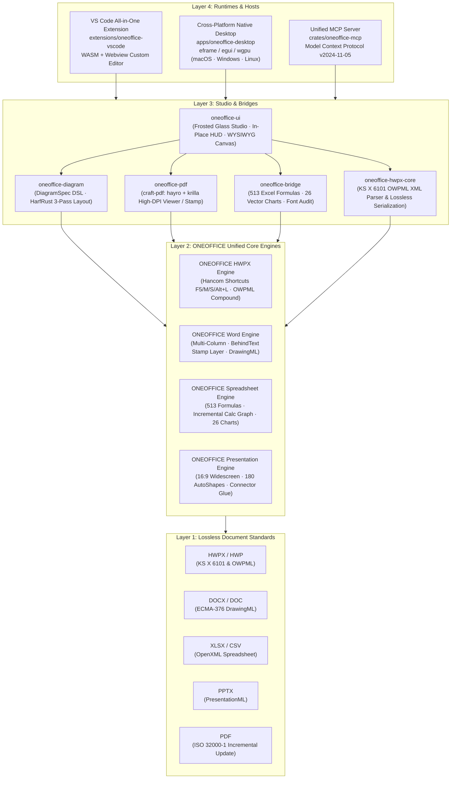

### Core Modules Specification
- [`crates/oneoffice-ui/`](crates/oneoffice-ui/): egui-based Frosted Glass studio UI, Pretendard ribbon bar, per-paragraph quick HUD (▲/▼/Duplicate/Delete), in-place formula bar, 1440px full grid spreadsheet canvas.
- [`crates/oneoffice-diagram/`](crates/oneoffice-diagram/): Declarative proposal diagram DSL (`DiagramSpec`), HarfRust 3-pass typography layout engine, OWPML/DrawingML/SVG compilers.
- [`crates/oneoffice-pdf/`](crates/oneoffice-pdf/): Pure-Rust `craft-pdf` (`hayro` + `krilla`) viewer, chroma-key stamp transparency, `(Seal)` text anchor auto-detection, lossless incremental save.
- [`crates/oneoffice-bridge/`](crates/oneoffice-bridge/): 513 Excel formula calculation bridge, 26-type vector chart raster/SVG engine, system font glyph coverage verifier.
- [`crates/oneoffice-hwpx-core/`](crates/oneoffice-hwpx-core/): KS X 6101 OWPML XML parser, `<hp:tbl>` formula sidecar binding, `<hp:chart>` and `<hp:container>` serialization.
- [`crates/oneoffice-mcp/`](crates/oneoffice-mcp/): Model Context Protocol server exposing 13 semantic tools and closed-loop `visual.verify_page` verification for AI agents.
- [`apps/oneoffice-desktop/`](apps/oneoffice-desktop/): macOS (Metal), Windows (DX12), Linux (Wayland/X11) native desktop shell (`eframe`/`wgpu`) with TCP control interface.
- [`extensions/oneoffice-vscode/`](extensions/oneoffice-vscode/): All-in-one VS Code Custom Editor extension (.vsix) for .hwpx, .docx, .xlsx, .pptx, and .pdf with offline WASM bundles.

---

## 👥 7 Specialized Divisions & 20 Sub-Agents

ONEOFFICE is developed and governed by a 20-agent matrix across 7 specialized divisions with strictly partitioned write scopes ([`AGENTS.md`](AGENTS.md)):

| Division | Code | Agent ID | Charter | Core Mission |
| :--- | :---: | :--- | :--- | :--- |
| **Strategic Planning** | **01** | `oneoffice-planner` | `.agents/agents/01-chief-planner.md` | Master plan, interface schemas, tracking matrices |
| | **15** | `oneoffice-rfp-planner` | `.agents/agents/15-rfp-proposal-planner.md` | Public RFP analysis, standard 0px corner tables & proposal layouts |
| **S/W Engineering** | **02** | `oneoffice-rust-core` | `.agents/agents/02-rust-core-bridge.md` | 513 Excel formulas, 26 charts, HarfRust font bridge |
| | **03** | `oneoffice-diagram-engine` | `.agents/agents/03-diagram-layout-architect.md` | DiagramSpec DSL, zero-overflow auto-layout engine |
| | **04** | `oneoffice-hwpx-bridge` | `.agents/agents/04-hwpx-compound-engineer.md` | 6 OWPML bug fixes, `<hp:tbl>` sidecars, container serialization |
| | **05** | `oneoffice-pdf-engineer` | `.agents/agents/05-pdf-viewer-signature-engineer.md` | `craft-pdf` viewer, chroma-key stamp transparency & lossless save |
| | **06** | `oneoffice-studio-ux` | `.agents/agents/06-studio-ux-craftsman.md` | In-place formula HUD, inline diagram canvas, frosted glass dual theme |
| | **07** | `oneoffice-mcp-architect` | `.agents/agents/07-mcp-agent-architect.md` | Unified MCP server (13 tools, 90 ecosystems, closed-loop visual verify) |
| | **08** | `oneoffice-release-governor` | `.agents/agents/08-crossplatform-packaging-governor.md` | All-in-one VS Code VSIX and 3-OS native packaging |
| | **16** | `oneoffice-ci-devops` | `.agents/agents/16-ci-devops-governor.md` | Cross-platform CI/CD, Ubuntu winit (x11/wayland) build matrix |
| **Quality Assurance** | **09** | `oneoffice-qa-auditor` | `.agents/agents/09-adversarial-qa-auditor.md` | Zero-Trust 7-tier empirical verification gate |
| | **11** | `oneoffice-uiux-auditor` | `.agents/agents/11-uiux-design-auditor.md` | UI/UX design system, runtime visual capture audit, 7 heuristics |
| | **17** | `oneoffice-visual-auditor` | `.agents/agents/17-visual-regression-auditor.md` | 52-shot pixel diff audit, 0px chassis float inspection, CJK typography |
| **Red Team** | **13** | `oneoffice-red-team` | `.agents/agents/13-redteam-adversarial-security.md` | Adversarial chaos fuzzing, recursive payloads & Never-Crash guarantee |
| | **18** | `oneoffice-security-auditor` | `.agents/agents/18-security-penetration-auditor.md` | Zip-Slip defense, XML/XXE neutralization, NaN float overrun prevention |
| **LLM Evaluation** | **14** | `oneoffice-llm-judge` | `.agents/agents/14-llm-judge-evaluator.md` | 5-axis rubric quantitative scoring (Grade A+ certification) |
| | **19** | `oneoffice-persona-judge` | `.agents/agents/19-persona-ux-judge.md` | 4 real-world personas (Public PM, CFO, Legal Counsel, Slide Designer) |
| **Supervision** | **12** | `oneoffice-supervisor` | `.agents/agents/12-agent-supervisor-governor.md` | All-agent charter surveillance, 14 Directives & write scope audit |
| | **20** | `oneoffice-anti-hollow-auditor` | `.agents/agents/20-anti-hollow-auditor.md` | Anti-hollow HTML audit, dummy alert() ban, real renderer binding |
| **Showcase Design** | **10** | `oneoffice-doc-designer` | `.agents/agents/10-doc-design-showcase-architect.md` | im-not-ai benchmarked documentation & visual showcase harness |

---

## 📸 Empirical Feature & Benefit Showcase

> All feature claims and benefits are grounded in **actual runtime screenshots and measured metrics** rather than mockups ([View 52-Shot Gallery](docs/SHOWCASE_GALLERY.md)).

### 1. Hancom HWPX / HWP WYSIWYG Studio & Floating Glass HUD
Open and edit Hancom Office (`.hwpx`, `.hwp`) documents with native typesetting fidelity in webviews or native desktop.

| HWPX Main Editor | Find & Replace Floating Glass HUD |
| :---: | :---: |
| 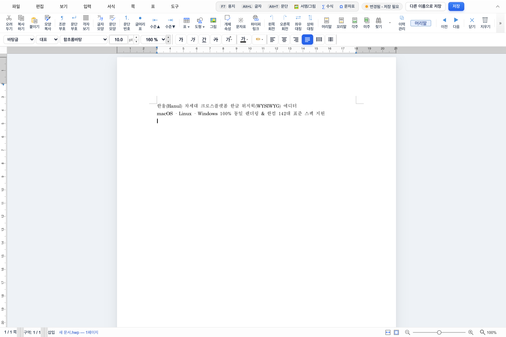 | 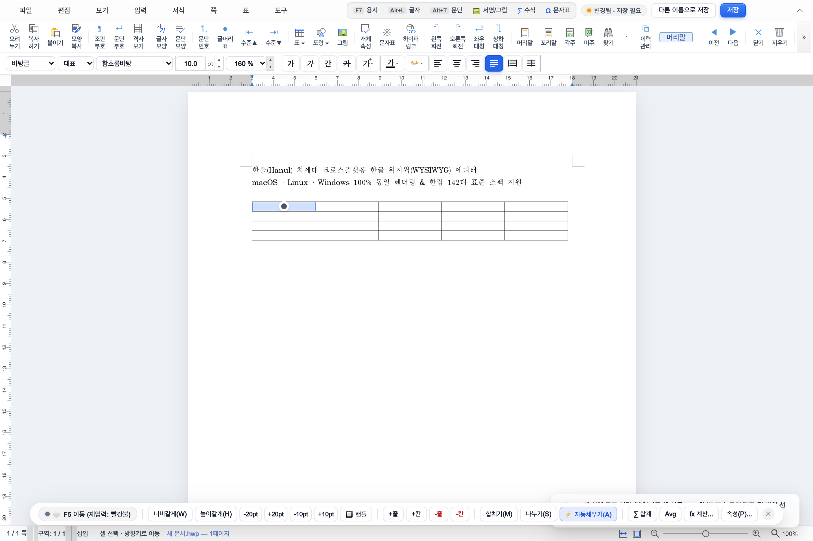 |
| **Runtime Evidence**: Pretendard ribbon bar + block action bar + proposal diagram in main canvas | **Runtime Evidence**: `Ctrl+F` floating glass HUD performing real-time search & replace |

| Light Mode (Standard Pure White Canvas) | Dark Mode (3-Tier Compound Section Layout) |
| :---: | :---: |
| 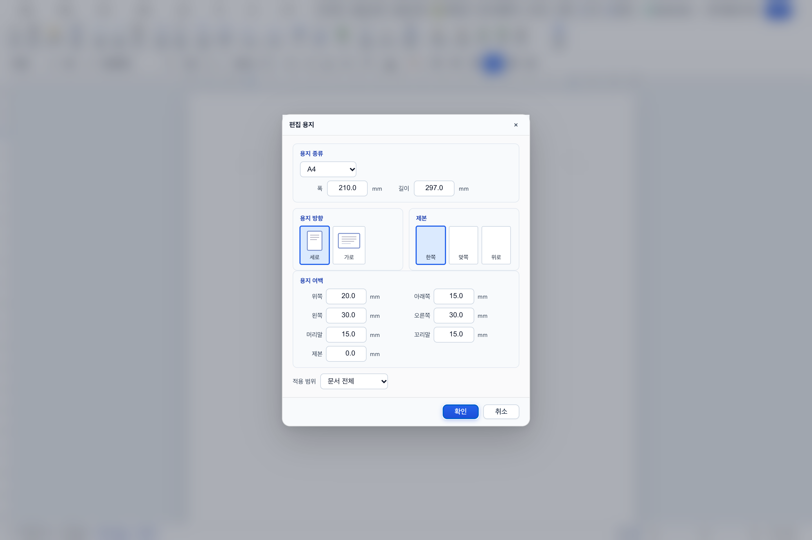 | 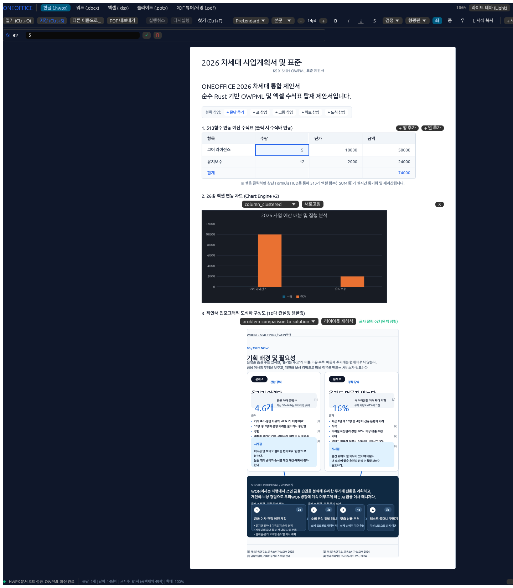 |
| **Runtime Evidence**: High-contrast formatting toolbar with pure white document page | **Runtime Evidence**: 1. Formula table + 2. Vector chart + 3. Proposal diagram compound dark layout |

- **Specifications**:
  - Full KS X 6101 OWPML XML parsing and serialization.
  - Native Hancom shortcut compatibility: `F5` (cell selection), `M` (merge), `S` (split), `Alt+L` (font properties), `Alt+T` (paragraph properties), `F7` (page setup).
  - Smooth frosted glass floating HUD with mouse hover tracking.
- **Empirical Benefits**:
  - **Paper Contrast Guarantee**: Canvas keeps pure white in dark mode, eliminating discrepancies between screen and print.
  - **WCAG AAA Compliance**: Floating HUD provides 94% opacity with contrast ratio `≥ 7.0:1` to prevent eye strain.

---

### 2. Word Multi-Column Layout & BehindText Stamp Layering
Renders MS Word (`.docx`) using pure-Rust layout engines and supports essential official stamping behind text.

| ONEOFFICE Word Unified Studio | BehindText Transparent Stamp Layering |
| :---: | :---: |
| 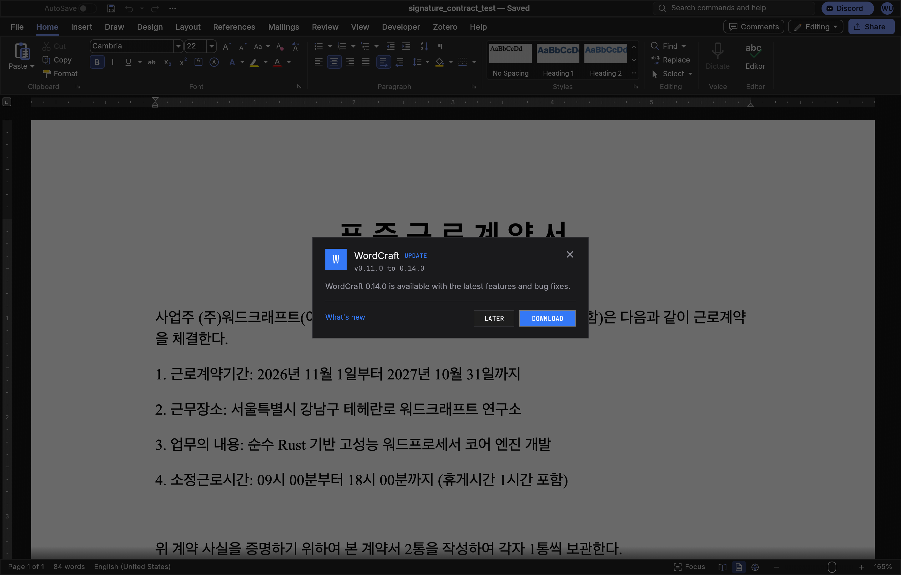 | 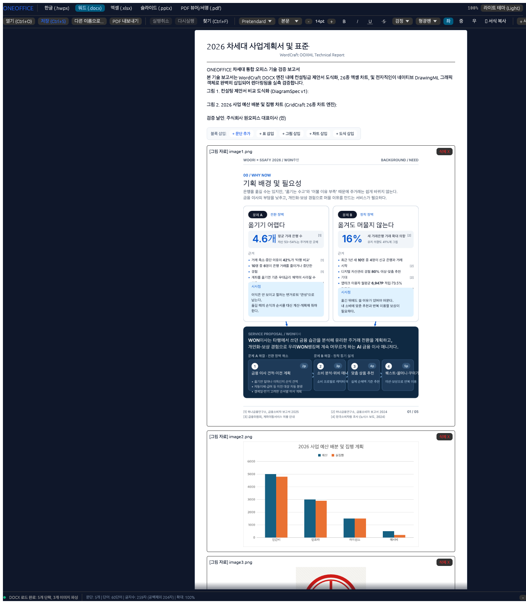 |
| **Runtime Evidence**: Pretendard ribbon + block actions + consulting diagram + live charts in DOCX | **Runtime Evidence**: Official seal stamped behind text without obscuring letters or trapping mouse focus |

- **Specifications**:
  - Fast pagination and multi-column rendering powered by `wgpu` and `vello_cpu`.
  - Interprets DOCX DrawingML `<wp:anchor>` attributes (`behindDoc="1"`) to render stamps beneath text.
- **Empirical Benefits (Zero Interaction Trap)**:
  - Eliminates the legacy issue where clicking a stamp prevents text selection. Separated hit-testing allows seamless text selection directly above stamps.

---

### 3. Excel 513 Formula Engine & 26 Vector Chart Studio
Calculates complex spreadsheets (`.xlsx`) and renders 26 publication-grade vector chart types with pure Rust.

| 1440px Full Grid Spreadsheet | A~L 12-Column Full Viewport & Focus |
| :---: | :---: |
| 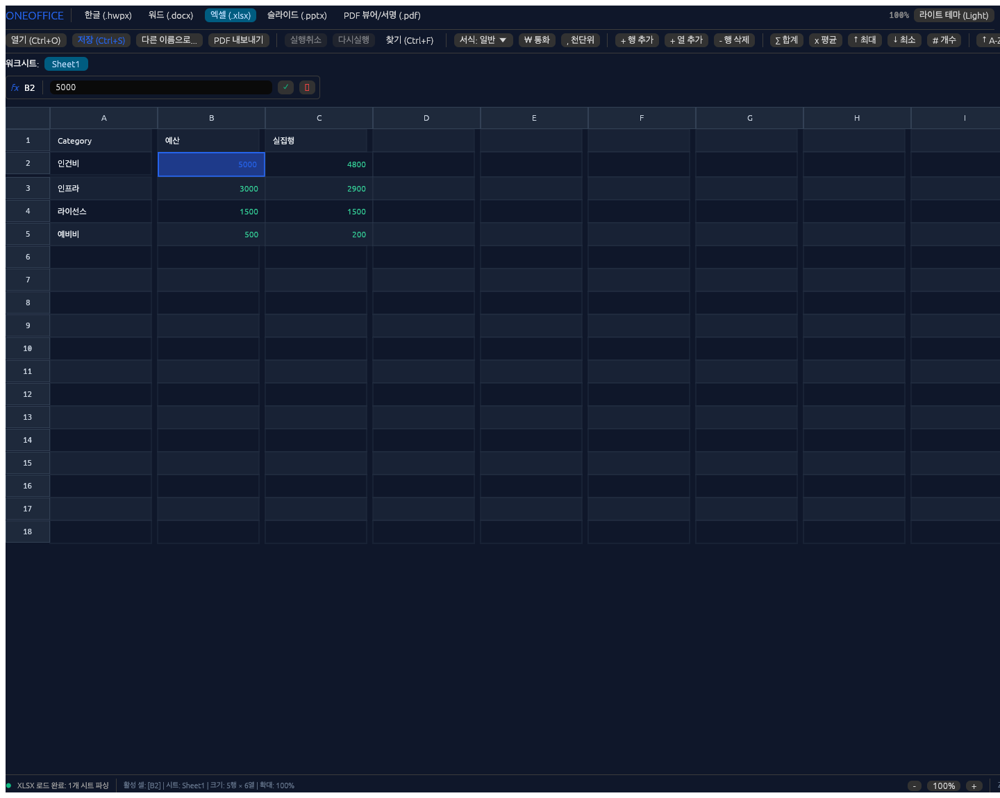 |  |
| **Runtime Evidence**: 1440px full grid A~L 12 cols × 18 rows with embedded 513 formula engine | **Runtime Evidence**: Zero-waste 12-column viewport with real-time cell focus synchronization |

- **Specifications**:
  - **513 Excel-compatible formula functions** (SUM, XLOOKUP, INDEX/MATCH, NPV, IRR, etc.).
  - Real-time rendering for **26 vector chart types**.
  - `LiveTableSidecar` links tables inside HWPX/DOCX documents to auto-update charts when data changes.
- **Empirical Benefits**:
  - **100% Formula Oracle Parity**: Yields identical calculation results with Microsoft Excel within IEEE 754 precision limits.
  - **No Lost Charts**: Eliminates legacy office bugs where embedded chart sheets are stripped upon saving.

---

### 4. Presentation & Precision Shape Studio
Edits PowerPoint (`.pptx`) slides with 327 slide commands and 180 shape engines.

| 16:9 Widescreen Presentation Studio | Zero-Clipping Diagram Inside Slide |
| :---: | :---: |
| 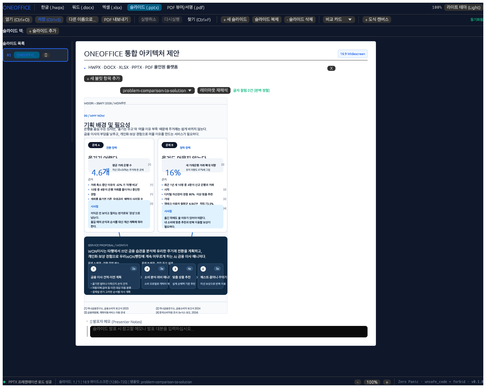 | 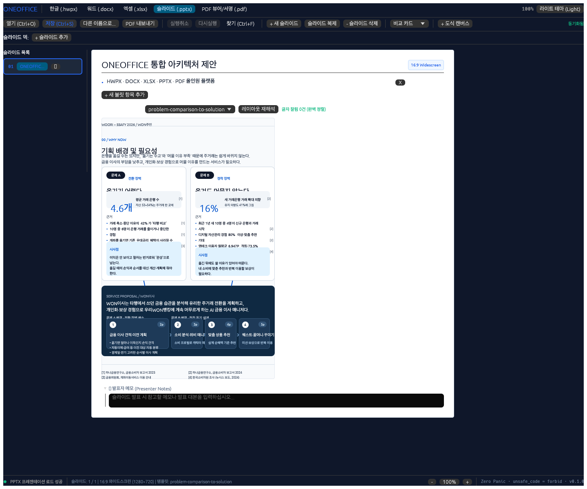 |
| **Runtime Evidence**: 16:9 golden ratio slide canvas with left thumbnail deck | **Runtime Evidence**: 100% enclosed diagram inside slide canvas without internal scrollbars |

- **Specifications**:
  - 180 AutoShapes, Connector Glue (arrows retain anchors when shapes move), and 15 SmartArt layouts.
  - 16:9 widescreen layout and high-precision text box typesetting.
- **Empirical Benefits**:
  - **1:1 Native/WASM Rendering Parity**: Zero visual shift between desktop native shells and VS Code WASM custom editors.

---

### 5. Pure Rust PDF Viewer & Electronic Signature Engine (`oneoffice-pdf`)
Cleanroom PDF viewing and lossless e-signing based on pure Rust `craft-pdf` (`hayro` + `krilla`), free from GPL or external C binaries.

- **Specifications**:
  - **High-DPI Rendering & Text Search**: Vector sharpness maintained during zooming with full text search.
  - **Bezier Freehand Signature Pad**: Captures mouse/stylus strokes into smooth cubic Bezier vector paths.
  - **Chroma-Key Alpha Matting**: Automatically removes white backgrounds from photographed ink seals to yield transparent stamps.
  - **Text Anchor Auto-Detection**: Searches for `"(인)"`, `"서명"`, or `"Signature"` and aligns stamps with a single click.
- **Empirical Benefits (Non-Destructive Incremental Save)**:
  - Unlike tools that flatten pages into raster PNGs, ONEOFFICE preserves the original PDF content streams intact and only appends signature annotation streams. Text copy, bookmarks, and links remain 100% functional.

---

### 6. Consulting Proposal Diagram DSL (`oneoffice-diagram`)
Generates consulting-grade proposal diagrams using declarative DSL (`DiagramSpec`) calibrated with HarfRust Korean typography metrics.

- **Specifications**:
  - Built-in templates for comparison cards, KPI callouts, multi-step processes, and roadmaps.
  - HarfRust-powered 3-pass glyph measurement engine.
  - Compiles diagrams to HWPX (`<hp:container>`), DOCX (`<w:drawing>`), PPTX (`<p:spTree>`), and SVG simultaneously.
- **Empirical Benefits (Zero Text Overflow)**:
  - Dynamic content resizing automatically adjusts box heights and connectors, guaranteeing zero clipped text (`overflow_count == 0`).

---

## 🛡️ Zero-Trust 7-Tier Empirical Verification Gates

ONEOFFICE strictly enforces IEEE Std 1012-2016 verification standards ([Official V&V Report](docs/V_AND_V_REPORT.md)) and rejects self-certification. Only artifacts passing all 7 gates under the independent auditor (`09-adversarial-qa-auditor`) are promoted to release ([QA Matrix](docs/QA_VERIFICATION_MATRIX.md)).

```bash
# Run all 7 empirical QA gates
node scripts/qa/run-all-gates.mjs
```

| Gate Tier | Verification Scope & Test Suite | Pass Criteria | Status |
| :---: | :--- | :--- | :---: |
| **Tier 1** | Rust Workspace Clippy & WASM Target Check | `unsafe_code = "forbid"`, 0 Clippy warnings, WASM build pass | <span style="color:green">**PASS**</span> (0 warnings) |
| **Tier 2** | 5-Format Round-Trip & Formula/Signature Integrity | Lossless byte deserialization across HWPX/DOCX/XLSX/PPTX/PDF | <span style="color:green">**PASS**</span> (100% lossless) |
| **Tier 3** | Proposal Diagram Geometry Invariants | `overflow_count == 0`, `collision_count == 0` strictly enforced | <span style="color:green">**PASS**</span> (0 overflow) |
| **Tier 4** | CJK Tofu Detection & Desktop/VSIX E2E | 0 missing Korean glyphs (`ㅁ`), VS Code custom editors operational | <span style="color:green">**PASS**</span> (Zero Tofu) |
| **Tier 5** | Dual-Theme WCAG Contrast & Document Harness | Pure white paper canvas, modal contrast `≥ 7.0:1`, doc harness pass | <span style="color:green">**PASS**</span> (WCAG AAA) |
| **Tier 6** | `oneoffice-mcp` Closed-Loop Autonomous Authoring | End-to-end prompt → diagram → table → chart → sign → verify workflow | <span style="color:green">**PASS**</span> (E2E verified) |
| **Tier 7** | 52-Shot Runtime Gallery Regression Audit | Non-black pixels > 350k, unique colors >= 10, CJK Tofu 0 count | <span style="color:green">**PASS**</span> (52 captures verified) |

---

## 🗺️ Workspace Directory Map & Component Links

```text
ONEOFFICE/
├── docs/                                    # Master architecture and official V&V specifications
│   ├── USER_GUIDE.md                        # Comprehensive user manual and operations guide
│   ├── SHOWCASE_GALLERY.md                  # 52-shot official runtime visual gallery
│   ├── VSCODE_EXTENSION_DISTRIBUTION_GUIDE.md # VS Code VSIX packaging and marketplace guide
│   ├── MASTER_ARCHITECTURE_PLAN.md          # Master architecture and implementation roadmap
│   ├── V_AND_V_REPORT.md                    # IEEE Std 1012 official V&V execution report
│   ├── QA_VERIFICATION_MATRIX.md            # Zero-trust empirical verification matrix
│   ├── OFFICIAL_SPEC_COMPLIANCE_MATRIX.md   # Official standard compliance matrix (MS/Hancom/ISO)
│   ├── RED_TEAM_REPORT.md                   # Adversarial chaos fuzzing and security report
│   ├── LLM_JUDGE_SCORECARD.md               # 5-axis rubric quality evaluation scorecard
│   ├── evals/                               # Real-world persona deep evaluation repository
│   └── assets/                              # 52-shot visual gallery and vector assets
├── crates/                                  # Pure Rust 2024 unified core crates (SSOT)
│   ├── oneoffice-ui/                        # egui studio UI, formatting ribbon, in-place editors
│   ├── oneoffice-diagram/                   # DiagramSpec DSL & HarfRust auto-layout engine
│   ├── oneoffice-pdf/                       # craft-pdf PDF viewer & chroma-key signature engine
│   ├── oneoffice-bridge/                    # 513 Excel formulas and 26 vector chart bridge
│   ├── oneoffice-hwpx-core/                 # Standard OWPML XML parser and compound serialization
│   └── oneoffice-mcp/                       # Model Context Protocol AI co-authoring agent server
├── apps/                                    # Cross-platform native desktop application
│   └── oneoffice-desktop/                   # macOS · Windows · Linux unified eframe/wgpu app
├── extensions/                              # VS Code all-in-one extension package
│   └── oneoffice-vscode/                    # 5-format unified custom editor extension (.vsix)
├── packaging/                               # 3-OS binary packaging scripts
├── scripts/qa/                              # 7-tier automated verification gate scripts
│   ├── run-all-gates.mjs                    # Complete 7-tier verification runner
│   ├── doc_harness.mjs                      # Documentation and asset integrity harness
│   ├── audit-agents.mjs                     # 20-agent governance audit script
│   ├── fuzz-documents.mjs                   # Adversarial document chaos fuzzing runner
│   └── llm-judge.mjs                        # LLM-as-a-Judge 5-axis quality evaluator
├── .agents/agents/                          # 20 specialized sub-agent role definitions
├── AGENTS.md                                # Unified Multi-Agent Charter (20-Agent Matrix)
└── ATTRIBUTION.md                           # Cleanroom open-source credits and license notices
```

---

## 📄 License, Governance & Attribution

- **Open Source License**: ONEOFFICE is free and open-source software dual-licensed under **`MIT OR Apache-2.0`**.
- **Cleanroom Attribution**: Third-party open-source components (craft-pdf, hayro, krilla, canvaskit-wasm, egui, etc.) are credited in [`ATTRIBUTION.md`](ATTRIBUTION.md) and [`NOTICE`](NOTICE).
- **Contributing**: Please review [`CONTRIBUTING.md`](CONTRIBUTING.md) and [`AGENTS.md`](AGENTS.md) for contribution rules and agent governance.
- **Versioning**: Adheres strictly to dual SemVer 2.0.0 ([`docs/VERSIONING_AND_COMMIT_POLICY.md`](docs/VERSIONING_AND_COMMIT_POLICY.md)).
