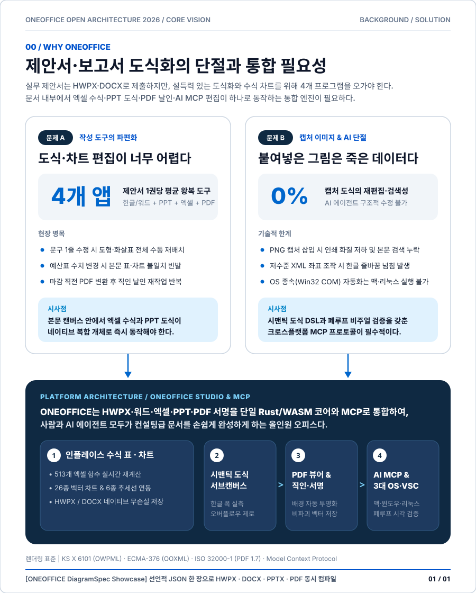
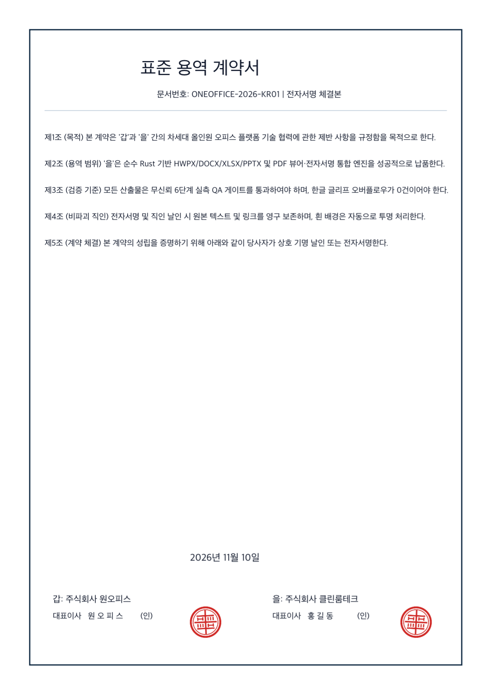
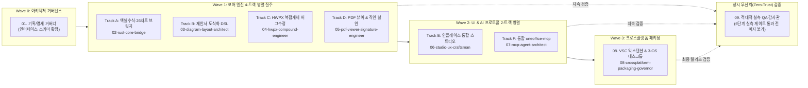

<div align="center">

# ONEOFFICE

**한글(`HWPX`/`HWP`) · 워드(`DOCX`) · 엑셀(`XLSX`) · 파워포인트(`PPTX`) · PDF(뷰어 & 전자서명/직인)**  
**제안서 도식화부터 엑셀 수식 표·차트·PDF 날인·AI Agent(`MCP`)까지 하나로 통합한 크로스플랫폼 오픈소스 오피스**

[](LICENSE-MIT)
[](#3대-실행-환경-vs-code--native--mcp)
[](#3대-실행-환경-vs-code--native--mcp)
[](#ai-agent--mcp-통합-편집)
[](CONTRIBUTING.md)

[**핵심 철학**](#-왜-oneoffice인가-core-philosophy) · [**시각 쇼케이스 & 캡처**](#-시각-쇼케이스--실측-캡처-갤러리) · [**주요 기능**](#-통합-기능-매트릭스) · [**아키텍처 & 로드맵**](docs/MASTER_ARCHITECTURE_PLAN.md) · [**기여하기 (Contributing)**](CONTRIBUTING.md)

</div>

---

<p align="center">
  
</p>

## 💡 왜 ONEOFFICE인가? (Core Philosophy)

한국의 실무 제안서(정부지원사업·RFP·공공기관 보고서)와 기업의 기획서는 **`.hwpx`/`.hwp` 또는 `.docx`** 로 작성하지만, 설득력을 높이기 위해서는 **컨설팅 수준의 도식화(비교 카드, 대형 KPI 콜아웃, 프로세스 다이어그램)** 와 **정교한 엑셀 수식 표·차트**, 그리고 마감 직전 **PDF 변환 및 직인/서명 날인**이 필수적입니다.

하지만 기존 오피스 환경에는 심각한 단절이 존재합니다:
1. **한글과 워드에서는 도식화·차트 편집이 너무 어렵습니다** — 문구 한 줄만 고쳐도 도형과 화살표가 전부 어긋나 결국 PPT·엑셀에서 작업한 뒤 **정적 이미지(PNG)로 캡처해 붙여넣는 비효율**이 반복됩니다.
2. **캡처된 그림은 죽은 데이터입니다** — 본문 검색이 불가능하고, 인쇄 시 화질이 깨지며, 수치 변경 시 표와 차트가 따로 놀고, **AI 에이전트(MCP)가 내부 내용을 읽거나 수정할 수 없습니다.**
3. **OS 종속성** — Windows 전용 COM/DLL에 묶인 도구들은 macOS와 Linux 개발·업무 환경에서 동작하지 않습니다.

**ONEOFFICE는 이 한계를 근본적으로 해결합니다:**
- **인플레이스(In-Place) 복합 개체**: `.hwpx`와 `.docx` 문서 캔버스를 벗어나지 않고 그 자리에서 **513개 엑셀 수식 표**, **26종 벡터 차트**, **PPT급 도식화 서브캔버스**를 직접 편집하고 네이티브 포맷으로 무손실 저장합니다.
- **시맨틱 제안서 도식화 DSL (`DiagramSpec`)**: 한글 글리프 폭을 실측(`harfrust`)하여 글자 잘림(Overflow) 없이 비교 카드·KPI 콜아웃·프로세스 화살표를 자동 배치하며, 사람과 AI 에이전트 모두가 쉽게 수정할 수 있습니다.
- **내장 PDF 뷰어 & 전자서명/직인 날인**: 외부 유료 PDF 도구나 GPL/AGPL 오염 없이 순수 Rust(`craft-pdf`)로 PDF를 열람하고, **자필 서명 및 흰 배경 도장 자동 투명화 날인**까지 한 번에 끝냅니다.

<p align="center">
  
</p>

---

## 📸 시각 쇼케이스 & 실측 캡처 갤러리

> ONEOFFICE는 **애자일(Agile) 방식**으로 지속 개발되며, 추측이 아닌 **실제 구동 화면 캡처(라이트/다크 양방향 실측)** 로 기능을 증명합니다. 아래는 현재 워크스페이스에 통합된 4대 기반 엔진의 실제 구동 캡처이며, 스프린트 진행에 따라 통합 서브캔버스 및 PDF 서명 캡처가 계속 추가됩니다 ([전체 캡처 체크리스트 보기](docs/QA_VERIFICATION_MATRIX.md)).

### 1. 한글 HWPX / HWP 위지윅 스튜디오 & 플로팅 글래스 HUD (`hanul-hwpx`)
| HWPX 메인 위지윅 에디터 | 표 컨텍스트 플로팅 글래스 캡슐 (`F5` / 병합 / 크기 조절) |
| :---: | :---: |
|  |  |

| 라이트 모드 (`Alt+L` / `F7` 고대비 격리) | 다크 모드 (용지 백색 유지 & 모달 WCAG AAA 대비) |
| :---: | :---: |
|  |  |

### 2. 워드 다단 조판 & 직인(`BehindText`) 투명 레이어링 (`OPEN_WORD`)
| macOS 네이티브 Frosted Glass 워드 스튜디오 | 공문서/계약서 본문 뒤 직인(`BehindText`) 알파 합성 |
| :---: | :---: |
|  |  |

### 3. 엑셀 513개 수식 엔진 & 26종 벡터 차트 스튜디오 (`OPEN_EXCELL`)
| 네이티브 스프레드시트 & 실시간 벡터 차트 | VS Code 확장 내 수식바 & 차트 삽입 |
| :---: | :---: |
|  |  |

### 4. 프레젠테이션 & 정밀 도형·다이어그램 스튜디오 (`OPEN_PPTX`)
| 네이티브 글래스 프레젠테이션 스튜디오 | VS Code 1:1 WASM 슬라이드 & 도형 서식 편집 |
| :---: | :---: |
|  |  |

### 5. 신규 통합 코어 실측 캡처 (Wave 1: 제안서 도식화 · PDF 뷰어/직인 날인 · 26종 차트 브릿지)
| 컨설팅급 제안서 도식화 (`oneoffice-diagram` 3-Pass 실측) | 순수 Rust PDF 뷰어 & 직인 날인 (`oneoffice-pdf` Chroma-Key) |
| :---: | :---: |
|  |  |

| 26종 벡터 차트 & 513개 엑셀 수식표 브릿지 (`oneoffice-bridge`) |
| :---: |
|  |

---

## ✨ 통합 기능 매트릭스

> 상태 범례: `🟢 완료 및 실측 통과` · `🟡 통합 진행 중` (상세 일정: [`docs/MASTER_ARCHITECTURE_PLAN.md`](docs/MASTER_ARCHITECTURE_PLAN.md))

| 영역 | 주요 기능 | 지원 포맷 / 범위 | 상태 |
| :--- | :--- | :--- | :---: |
| **한글 문서 엔진** | KS X 6101 `.hwpx` 위지윅 편집, 레거시 `.hwp` 및 **배포용 문서(`ViewText` AES-128) 복호화**, 한컴 단축키(`F5`, `M`, `S`, `W`, `H`, `Alt+L/T`, `F7`, `F11`) | `.hwpx`, `.hwp`, `.hml` | `🟢 완료` |
| **워드 조판 엔진** | 다단(1~45단)·각주·머리글/바닥글 페이지네이션, `BehindText` 직인, 수식(OMML), **Tagged 벡터 PDF 출력** | `.docx`, `.doc`, `.rtf`, `.odt`, `.md` | `🟢 완료` |
| **엑셀 수식 & 차트** | **513개 엑셀 함수**, Tarjan SCC 증분 재계산, 조건부 서식, 피벗, **26종 벡터 차트 + 6종 추세선** | `.xlsx`, `.xls`, `.xlsb`, `.ods`, `.csv` | `🟢 완료` |
| **슬라이드 & 도형** | 327개 커맨드, 180종 AutoShape, 도형 부울 병합(5종), 커넥터 글루(자동 경로 연결), SmartArt | `.pptx`, `.potx`, `.ppsx` | `🟢 완료` |
| **시맨틱 제안서 도식화** | `DiagramSpec` 기반 비교 카드·KPI 콜아웃·프로세스 화살표 **한글 글자 잘림 0% 자동 레이아웃** (`oneoffice-diagram`) | OWPML + DrawingML + SVG + PNG | `🟢 완료` |
| **PDF 뷰어 & 서명** | 순수 Rust(`craft-pdf`) 고속 PDF 뷰어·검색·목차 + **자필 베지어 서명, 흰 배경 도장 투명화, 비파괴 날인 저장** (`oneoffice-pdf`) | PDF 1.7 (읽기·렌더링·서명 저장) | `🟢 완료` |
| **HWPX 복합개체 코어** | **HWPX OWPML 버그 6건 박멸**, `<hp:tbl>` 수식 사이드카, `<hp:container>` 도식화 임베딩, 필드 자동 치환 (`oneoffice-hwpx-core`) | `.hwpx` OWPML 패키징 | `🟢 완료` |
| **인플레이스 통합 편집** | **HWPX·DOCX 내부에서 엑셀 수식 표 실시간 계산, 26종 차트 데이터 편집, PPT급 도식 서브캔버스 구동** | `.hwpx`, `.docx`, `.pptx` 공통 | `🟡 Sprint 3–4` |
| **3대 런타임 & MCP** | **단일 VS Code VSIX** + **macOS·Windows·Linux 네이티브 앱** + **`oneoffice-mcp` AI 에이전트 서버** | 전 플랫폼 100% 무의존 구동 | `🟡 Sprint 5–6` |

---

## 🖥️ 3대 실행 환경: VS Code · Native · MCP

ONEOFFICE는 사용자의 작업 방식에 맞춰 세 가지 실행 표면을 모두 제공합니다:

1. **🧩 VS Code / Antigravity 올인원 익스텐션 (`.vsix`)**
   - 코드 저장소 옆에 놓인 제안서(`.hwpx`), 사양서(`.docx`), 예산표(`.xlsx`), 발표자료(`.pptx`), 계약서(`.pdf` 열람 및 서명 날인)를 별도 프로그램 실행 없이 에디터 탭 안에서 오프라인으로 즉시 편집합니다.
2. **💻 크로스플랫폼 네이티브 데스크톱 (`macOS` · `Windows` · `Linux`)**
   - **macOS**: Apple Silicon(`arm64`) & Intel Universal `.app` / Metal GPU 가속
   - **Windows**: Windows 10/11 (`x64`, `ARM64`) `.exe` & MSI / DirectX 12 가속 (한컴·MS 오피스 미설치 PC 완전 독립 실행)
   - **Linux**: `x86_64` / `aarch64` AppImage, `.deb`, `.rpm`, Flatpak / Wayland & X11 지원
3. **🤖 AI Agent 통합 `oneoffice-mcp` 서버**
   - AI 에이전트가 저수준 XML 좌표 계산 없이 고수준 도구로 제안서를 작성하고 스스로 렌더링 품질을 검증합니다:
     - `oneoffice.diagram.compose`: 컨설팅급 제안서 도식(`DiagramSpec`) 생성 및 삽입
     - `oneoffice.table.upsert` & `oneoffice.chart.upsert`: 엑셀 수식 표 및 26종 연동 차트 삽입
     - `oneoffice.pdf.sign`: 계약서/제안서 PDF의 `"(인)"` 텍스트 위치를 자동 탐색해 투명 직인 날인
     - `oneoffice.visual.verify_page`: 페이지 PNG 렌더링 + 글자 넘침/박스 충돌 자동 진단(Self-Healing Loop)

---

## 📦 모노레포 구조 및 Git Submodule 원격 연동 관리

ONEOFFICE는 개별 전문 오피스 엔진의 독립적인 오픈소스 기여 및 릴리즈 사이클을 온전히 존중하기 위해 **Git Submodule**을 통해 상위 통합 저장소와 4대 전문 엔진 원격 저장소를 영구 연동 관리합니다:

| 하위 서브모듈 | 독립 원격 저장소 (Remote Repo) | 핵심 역할 및 라이선스 |
| :--- | :--- | :--- |
| `hanul-hwpx/` | [`github.com/iamywl/hanul-hwpx`](https://github.com/iamywl/hanul-hwpx) | HWPX/HWP OWPML 코어, 배포용 문서 복호화, 한컴 단축키 스튜디오 (MIT) |
| `OPEN_WORD/` | [`github.com/iamywl/OPEN_WORD`](https://github.com/iamywl/OPEN_WORD) | WordCraft Rust 조판, 다단/각주, 직인 레이어링, Tagged PDF (MIT OR Apache-2.0) |
| `OPEN_EXCELL/` | [`github.com/iamywl/OPEN_EXCELL`](https://github.com/iamywl/OPEN_EXCELL) | GridCraft Rust 513개 수식, 증분 계산, 26종 벡터 차트 엔진 (MIT OR Apache-2.0) |
| `OPEN_PPTX/` | [`github.com/iamywl/OPEN_PPTX`](https://github.com/iamywl/OPEN_PPTX) | DeckCraft 슬라이드/도형 327개 커맨드, 커넥터 글루, SmartArt 스튜디오 (MIT OR Apache-2.0) |

- **클론 시 원클릭 재귀 다운로드**:
  ```bash
  git clone --recurse-submodules https://github.com/iamywl/ONEOFFICE.git
  # 기존 클론 저장소의 경우
  git submodule update --init --recursive
  ```
- **독립 기여 및 통합 동기화**:
  - 개별 서브모듈 디렉토리에서 작업 후 해당 서브모듈 원격으로 직접 `push` 가능
  - 상위 `ONEOFFICE` 저장소에서는 서브모듈 커밋 포인터를 고정(Pinning)하여 전체 통합 빌드의 재현성과 안정성을 보장

---

## ⚡ 9대 전문 서브에이전트 고속 병렬 개발 파이프라인

ONEOFFICE는 순차적 개발의 병목을 없애고 개발 속도를 극대화하기 위해 **쓰기 영역이 완전히 분리된 9대 서브에이전트 병렬 파이프라인**으로 가동됩니다:



---

## 🚀 빠른 시작 (Quick Start)

각 하위 엔진은 지금 바로 클론하여 실행하고 테스트할 수 있습니다:

```bash
git clone https://github.com/iamywl/ONEOFFICE.git
cd ONEOFFICE

# 1) 한글 HWPX / HWP 에디터 & MCP 서버 빌드/실행
cd hanul-hwpx && npm install && npm run build && npm test && cd ..

# 2) 엑셀(GridCraft) 네이티브 앱 실행 (macOS / Windows / Linux)
cargo run --manifest-path OPEN_EXCELL/Cargo.toml --release -p gridcraft -- --sample sales

# 3) 워드(WordCraft) 네이티브 앱 실행
cargo run --manifest-path OPEN_WORD/Cargo.toml --release -p wordcraft -- --sample
```

---

## 🤝 쉽게 기여하는 방법 (Easy Contributing)

ONEOFFICE는 누구나 쉽고 안전하게 기여할 수 있도록 모듈형 구조와 **9대 AI 서브에이전트 가이드**를 갖추고 있습니다. 자세한 내용은 [**기여 가이드 (`CONTRIBUTING.md`)**](CONTRIBUTING.md)를 확인하세요!

### 어디서부터 기여할 수 있나요?
- 🎨 **제안서 도식 템플릿 추가**: 사업계획서·RFP용 신규 `DiagramSpec` 레이아웃 프리셋 기여
- 📊 **HWPX·워드 복합 개체 & 수식 연동**: OWPML/OOXML 표·차트·도형 직렬화 정밀도 개선
- ✍️ **PDF 뷰어 & 직인/서명 기능**: 자필 서명 브러시, 도장 배경 투명화, 날짜 스탬프 UX 개선
- 🌐 **다국어 번역 & 단축키 개선**: 한국어/다국어 카탈로그 및 OS별 단축키 손맛 개선
- 🤖 **AI 서브에이전트 협업 구조**: 루트 [`AGENTS.md`](AGENTS.md) 및 [`.agents/agents/`](.agents/agents/)에 정의된 9개 역할별 에이전트와 함께 빠르게 개발·검증 가능

```text
ONEOFFICE/
├── AGENTS.md                        # 통합 에이전트 협업 헌장 & 10대 절대 원칙
├── CONTRIBUTING.md                  # 5분 개발 환경 세팅 및 PR 가이드
├── ATTRIBUTION.md                   # 클린룸 에셋 출처 원장 (독점 자산 무오염)
├── .agents/
│   ├── agents/                      # 01~09번 역할별 전문 서브에이전트 명세
│   └── skills/                      # 병렬 스프린트 · 6단계 실측 QA · 제안서 도식화 스킬
├── docs/
│   ├── MASTER_ARCHITECTURE_PLAN.md          # 통합 아키텍처 & 고속 병렬 애자일 개발 계획(WBS)
│   ├── VERSIONING_AND_COMMIT_POLICY.md      # S/W 버전관리, Conventional Commits & 서브모듈 커밋 규정
│   ├── AUTONOMOUS_OPERATING_PROCEDURE.md    # "개발진행해" 한마디로 도는 자율 개발·셀프힐링 프로시저
│   ├── FEATURE_DISCOVERY_PROTOCOL.md        # 숨은 기능·미문서화 스펙 동적 탐색 & 흡수 프로토콜
│   ├── GAPS.md                              # 기능 결손(Gap) & 엣지케이스 추적 원장
│   ├── SPEC_DIAGRAM_AND_COMPOUND_OBJECTS.md # 시맨틱 도식화(DiagramSpec) & 복합 개체 바이트 명세
│   ├── SPEC_PDF_VIEWER_AND_SIGNATURE.md     # 순수 Rust PDF 뷰어 & 비파괴 서명·직인 명세
│   ├── SPEC_MCP_AND_AGENT_PROTOCOL.md       # 통합 oneoffice-mcp & 폐루프 비주얼 검증 명세
│   └── QA_VERIFICATION_MATRIX.md            # 기능 검증 현황판 & 애자일 캡처 체크리스트
├── hanul-hwpx/                      # HWPX / HWP / HML 코어 & 스튜디오
├── OPEN_WORD/                       # DOCX 조판 & 벡터 PDF 엔진
├── OPEN_EXCELL/                     # 513 수식 & 26종 차트 스프레드시트 엔진
└── OPEN_PPTX/                       # PPTX 슬라이드 & 도형 스튜디오
```

---

## 📜 라이선스 및 클린룸 원칙 (License & Clean-Room Policy)

ONEOFFICE는 사용자의 선택에 따라 **[MIT License](LICENSE-MIT)** 또는 **[Apache License 2.0](LICENSE-APACHE)** 하에 배포되는 듀얼 오픈소스 프로젝트입니다 (`MIT OR Apache-2.0`).

- **100% 클린룸 엔지니어링**: 공개 표준 명세(**KS X 6101 OWPML**, **ECMA-376 OOXML**, **ODF 1.3**, **PDF 1.7**)만을 기반으로 구현하며, Microsoft·한컴·Adobe의 독점 코드·폰트·아이콘·템플릿이나 `GPL`/`AGPL` 오염 라이브러리를 일절 포함하지 않습니다.
- 서드파티 오픈소스 고지 및 에셋 출처는 [`NOTICE`](NOTICE) 및 [`ATTRIBUTION.md`](ATTRIBUTION.md)에서 투명하게 관리합니다.
