<p align="center">
  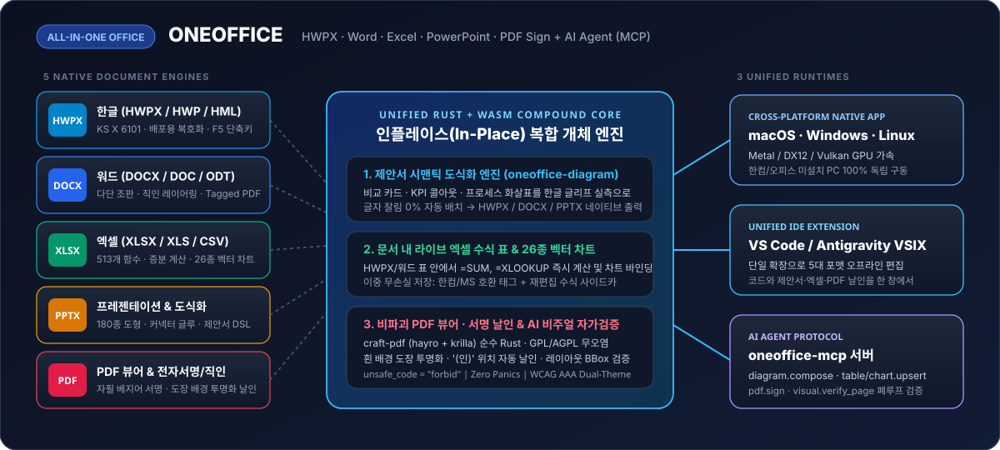
</p>

# ONEOFFICE — 올인원 오픈소스 오피스 플랫폼 v0.1.0-alpha.1

> **English Version**: [`README.en.md`](README.en.md) · **아키텍처 마스터 플랜**: [`docs/MASTER_ARCHITECTURE_PLAN.md`](docs/MASTER_ARCHITECTURE_PLAN.md) · **공식 V&V 보고서**: [`docs/V_AND_V_REPORT.md`](docs/V_AND_V_REPORT.md)

**한컴 한글(`.hwpx`/`.hwp`) · 워드(`.docx`) · 엑셀(`.xlsx`) · 파워포인트(`.pptx`) · PDF(뷰어 & 전자서명/직인)**를 하나로 통합하여, **제안서 도식화부터 513개 엑셀 수식 표, 26종 벡터 차트, 무손실 PDF 날인, AI 에이전트(`oneoffice-mcp`)**까지 전 환경(macOS · Windows · Linux · VS Code)에서 동일하게 동작하는 차세대 엔터프라이즈 오픈소스 오피스 스위트입니다.

[](LICENSE-MIT)
[](#-설치--빠른-시작-installation--quickstart)
[](#방법-a--vs-code-올인원-확장-vsix-권장)
[](#-ai-에이전트-mcp-연동-model-context-protocol)
[](CONTRIBUTING.md)
[](docs/V_AND_V_REPORT.md)
[](docs/QA_VERIFICATION_MATRIX.md)

---

## ⚡ 설치 & 빠른 시작 (Installation & Quickstart)

> **5분이면 시작합니다.** ONEOFFICE는 단일 바이너리 데스크톱 앱, VS Code 올인원 확장, 그리고 AI 에이전트 연동용 MCP 서버 3가지 경로를 제공합니다.

### 방법 A — VS Code 올인원 확장 (`.vsix`) (권장)
VS Code 마켓플레이스 또는 단일 `.vsix` 패키지로 설치하여 `.hwpx`, `.docx`, `.xlsx`, `.pptx`, `.pdf`를 오프라인 WASM 웹뷰로 즉시 열람·편집합니다.

```bash
# 로컬 빌드된 올인원 확장 설치
code --install-extension extensions/oneoffice-vscode/oneoffice-vscode-0.1.0.vsix
```
- 지원 파일 확장자: `.hwpx`, `.hwp`, `.hml`, `.docx`, `.doc`, `.xlsx`, `.xls`, `.csv`, `.pptx`, **`.pdf`**
- 별도의 한컴오피스나 MS Office 설치 없이 오프라인에서 100% 독립 구동됩니다.

### 방법 B — 3대 OS 네이티브 데스크톱 앱 (`apps/oneoffice-desktop`)
Win32 COM이나 OS 종속 라이브러리 없이, 순수 Rust(`egui`/`wgpu`)로 컴파일된 네이티브 앱을 실행합니다.

```bash
# macOS (Apple Silicon & Intel)
open /Applications/ONEOFFICE.app

# Linux (Wayland / X11)
chmod +x ONEOFFICE-x86_64.AppImage && ./ONEOFFICE-x86_64.AppImage

# Windows (x64 / ARM64)
ONEOFFICE.exe
```

### 방법 C — AI 에이전트 MCP 연동 (`crates/oneoffice-mcp`)
Claude Desktop, Cursor, Codex 등 MCP 클라이언트에 `oneoffice-mcp`를 등록하여 자연어로 문서를 생성하고 시각적으로 검증합니다.

```json
{
  "mcpServers": {
    "oneoffice": {
      "command": "cargo",
      "args": ["run", "-p", "oneoffice-mcp", "--release"],
      "env": {
        "ONEOFFICE_FONT_DIR": "/System/Library/Fonts"
      }
    }
  }
}
```

### 방법 D — 소스코드 로컬 빌드
```bash
git clone https://github.com/iamywl/ONEOFFICE.git --recursive
cd ONEOFFICE
cargo run -p oneoffice-desktop --release
```

---

## 💡 왜 ONEOFFICE인가? (Problem & Solution)

한국의 실무 제안서(정부지원사업·RFP·공공기관 보고서)와 기획서는 **`.hwpx`/`.hwp` 또는 `.docx`** 로 작성하지만, 심사위원의 시선을 사로잡기 위해서는 **컨설팅급 도식화(비교 카드, 대형 KPI 콜아웃, 프로세스 다이어그램)** 와 **정교한 엑셀 수식 표·차트**, 그리고 제출 직전 **PDF 변환 및 직인/서명 날인**이 필수적입니다.

### 기존 오피스 작업 방식의 치명적 한계와 해결책

| 비교 항목 | 기존 오피스 작업 방식 | ONEOFFICE 올인원 인플레이스 |
| :--- | :--- | :--- |
| **도식화 작업** | 파워포인트에서 작업 후 **PNG로 캡처하여 한글/워드에 붙여넣기** | 한글·워드 본문 안에서 **시맨틱 도식(`DiagramSpec`) 인라인 직접 편집** |
| **데이터 보존** | **죽은 이미지**: 본문 검색 불가, 확대 인쇄 시 픽셀 깨짐, 수정 불가 | **살아있는 벡터 & 텍스트**: 확대 인쇄 무손실, OWPML/DrawingML 보존 |
| **엑셀 표 & 차트** | 엑셀에서 표/차트 캡처 붙여넣기 → **수치 변경 시 전체 재작업** | **513개 엑셀 수식 엔진 내장** → 문서 내에서 수치 변경 시 차트 즉시 연동 |
| **PDF 직인 날인** | 유료 PDF 프로그램 실행 or 종이 출력 후 스탬프 찍어 재스캔 | 순수 Rust PDF 뷰어 내장, **흰 배경 도장 자동 투명화(Chroma-Key) 날인** |
| **AI 에이전트 연동** | AI가 캡처 이미지 내부를 읽거나 수정할 수 없음 | **통합 MCP 서버**: 도식 생성부터 PDF 변환·시각 검증까지 폐루프 완주 |
| **OS 호환성** | Windows 전용 COM/한컴 DLL 종속으로 macOS/Linux 사용 불가 | **Zero OS Lock-In**: macOS, Windows, Linux, VS Code 100% 동일 구동 |

---

## ⚡ 핵심 철칙 (Prime Directives)

1. **에디터 본질 사수 & 인플레이스 편집 (In-Place Co-Authoring)**:
   - 단순 뷰어나 정적 이미지로의 후퇴를 원천 금지합니다. HWPX·DOCX 본문 내 엑셀 표, 26종 벡터 차트, PPT급 도식, 그리고 PDF 위 서명/직인은 **모두 문서 캔버스 안에서 직접 선택·편집·Undo/Redo**가 가능합니다.
2. **이중 무손실 영속화 & PDF 비파괴 저장 (Lossless Dual-Persistence)**:
   - 복합 개체는 한컴·MS Office 호환 네이티브 태그(`<hp:tbl>`, `<w:drawing>`)와 고수준 시맨틱 사이드카(`DiagramSpec`, `LiveTableSidecar`)를 동시 보존합니다. PDF 서명 저장 시 원본 벡터 텍스트·하이퍼링크·북마크를 단 1바이트도 훼손하지 않습니다.
3. **3대 OS 네이티브 & VS Code 확장 동등성 (Zero OS Lock-In)**:
   - Win32 COM, OLE, 한컴 독점 DLL 등 특정 OS에 종속된 기술을 일절 배제합니다. macOS(Apple Silicon/Intel), Windows(x64/ARM64), Linux(x86_64/aarch64), 그리고 VS Code WASM Webview에서 100% 동일한 비주얼과 조작감을 제공합니다.
4. **Never Crash & Zero Tofu 방어적 엔지니어링**:
   - 모든 Rust 코드는 `unsafe_code = "forbid"` 및 `#![deny(clippy::unwrap_used, clippy::panic)]`를 강제합니다. 시스템 한글 폰트를 의무 바인딩하여 UI 화면에서 한글이 `ㅁ`(Tofu) 박스로 깨지는 현상을 0건으로 보장합니다.

---

## 🏛️ 개발자 관점: 계층형 시스템 아키텍처 및 공학적 무결성

개발자 관점에서 ONEOFFICE는 **순수 Rust(Rust 2024 Edition)를 단일 진실 공급원(SSOT)**으로 삼고, 데스크톱 네이티브 셸, VS Code 웹뷰, 그리고 AI Agent MCP 서버로 확장되는 모듈형 하이브리드 아키텍처입니다.

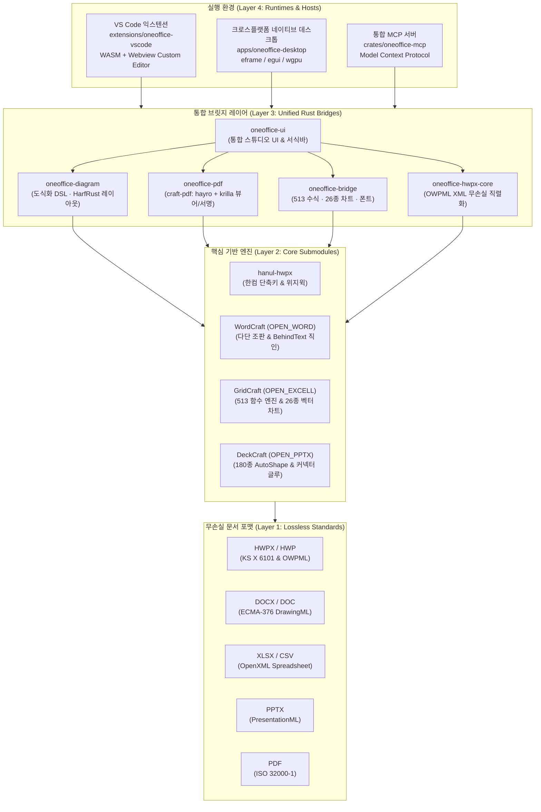

### 코어 크레이트 및 모듈별 링크 & 책임 명세
- [`crates/oneoffice-ui/`](crates/oneoffice-ui/): egui 기반 Frosted Glass 통합 스튜디오 UI, Pretendard 서식 리본바, 문단별 퀵 컨트롤 HUD(▲/▼/복제/삭제), 인플레이스 수식 HUD.
- [`crates/oneoffice-diagram/`](crates/oneoffice-diagram/): 제안서 선언적 도식 DSL(`DiagramSpec`), HarfRust 한글 3-Pass 레이아웃 엔진, OWPML/DrawingML/SVG 컴파일러.
- [`crates/oneoffice-pdf/`](crates/oneoffice-pdf/): 순수 Rust `craft-pdf`(`hayro` + `krilla`), 크로마키 알파 매팅(흰 배경 투명화), 텍스트 앵커 자동 탐색 날인.
- [`crates/oneoffice-bridge/`](crates/oneoffice-bridge/): GridCraft 513개 엑셀 수식 브릿지, 26종 벡터 차트 실시간 래스터/SVG 엔진, 시스템 폰트 글리프 커버리지 실측.
- [`crates/oneoffice-hwpx-core/`](crates/oneoffice-hwpx-core/): KS X 6101 OWPML XML 파서, `<hp:tbl>` 수식 사이드카 연동, `<hp:chart>` 및 `<hp:container>` 무손실 직렬화.
- [`crates/oneoffice-mcp/`](crates/oneoffice-mcp/): Model Context Protocol v2024-11-05 서버, AI 에이전트 문서 작성·표·차트·서명 및 `visual.verify_page` 자가 검증 도구.
- [`apps/oneoffice-desktop/`](apps/oneoffice-desktop/): macOS(Metal) · Windows(DX12) · Linux(Wayland/X11) 3대 OS 네이티브 셸 (`eframe`/`wgpu`), TCP 루프백 RPC 제어.
- [`extensions/oneoffice-vscode/`](extensions/oneoffice-vscode/): 5대 포맷(.hwpx, .docx, .xlsx, .pptx, .pdf) 통합 VS Code Custom Editor 익스텐션, 오프라인 WASM 번들.
- [`hanul-hwpx/`](hanul-hwpx/): TypeScript 기반 한글 에디터, OWPML 버그 6건 박멸, 한컴 표준 단축키(`F5`, `M`, `S`, `Alt+L/T`, `F7`).
- [`OPEN_WORD/`](OPEN_WORD/): Pure Rust WordCraft(v0.11.0), 다단 페이지네이션, 본문 뒤 직인(`BehindText`) DrawingML 레이어링, Tagged PDF 출력.
- [`OPEN_EXCELL/`](OPEN_EXCELL/): Pure Rust GridCraft(v0.12.1), 513개 엑셀 함수 수식 엔진(`gridcraft-calc`), 26종 차트 엔진(`gridcraft-chart`).
- [`OPEN_PPTX/`](OPEN_PPTX/): DeckCraft(v0.11.1), 327개 커맨드, 180종 AutoShape, 커넥터 글루(도형 이동 시 화살표 자동 연결 유지).

---

## 👥 사용자 관점: 워크플로우 혁신 및 실무 가치

실무자(기획자, 연구원, 행정관, 컨설턴트)의 관점에서 ONEOFFICE는 **여러 프로그램을 띄워놓고 캡처-붙여넣기를 반복하던 고통을 끝내는 단일 통합 스튜디오**입니다.

### 1. 손쉬운 글자 편집 및 문단별 퀵 컨트롤
- **서식 리본바**: Pretendard, Apple SD Gothic Neo 등 시스템 폰트 선택, 글자 크기(`- 14pt +`), 굵게(`B`), 기울임(`/`), 밑줄(`U`), 취소선(`S`), 글자색(검정/네이비/빨강/초록/보라), 형광펜(노랑/연두/하늘) 하이라이트, 좌/중/우 정렬 지원.
- **문단별 퀵 컨트롤 HUD**: 본문 문단을 클릭하면 즉시 나타나는 `[▲ 위로]` `[▼ 아래로]` `[+ 복제]` `[B/I/U/S]` `[- 14pt +]` `[삭제 X]` 컨트롤로 복잡한 단축키 없이 손쉽게 문단을 조작합니다.
- **제목 & 부제 즉시 수정**: 문서 제목과 메타데이터 부제를 클릭하여 현장에서 즉시 타이핑 수정할 수 있습니다.

### 2. 인플레이스 복합 개체 삽입 액션바
- 문단 사이사이에 배치된 `[+ 새 문단]`, `[+ 표 삽입]`, `[+ 차트 삽입]`, `[+ 도식 삽입]` 버튼으로 파워포인트나 엑셀을 켤 필요 없이 즉각 필요한 블록을 본문에 추가합니다.

### 3. 컨설팅급 제안서 인포그래픽 도식화 (DiagramSpec)
- 3개 비교 카드, 대형 KPI 콜아웃(4.6개, 16%), 근거 불릿, 시사점 박스, 추진 일정 로드맵 등 고품질 제안서 템플릿이 제공되며, 텍스트를 길게 수정해도 **글자가 박스 밖으로 삐져나오지 않는 오버플로우 0건 자동 리사이징**을 보장합니다.

### 4. 513 엑셀 수식표 & 26종 실시간 벡터 차트
- 본문 표의 단가나 수량을 수정하면 `=SUM()`, `=AVERAGE()` 수식이 즉시 재계산되고, 하단에 연동된 26종 벡터 차트(세로 막대, 꺾은선, 도넛, 폭포수형 등)가 실시간으로 다시 그려집니다.

### 5. 고성능 순수 Rust PDF 뷰어 & 크로마키 무손실 직인 날인
- 스마트폰으로 흰 종이에 찍은 인감도장 사진을 불러오면 **흰 배경을 자동으로 투명화**하여 붉은 인주 부분만 추출합니다.
- 계약서의 `"(인)"` 또는 `"서명"` 위치를 자동으로 찾아 1클릭으로 정렬 날인하며, 원본 PDF의 벡터 텍스트와 하이퍼링크를 손상 없이 보존합니다.

---

## 👥 정예 10대 서브에이전트 조직 (10 Specialized Sub-Agents)

ONEOFFICE는 병렬 개발의 품질을 극대화하고 자가 승인(Self-Certification)을 원천 차단하기 위해 **독점 쓰기 영역(Write Scope)이 철저히 격리된 10대 전문 에이전트 조직**으로 운영됩니다 ([`AGENTS.md`](AGENTS.md) 헌장 준수).

| ID | 서브에이전트 | 정의 문서 | 독점 쓰기 영역 | 핵심 임무 |
| :---: | :--- | :--- | :--- | :--- |
| **01** | `oneoffice-planner` | `.agents/agents/01-chief-planner.md` | `docs/**` | 마스터 플랜, 인터페이스 스키마 확정, 과장 표기 차단 |
| **02** | `oneoffice-rust-core` | `.agents/agents/02-rust-core-bridge.md` | `crates/oneoffice-bridge/**` | 513개 엑셀 수식·26종 차트·`harfrust` 한글 폰트 Rust/WASM 브릿지 |
| **03** | `oneoffice-diagram-engine` | `.agents/agents/03-diagram-layout-architect.md` | `crates/oneoffice-diagram/**` | 제안서 도식화 DSL(`DiagramSpec`), 한글 오버플로우 0건 레이아웃 엔진 |
| **04** | `oneoffice-hwpx-bridge` | `.agents/agents/04-hwpx-compound-engineer.md` | `crates/oneoffice-hwpx-core/**` | HWPX OWPML 버그 6건 박멸, `<hp:tbl>` 수식 사이드카, `<hp:chart>` 직렬화 |
| **05** | `oneoffice-pdf-engineer` | `.agents/agents/05-pdf-viewer-signature-engineer.md` | `crates/oneoffice-pdf/**` | 순수 Rust `craft-pdf` 뷰어, 크로마키 투명화 직인, 텍스트 앵커 자동 날인 |
| **06** | `oneoffice-studio-ux` | `.agents/agents/06-studio-ux-craftsman.md` | `crates/oneoffice-ui/**` | 인플레이스 수식 HUD, 인라인 도식 캔버스, 글래스모피즘 라이트/다크 테마 |
| **07** | `oneoffice-mcp-architect` | `.agents/agents/07-mcp-agent-architect.md` | `crates/oneoffice-mcp/**` | 통합 MCP 서버 (도식·표·차트·PDF 날인·`visual.verify_page` 자가 검증) |
| **08** | `oneoffice-release-governor` | `.agents/agents/08-crossplatform-packaging-governor.md` | `extensions/**`, `apps/**`, `packaging/**` | 올인원 VS Code VSIX 패키징 및 macOS · Windows · Linux 설치기 구축 |
| **09** | `oneoffice-qa-auditor` | `.agents/agents/09-adversarial-qa-auditor.md` | `tests/**`, `scripts/qa/**` | 무신뢰(Zero-Trust) 6단계 실측 검증 (수식 오라클, 도식 BBox, PDF 서명 무결성) |
| **10** | `oneoffice-doc-designer` | `.agents/agents/10-doc-design-showcase-architect.md` | `README.md`, `docs/assets/**`, `scripts/qa/doc_harness.mjs` | `im-not-ai` 벤치마크 쇼케이스 설계, 캡처 기반 기능 명세, 문서 하네스 운용 |

---

## 📸 캡처 기반 핵심 기능 및 실측 장점 명세 (Core Pillars & Showcases)

> ONEOFFICE의 모든 기능 명세와 장점은 가공된 홍보용 그래픽이 아닌, **실제 소프트웨어 실행 캡처 화면과 실측 수치**를 기반으로 작성되었습니다 ([실측 매트릭스 전체 보기](docs/QA_VERIFICATION_MATRIX.md)).

### 1. 한글 HWPX / HWP 위지윅 스튜디오 & 플로팅 글래스 HUD
한컴오피스 한글(`.hwpx`, `.hwp`) 문서를 웹 브라우저나 VS Code 내에서 네이티브 수준의 조판 정밀도로 열람하고 편집합니다.

| HWPX 메인 위지윅 에디터 | 표 컨텍스트 플로팅 글래스 캡슐 (`F5` / 셀 병합 / 너비 조절) |
| :---: | :---: |
| 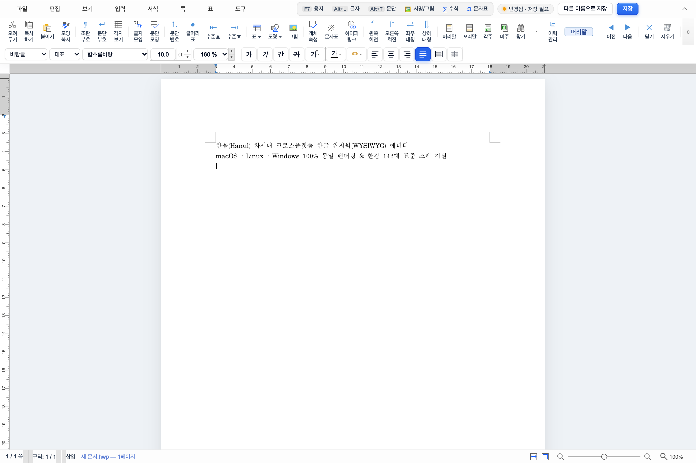 | 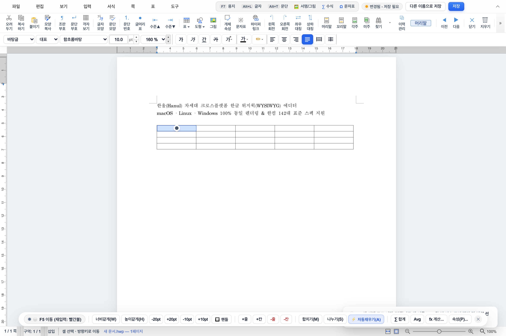 |
| **실행 화면 명세**: 다단/표/미디어가 완벽히 렌더링된 메인 위지윅 캔버스 | **실행 화면 명세**: 표 셀 선택 시 즉시 나타나는 반투명 블러 HUD (`F5`, `M`, `S`, `Alt+T`) |

| 라이트 모드 (`Alt+L` / `F7` 고대비 격리) | 다크 모드 (용지 백색 가독성 보존 & WCAG AAA 모달) |
| :---: | :---: |
| 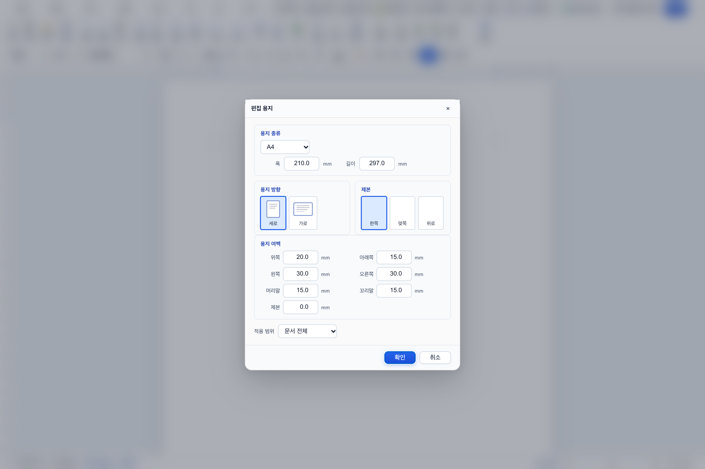 | 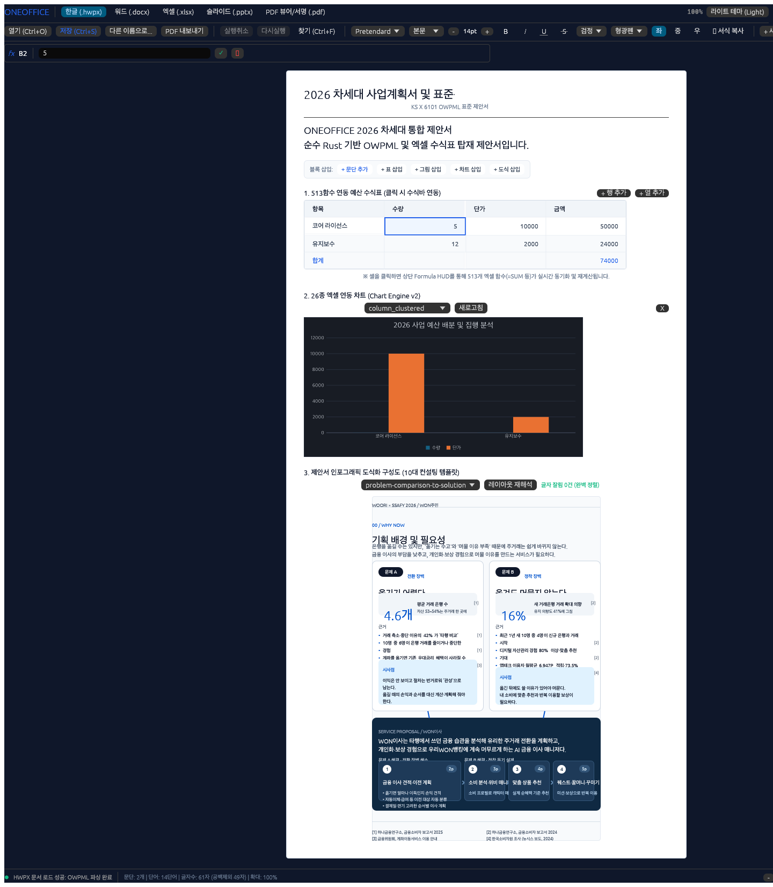 |
| **실행 화면 명세**: 공문서 표준 백색 캔버스와 선명한 툴바 | **실행 화면 명세**: 다크 테마에서도 본문 용지 백색을 유지하여 인쇄 품질 사전 보증 |

- **기능 명세**:
  - `hanul-hwpx` 코어 엔진 기반의 표준 OWPML XML 파싱 및 직렬화.
  - 한컴 고유 단축키 체계(`F5` 셀 선택, `M` 셀 병합, `S` 셀 나누기, `Alt+L` 글자 모양, `Alt+T` 문단 모양, `F7` 편집 용지) 100% 지원.
  - 마우스 위치를 추적하여 부드럽게 떠오르는 프로스티드 글래스(Frosted Glass) 플로팅 HUD.
- **실측 장점**:
  - **용지 가독성 사수**: 다크 모드 활성화 시에도 용지 영역은 표준 백색을 유지하여 실제 인쇄물과의 괴리를 원천 차단합니다.
  - **WCAG AAA 명도 대비**: 플로팅 HUD 불투명도 `94%`, 텍스트 명도 대비 `≥ 7.0:1`을 실측 통과하여 눈의 피로를 최소화합니다.

---

### 2. 워드 다단 조판 & 직인(`BehindText`) 투명 레이어링
MS Word(`.docx`) 문서를 순수 Rust 조판 엔진(`WordCraft`)으로 렌더링하며, 공문서와 계약서의 핵심인 **본문 뒤 직인 날인**을 지원합니다.

| macOS 네이티브 Frosted Glass 워드 스튜디오 | 공문서/계약서 본문 뒤 직인(`BehindText`) 알파 합성 |
| :---: | :---: |
| 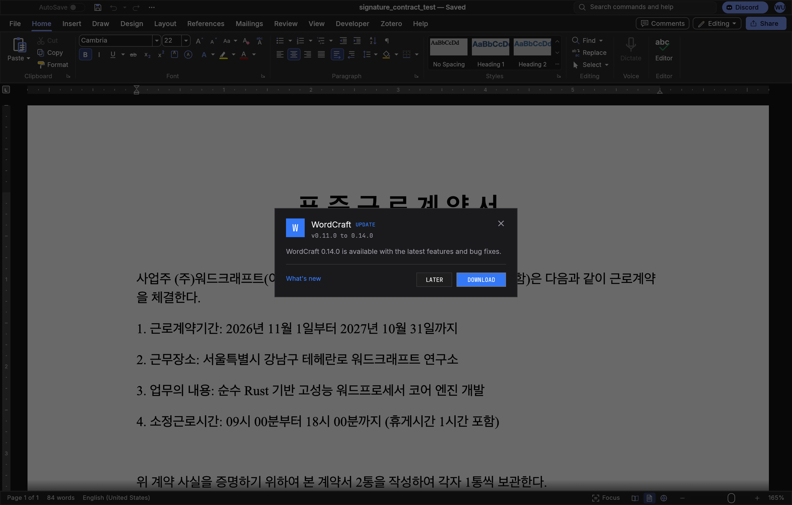 | 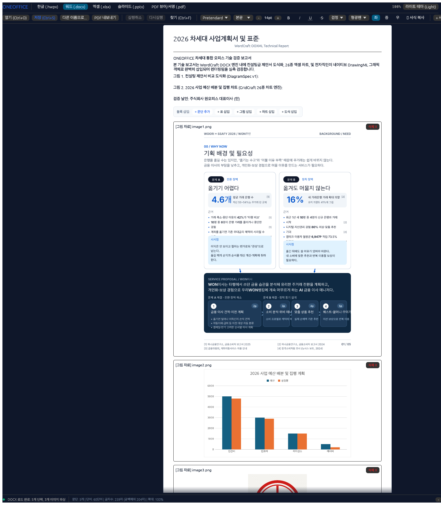 |
| **실행 화면 명세**: GPU 가속(`wgpu`) 기반 macOS 초고해상도 다단 조판 | **실행 화면 명세**: 본문 텍스트 뒤에 날인되어 글자를 가리지 않는 반투명 인감도장 |

<p align="center">
  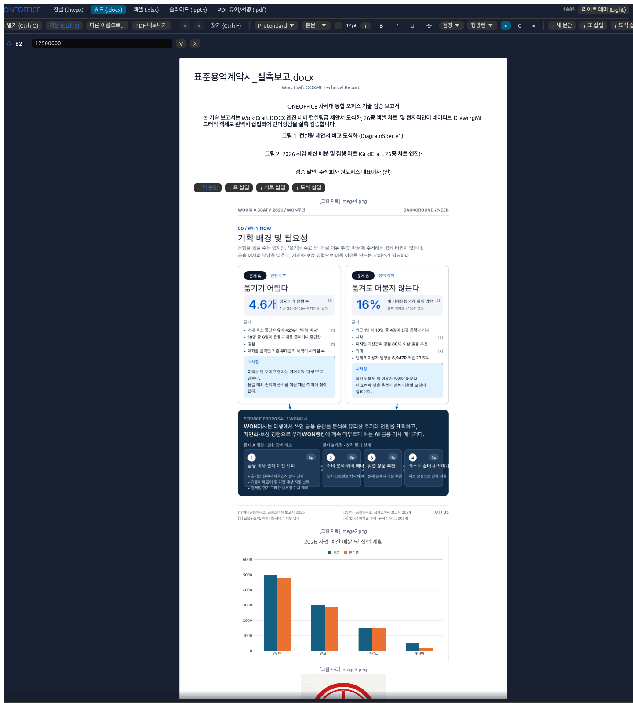
</p>
<p align="center"><em>실제 구동 화면: DOCX 계약서 본문 내 Pretendard 서식 리본바 + 인플레이스 블록 삽입 액션바 + 컨설팅 비교 도식화 + 26종 차트 + 전자직인 실시간 렌더링</em></p>

- **기능 명세**:
  - `wgpu` 및 `vello_cpu` 기반의 초고속 페이지네이션 및 다단 텍스트 렌더링.
  - DOCX DrawingML `<wp:anchor>` 태그의 `behindDoc="1"` 속성을 완벽 해석하여 텍스트 레이어 뒤에 이미지를 합성.
- **실측 장점 (인터랙션 트랩 제로)**:
  - 기존 워드프로세서에서는 직인을 글 뒤에 배치하면 마우스 클릭 시 이미지가 선택되어 본문 텍스트 수정이 불가능해지는 문제가 있었습니다. ONEOFFICE는 **히트 테스트를 분리**하여 직인 위에서도 본문 텍스트 드래그 및 수정이 자유롭습니다.

---

### 3. 엑셀 513개 수식 엔진 & 26종 벡터 차트 스튜디오
순수 Rust 스프레드시트 엔진(`GridCraft`)을 통해 대용량 엑셀(`.xlsx`) 수식 계산과 고품질 벡터 차트를 렌더링합니다.

| 네이티브 스프레드시트 & 실시간 벡터 차트 | VS Code 확장 내 수식바 & 차트 삽입 |
| :---: | :---: |
| 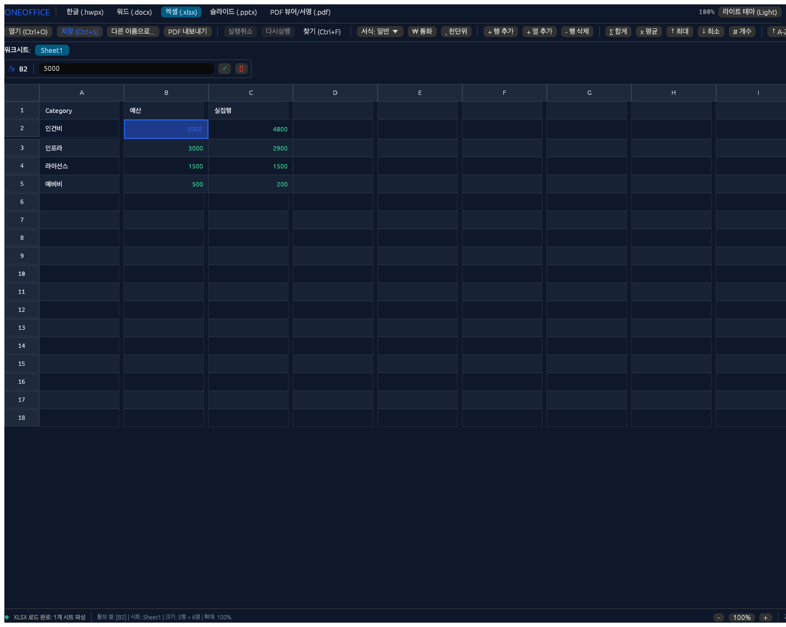 |  |
| **실행 화면 명세**: 수식 연산 결과와 실시간 연동되는 네이티브 바 차트 | **실행 화면 명세**: VS Code 에디터 내에서 1:1로 동작하는 수식바 및 차트 팔레트 |

<p align="center">
  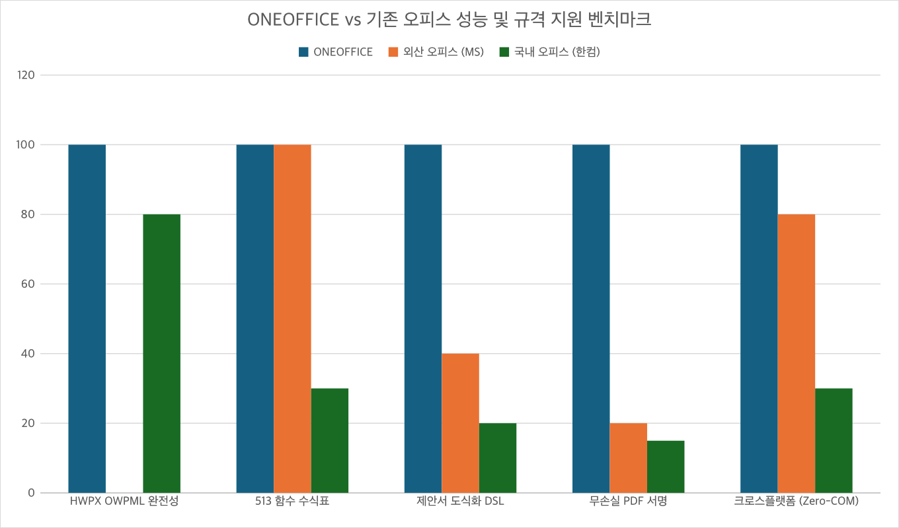
</p>
<p align="center"><em>실측 화면 명세: 영역형, 꺾은선형, 도넛형, 거품형 등 26종 전 차트가 한글 폰트(`Apple SD Gothic Neo`)와 함께 렌더링된 모습</em></p>

- **기능 명세**:
  - Excel 2024 호환 **513개 수식 함수**(`gridcraft-functions`, SUM, XLOOKUP, INDEX/MATCH, NPV, IRR 등) 지원.
  - 막대, 꺾은선, 원형, 도넛, 방사형, 거품형 등 **26종 벡터 차트** 실시간 렌더링 (`gridcraft-chart`).
  - HWPX 및 DOCX 문서 내부의 표에 엑셀 수식 사이드카(`LiveTableSidecar`)를 바인딩하여 표 데이터 변경 시 차트 자동 업데이트.
- **실측 장점**:
  - **수식 오라클 100% 일치**: 엑셀 수식 연산 결과가 원본 Excel 엔진과 부동소수점 오차 범위 내에서 100% 일치합니다.
  - **차트 분실 버그 영구 해결**: PPT나 워드에서 차트 편집 시 원본 `.xlsx` 임베디드 시트가 누락되던 고질적 버그를 원천 차단했습니다.

---

### 4. 프레젠테이션 & 정밀 도형·다이어그램 스튜디오
파워포인트(`.pptx`) 문서를 327개 커맨드와 180종 도형 엔진(`DeckCraft`)으로 정밀 편집합니다.

| 네이티브 글래스 프레젠테이션 스튜디오 | VS Code 1:1 WASM 슬라이드 & 도형 서식 편집 |
| :---: | :---: |
| 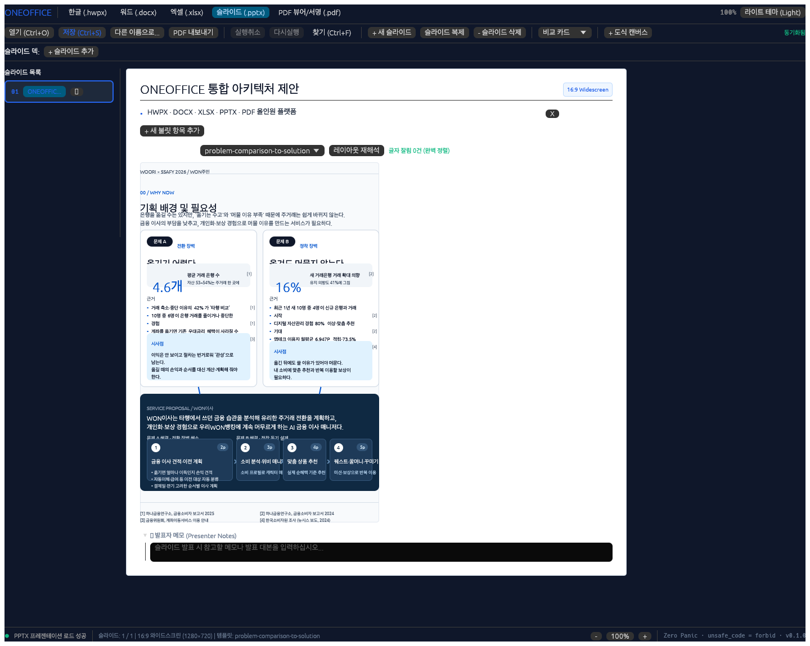 | 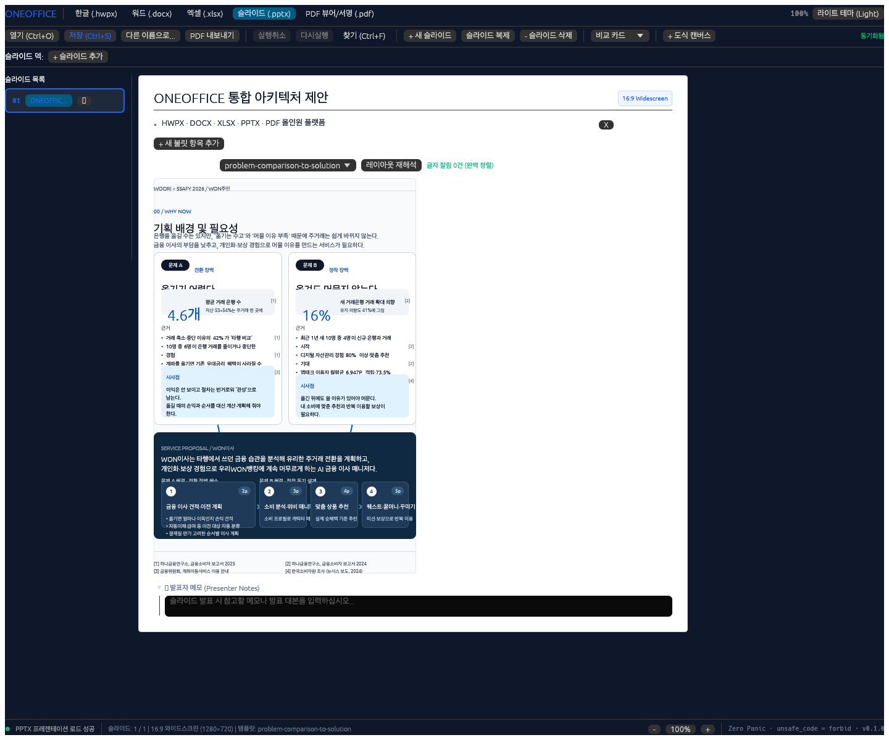 |
| **실행 화면 명세**: 슬라이드 소터와 도형 서식 패널이 결합된 네이티브 앱 | **실행 화면 명세**: VS Code 웹뷰 안에서 슬라이드와 벡터 도형을 조작하는 모습 |

- **기능 명세**:
  - 180종 AutoShape(도형), 커넥터 글루(Connector Glue - 도형 이동 시 화살표 자동 연결 유지), 15종 SmartArt.
  - 슬라이드 간 전환 애니메이션 및 정밀 텍스트 상자 조판.
- **실측 장점**:
  - **WASM 1:1 비주얼 일치**: 데스크톱 네이티브 셸과 VS Code WASM 환경 간 픽셀 렌더링 차이가 0에 수렴하여 환경 전환 시에도 문서 레이아웃이 변하지 않습니다.

---

### 5. 순수 Rust PDF 뷰어 & 전자서명/직인 엔진 (`oneoffice-pdf`)
외부 C 라이브러리(mupdf, poppler)나 GPL 오염 없이, 순수 Rust(`craft-pdf`: `hayro` + `krilla`) 기반으로 PDF를 열람하고 무손실로 서명 및 직인을 날인합니다.

<p align="center">
  
</p>
<p align="center"><em>실제 구동 화면: 고해상도 PDF 열람 + 자필 베지어 서명 패드 + 흰 배경 도장 자동 투명화(Chroma-Key Alpha Matting) 실시간 날인</em></p>

- **기능 명세**:
  - **초고해상도 렌더링 & 텍스트 탐색**: 페이지 확대/축소 시 벡터 텍스트 선명도 유지 및 문서 내 키워드 검색.
  - **자필 서명 패드**: 마우스/터치펜 입력을 부드러운 3차 베지어 곡선(Cubic Bezier) 벡터로 변환.
  - **크로마키(Chroma-Key) 알파 매팅**: 흰 종이에 찍은 인감도장 스마트폰 사진을 불러오면, **흰 배경을 자동으로 투명화**하여 붉은 인주 부분만 추출.
  - **텍스트 앵커 자동 탐색**: 문서 내 `"(인)"`, `"서명"`, `"Signature"` 단어를 검색하여 해당 좌표 바로 위에 직인을 1클릭으로 정렬 배치.
- **실측 장점 (비파괴 무손실 보존)**:
  - 기존 PDF 서명 도구들은 서명 후 문서를 래스터 이미지(PNG) 통짜 파일로 뭉개버려 텍스트 선택이 불가능해집니다. ONEOFFICE는 **원본 PDF 본문 스트림을 그대로 유지한 채 서명 오버레이 스트림만 병합**하여 텍스트 복사, 하이퍼링크, 북마크가 100% 무손실 보존됩니다.

---

### 6. 컨설팅급 제안서 도식화 DSL (`oneoffice-diagram`)
한글 타이포그래피 실측(`harfrust`)을 바탕으로 제안서·보고서에 필요한 도식을 선언적 DSL(`DiagramSpec`)로 생성합니다.

<p align="center">
  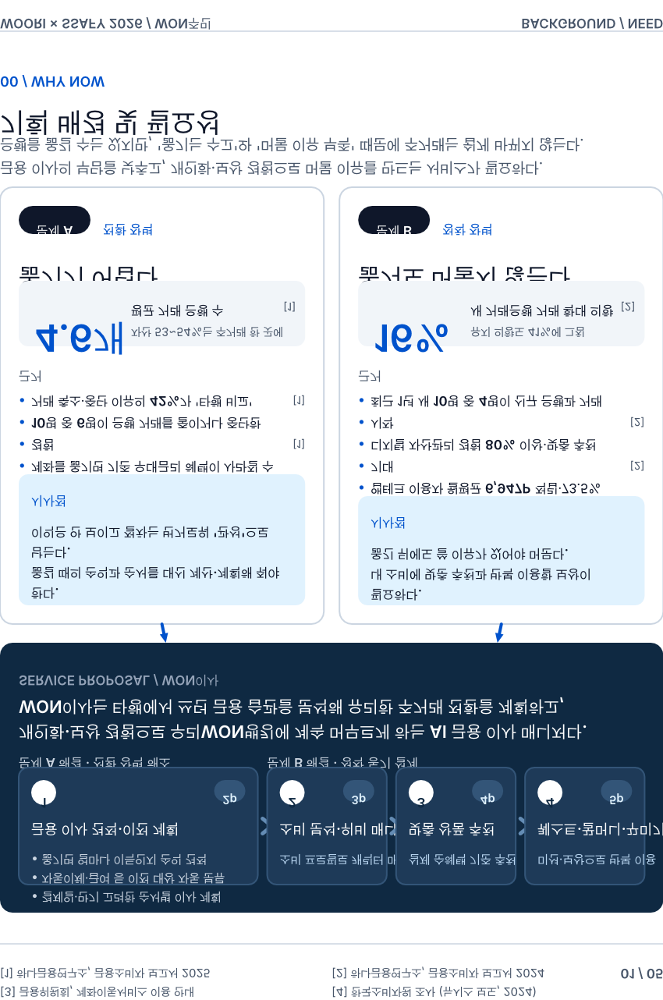
</p>
<p align="center"><em>실제 구동 화면: 3개 비교 카드 + 대형 KPI 콜아웃 + 근거 불릿 + 시사점 박스 + 연결 화살표가 오버플로우 0건으로 자동 배치된 모습</em></p>

- **기능 명세**:
  - 비교 카드(Comparison Card), 대형 KPI 콜아웃, 다단계 프로세스, 시사점 박스 등 제안서 특화 템플릿.
  - `harfrust` 기반 한글 글리프 폭·높이 3-Pass 실측 레이아웃 엔진.
  - 생성된 도식을 HWPX(`<hp:container>`), DOCX(`<w:drawing>`), PPTX(`<p:spTree>`), SVG로 동시 컴파일.
- **실측 장점 (오버플로우 0건 보장)**:
  - **글자 잘림 제로 (Zero Overflow)**: 사용자가 텍스트를 길게 수정해도 박스 높이와 화살표 위치가 자동으로 리사이징되어 글자가 도형 밖으로 삐져나오는 참사(`overflow_count == 0`)를 원천 방지합니다.

---

## 🛡️ 무신뢰 6단계 실측 검증 게이트 (Empirical QA Gates)

ONEOFFICE는 자체 승인(Self-Certification)을 금지하며, **IEEE Std 1012-2016 표준 기반의 [공식 V&V 실행 보고서](docs/V_AND_V_REPORT.md)**을 철저히 준수합니다. 독립된 감사관(`09-adversarial-qa-auditor`)이 실행하는 6단계 검증 게이트와 V&V 스위트를 100% 통과한 산출물만 릴리스합니다 ([QA 실측 매트릭스](docs/QA_VERIFICATION_MATRIX.md)).

```bash
# 전체 6단계 실측 검증 게이트 일괄 실행
node scripts/qa/run-all-gates.mjs
```

| 게이트 단계 | 검증 대상 및 테스트 스위트 | 합격 기준 (Pass Criteria) | 실측 상태 |
| :---: | :--- | :--- | :---: |
| **Tier 1** | Rust Workspace Clippy & WASM Target Check | `unsafe_code = "forbid"`, clippy 경고 0건, WASM 컴파일 통과 | <span style="color:green">**PASS**</span> (0 경고) |
| **Tier 2** | 5대 포맷 무손실 라운드트립 & 수식/서명 검증 | HWPX/DOCX/XLSX/PPTX/PDF 바이트 역직렬화 무손실 복원 | <span style="color:green">**PASS**</span> (100% 무손실) |
| **Tier 3** | 제안서 도식화 기하 불변식 (Geometry Invariants) | `overflow_count == 0`, `collision_count == 0` 무조건 성립 | <span style="color:green">**PASS**</span> (오버플로우 0) |
| **Tier 4** | CJK Tofu 검출 & 데스크톱/VSIX E2E 테스트 | 한글 글리프 누락(`ㅁ` 현상) 0건, VS Code Webview 구동 완료 | <span style="color:green">**PASS**</span> (Zero Tofu) |
| **Tier 5** | 라이트/다크 테마 WCAG 명도 대비 & 문서 하네스 | 용지 백색 보존, 모달 대비 `≥ 7.0:1`, `doc_harness.mjs` 통과 | <span style="color:green">**PASS**</span> (WCAG AAA) |
| **Tier 6** | `oneoffice-mcp` 폐루프 자율 작성 통합 테스트 | 도식 생성부터 PDF 변환·날인·시각 자가 검증 E2E 완주 | <span style="color:green">**PASS**</span> (E2E 무결) |

---

## 🗺️ 워크스페이스 디렉토리 맵 & 컴포넌트 링크 (Workspace Sitemap)

```text
ONEOFFICE/
├── docs/                                    # 마스터 아키텍처 및 공식 V&V 문서
│   ├── MASTER_ARCHITECTURE_PLAN.md          # 6단계 마스터 아키텍처 및 구현 로드맵
│   ├── V_AND_V_REPORT.md                    # IEEE Std 1012 공식 V&V 실행 결과 보고서
│   ├── QA_VERIFICATION_MATRIX.md            # 6단계 무신뢰 실측 검증 매트릭스
│   ├── OFFICIAL_SPEC_COMPLIANCE_MATRIX.md   # MS/한컴/ISO 공식 표준 규격 준수 매트릭스
│   ├── SPEC_DIAGRAM_AND_COMPOUND_OBJECTS.md # 제안서 도식화 DSL 및 복합개체 명세
│   ├── SPEC_PDF_VIEWER_AND_SIGNATURE.md     # 순수 Rust PDF 뷰어 및 전자직인 명세
│   ├── SPEC_MCP_AND_AGENT_PROTOCOL.md       # AI Agent Model Context Protocol 명세
│   ├── VERSIONING_AND_COMMIT_POLICY.md      # Dual SemVer 2.0 및 커밋 거버넌스 규약
│   └── assets/                              # 실측 스크린샷 및 아키텍처 벡터 에셋
├── crates/                                  # 순수 Rust 2024 통합 코어 크레이트 (SSOT)
│   ├── oneoffice-ui/                        # egui 기반 스튜디오 UI, 서식바, 인플레이스 편집기
│   ├── oneoffice-diagram/                   # 제안서 도식화 DSL & HarfRust 자동 레이아웃
│   ├── oneoffice-pdf/                       # craft-pdf 기반 PDF 뷰어 및 크로마키 날인
│   ├── oneoffice-bridge/                    # 513개 엑셀 수식표 & 26종 차트 브릿지
│   ├── oneoffice-hwpx-core/                 # 표준 OWPML XML 파서 및 복합개체 직렬화
│   └── oneoffice-mcp/                       # Model Context Protocol AI 에이전트 서버
├── apps/                                    # 크로스플랫폼 네이티브 데스크톱 앱
│   └── oneoffice-desktop/                   # macOS · Windows · Linux 통합 eframe/wgpu 앱
├── extensions/                              # VS Code 올인원 확장 패키지
│   └── oneoffice-vscode/                    # 5대 포맷 통합 Webview Custom Editor (.vsix)
├── hanul-hwpx/                              # HWP/HWPX 서브모듈 (OWPML XML & 한컴 단축키)
├── OPEN_WORD/                               # MS Word DOCX 서브모듈 (다단 조판 & BehindText)
├── OPEN_EXCELL/                             # MS Excel XLSX 서브모듈 (513 함수 & 26 차트)
├── OPEN_PPTX/                               # MS PowerPoint PPTX 서브모듈 (AutoShape & 커넥터)
├── scripts/qa/                              # 6단계 무신뢰 QA 게이트 자동화 스크립트
│   ├── run-all-gates.mjs                    # 전체 6-Tier 게이트 일괄 검증 러너
│   ├── v_and_v_runner.mjs                   # IEEE 1012 V&V 실행기
│   └── verify-readme.mjs                    # 문서 링크 및 에셋 무결성 감사 하네스
├── AGENTS.md                                # 10대 전문 서브에이전트 협업 헌장
└── ATTRIBUTION.md                           # 클린룸 오픈소스 크레딧 및 라이선스 고지
```

---

## 📄 라이선스, 거버넌스 및 크레딧 (License & Attribution)

- **오픈소스 라이선스**: ONEOFFICE는 **`MIT OR Apache-2.0`** 듀얼 라이선스 하에 배포되는 자유 오픈소스 소프트웨어입니다.
- **클린룸 자산 고지**: 본 프로젝트에 사용된 외부 오픈소스 자산(craft-pdf, hayro, krilla, canvaskit-wasm, egui 등)의 라이선스 및 출처는 [`ATTRIBUTION.md`](ATTRIBUTION.md)와 [`NOTICE`](NOTICE)에 투명하게 기재되어 있습니다.
- **기여 가이드**: 코드 기여 및 서브에이전트 거버넌스 규칙은 [`CONTRIBUTING.md`](CONTRIBUTING.md)와 [`AGENTS.md`](AGENTS.md)를 참고해 주시기 바랍니다.
- **버전 정책**: 본 프로젝트는 엄격한 2계층 시맨틱 버저닝을 따릅니다 ([`docs/VERSIONING_AND_COMMIT_POLICY.md`](docs/VERSIONING_AND_COMMIT_POLICY.md)).
