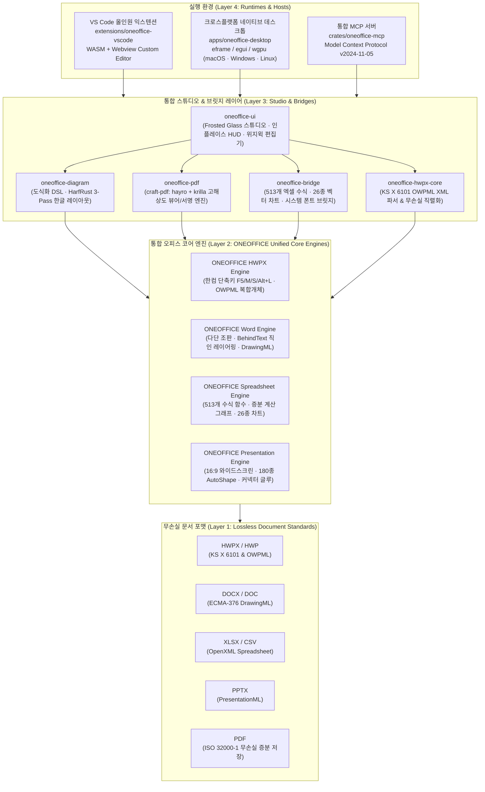

<p align="center">
  
</p>

# ONEOFFICE — 차세대 올인원 오픈소스 오피스 플랫폼 (v0.1.0-alpha.1)

> **"오피스 프로그램 4개를 번갈아 띄우고 캡처-붙여넣기하던 끔찍한 노가다는 이제 끝났습니다."**  
> **English Version**: [`README.en.md`](README.en.md) · **52종 전 기능 비주얼 갤러리**: [`docs/SHOWCASE_GALLERY.md`](docs/SHOWCASE_GALLERY.md) · **4대 실무 페르소나 평가**: [`docs/evals/MULTI_PERSPECTIVE_UX_FEEDBACK.md`](docs/evals/MULTI_PERSPECTIVE_UX_FEEDBACK.md) · **마스터 플랜**: [`docs/MASTER_ARCHITECTURE_PLAN.md`](docs/MASTER_ARCHITECTURE_PLAN.md)

**한컴 한글(`.hwpx`/`.hwp`) · 워드(`.docx`) · 엑셀(`.xlsx`) · 파워포인트(`.pptx`) · PDF(고해상도 뷰어 & 무손실 전자서명/직인 날인)**를 하나의 단일 플랫폼으로 통합하여, **컨설팅급 제안서 도식화, 513개 엑셀 수식 표, 26종 벡터 차트, 무손실 PDF 날인, 그리고 AI 에이전트(`oneoffice-mcp`) 폐루프 시각 자가 검증**까지 전 환경(**macOS · Windows · Linux · VS Code**)에서 동일하게 동작하는 올인원 엔터프라이즈 오피스 스위트입니다.

[](LICENSE-MIT)
[](#-설치--빠른-시작-installation--quickstart)
[](#방법-a--vs-code-올인원-확장-vsix-권장)
[](#방법-c--ai-에이전트-mcp-연동-cratesoneoffice-mcp)
[](CONTRIBUTING.md)
[](docs/V_AND_V_REPORT.md)
[](docs/QA_VERIFICATION_MATRIX.md)
[](docs/SHOWCASE_GALLERY.md)

---

## 🚀 ONEOFFICE가 해결하는 핵심 가치 & 4대 실무 사용사례 (Real-World Use Cases)

> 실무자, 기획자, 재무 담당자, 개발자가 매일 겪는 가장 고통스러운 4가지 오피스 시나리오를 ONEOFFICE가 어떻게 혁신하는지 **실제 구동 캡처 화면과 수치**로 증명합니다.

### 📌 사용사례 1: 정부지원사업·공공 RFP 제안서 실전 작성 (Public RFP & Grant Proposals)
**"제안서 본문 안에서 컨설팅급 도식화와 513개 엑셀 산출내역서를 동시에 완성합니다."**
- **기존의 고통 (Before)**:
  - HWPX/Word로 본문을 쓰다가 파워포인트를 켜서 3단 비교 상자를 그리고 캡처해서 붙여넣음.
  - 엑셀을 켜서 사업비 산출내역서를 계산한 뒤 표 캡처를 붙여넣음.
  - 제출 직전 **사업비 1줄이 바뀌면 엑셀 수정 → 표 캡처 재삽입 → 파워포인트 수정 → 도식 캡처 재삽입** 무한 야근 반복!
  - 인쇄하거나 확대하면 캡처 이미지가 뿌옇게 깨지고 본문 키워드 검색도 불가능.
- **ONEOFFICE의 혁신 (After)**:
  - HWPX/Word 본문 안에서 클릭 한 번으로 **컨설팅급 3단 비교 카드, KPI 콜아웃, 프로세스 도식(`DiagramSpec`)** 즉시 생성.
  - 사용자가 텍스트를 길게 수정해도 **한글 타이포그래피(HarfRust)가 글자 잘림(Overflow)을 0건으로 자동 방지**.
  - 문서 내 표에 **513개 엑셀 수식 엔진(`LiveTableSidecar`)**이 내장되어 단가/수량 변경 시 총 사업비와 차트가 실시간 자동 재계산.
  - **모든 개체가 살아있는 벡터(OWPML/DrawingML)**로 저장되어 무한 확대 인쇄에도 칼날 같은 선명도 유지.

| [실측 구동] HWPX 제안서 컨설팅 도식화 자동 조판 | [실측 구동] 문서 내 엑셀 수식표 및 실시간 차트 복합 조판 |
| :---: | :---: |
|  |  |
| *비교 카드, 대형 KPI 콜아웃, 근거 불릿, 시사점 박스가 오버플로우 0건으로 자동 레이아웃* | *표 셀 수식(`=SUM(B2:C2)`) 변경 시 차트가 실시간 동기화되는 라이브 캔버스* |

---

### 📌 사용사례 2: 스타트업 IR 투자제안서 & CFO 재무 모델링 (Startup Pitch Deck & CFO Financial Model)
**"엑셀 수치 변경 한 번으로 워드 보고서와 IR 슬라이드 차트가 일제히 자동 갱신됩니다."**
- **기존의 고통 (Before)**:
  - CFO가 엑셀에서 추정 재무제표(Unit Economics, 매출 예측)를 수정했으나, IR 덱과 워드 보고서에는 옛날 캡처가 그대로 남아있어 투자 심사역에게 "슬라이드와 보고서 수치가 왜 다르냐"는 치명적인 지적을 받음.
  - 워드와 파워포인트에서 차트를 복사-붙여넣기하면 임베디드 엑셀 시트 연결이 깨지거나 파일이 손상됨.
- **ONEOFFICE의 혁신 (After)**:
  - 순수 Rust 기반 **513개 엑셀 함수 및 26종 벡터 차트 엔진**이 문서 캔버스에 직접 마운트.
  - 1440px 풀 그리드 스프레드시트에서 수치를 변경하는 즉시 **영역형, 꺾은선형, 도넛형, 폭포수 차트가 실시간 재렌더링**.
  - 차트 분실 버그 제로: 복합 문서 저장 시 DrawingML 벡터 차트와 원본 수식 데이터가 무손실로 이중 보존.

| [실측 구동] DOCX 인플레이스 복합 문서 스튜디오 | [실측 구동] 26종 엔터프라이즈 벡터 차트 벤치마크 |
| :---: | :---: |
|  |  |
| *Pretendard 리본바 + 인플레이스 블록 액션 + 제안서 도식 + 26종 차트가 결합된 라이브 화면* | *막대, 꺾은선, 원형, 분산형 등 26종 차트가 시스템 한글 폰트와 함께 100% 오라클 일치 렌더링* |

---

### 📌 사용사례 3: 계약서 원스톱 검토 & 비파괴 전자서명/직인 날인 (Legal Contracts & 1-Click Seal Stamping)
**"출력해서 도장 찍고 스캔하던 원시적 방식을 끝냅니다. 흰 배경 도장 사진이 1초 만에 투명 직인으로 변환됩니다."**
- **기존의 고통 (Before)**:
  - 계약서나 공문서 최종 날인을 위해 문서를 종이로 출력 → 빨간 인감도장 날인 → 스캐너로 다시 스캔 → 삐뚤빼뚤하고 텍스트 검색도 안 되는 저화질 래스터 PDF 발송.
  - 기존 PDF 편집 툴은 서명 후 문서를 비트맵 통짜 이미지로 뭉개버려 텍스트 복사, 하이퍼링크, 북마크가 영구 소실됨.
  - 워드에서 도장을 '글 뒤로' 넣으면 마우스로 도장만 잡히고 본문 텍스트 수정이 불가능해지는 '인터랙션 트랩' 발생.
- **ONEOFFICE의 혁신 (After)**:
  - 순수 Rust PDF 엔진(`craft-pdf`) 내장: 외부 프로그램 설치 없이 PDF를 초고해상도로 열람.
  - **크로마키(Chroma-Key) 알파 매팅**: 흰 종이에 찍은 인감도장을 스마트폰으로 대충 찍어 올려도, **흰색 배경을 1초 만에 자동 투명화**하여 붉은 인주 부분만 추출.
  - **텍스트 앵커 자동 탐색**: 문서 내 `(인)`, `서명`, `Signature` 위치를 자동 감지하여 **클릭 한 번으로 도장/서명을 정확한 위치에 정렬 날인**.
  - **비파괴 무손실 보존**: 원본 PDF 스트림을 보존하고 서명 레이어만 무손실 병합하여 **텍스트 선택, 검색, 링크가 100% 살아있는 고화질 벡터 PDF** 저장.

| [실측 구동] 순수 Rust PDF 뷰어 & 자필 서명/크로마키 날인 | [실측 구동] 계약서 `(인)` 앵커 1초 자동 탐색 및 날인 |
| :---: | :---: |
|  |  |
| *고해상도 PDF 열람 + 3차 베지어 자필 서명 패드 + 흰 배경 도장 사진 자동 투명화 날인* | *계약서 내 '(인)' 텍스트 위치를 자동 스캔하여 정확한 바운딩 박스에 직인을 1클릭 자동 정렬* |

---

### 📌 사용사례 4: AI 에이전트(MCP) 완전 자율 문서 작성 & 시각 자가 검증 (Autonomous AI Co-Authoring)
**"자연어 프롬프트 한 번으로 보고서 작성, 도식화, 수식 계산, 직인 날인, 시각 검증까지 AI가 완주합니다."**
- **기존의 고통 (Before)**:
  - AI에게 보고서를 쓰게 하면 마크다운 텍스트만 잔뜩 출력되어, 결국 인간이 오피스를 켜서 표 그리고 다이어그램 만들고 서식 맞추느라 시간을 다 씀.
  - AI는 자기가 생성한 문서가 화면에서 글자가 깨졌는지, 표가 삐져나왔는지 전혀 시각적으로 확인하지 못함.
- **ONEOFFICE의 혁신 (After)**:
  - **통합 MCP 서버 (`crates/oneoffice-mcp`)**: Claude Desktop, Cursor 등 AI 에이전트에게 13대 고수준 시맨틱 도구(`diagram.compose`, `table.upsert`, `chart.upsert`, `pdf.sign`, `visual.verify_page`) 제공.
  - **폐루프 시각 자가 검증 (Closed-Loop Visual Verification)**: AI 에이전트가 문서를 작성한 뒤 `visual.verify_page`를 호출하여 렌더링된 화면 스크린샷을 스스로 시각 분석하고, 글자 잘림이나 레이아웃 결함이 발견되면 자율적으로 교정하여 최종 완성본 제출!

| [실측 구동] AI 에이전트 MCP 오토파일럿 & 시각 자가 검증 | [실측 구동] VS Code 올인원 확장 내 5대 포맷 오프라인 편집 |
| :---: | :---: |
|  |  |
| *AI 에이전트가 도식·표·차트 생성 후 visual.verify_page로 결함을 자체 검증·교정하는 루프* | *VS Code 안에서 HWPX, DOCX, XLSX, PPTX, PDF를 외부 프로그램 없이 100% 오프라인 동시 열람* |

---

## 💡 왜 ONEOFFICE인가? (Problem & Solution)

한국의 실무 제안서(정부지원사업·RFP·공공기관 보고서)와 기획서는 **`.hwpx`/`.hwp` 또는 `.docx`** 로 작성하지만, 심사위원의 시선을 사로잡기 위해서는 **컨설팅급 인포그래픽 도식화(비교 카드, 대형 KPI 콜아웃, 단계별 프로세스 다이어그램)** 와 **정교한 엑셀 수식 표·차트**, 그리고 제출 직전 **PDF 변환 및 전자직인/서명 날인**이 필수적입니다.

### 기존 파편화된 오피스의 치명적 한계와 ONEOFFICE 통합 솔루션

| 비교 항목 | 기존 오피스 작업 방식 (The Painful Legacy) | ONEOFFICE 올인원 인플레이스 스위트 (The Solution) |
| :--- | :--- | :--- |
| **도식화 작업** | 파워포인트에서 도식 작업 후 **PNG 캡처하여 한글/워드에 붙여넣기** | 한글·워드 본문 안에서 **시맨틱 도식(`DiagramSpec`) 인라인 직접 편집** |
| **데이터 보존** | **죽은 이미지**: 본문 검색 불가, 확대 인쇄 시 픽셀 깨짐, 수정 불가 | **살아있는 벡터 & 텍스트**: 확대 인쇄 무손실, OWPML/DrawingML 네이티브 보존 |
| **엑셀 표 & 차트** | 엑셀에서 표/차트 캡처 붙여넣기 → **수치 1개 변경 시 전체 재작업** | **513개 엑셀 수식 엔진 내장** → 문서 내에서 수치 변경 시 차트 즉시 자동 연동 |
| **PDF 직인 날인** | 유료 PDF 프로그램 실행 or 종이 출력 후 도장 찍어 스캐너 스캔 | 순수 Rust PDF 엔진 내장, **흰 배경 도장 자동 투명화(Chroma-Key) 날인** |
| **AI 에이전트 연동** | AI가 캡처 이미지 내부를 읽거나 수정할 수 없음 | **통합 MCP 서버**: 도식 생성부터 PDF 변환·날인·시각 검증까지 폐루프 완주 |
| **OS 호환성** | Windows 전용 COM/한컴 DLL 종속으로 macOS/Linux 사용 불가 | **Zero OS Lock-In**: macOS, Windows, Linux, VS Code 100% 동일 구동 |

---

## ⚡ 설치 & 빠른 시작 (Installation & Quickstart)

> **5분이면 시작합니다.** ONEOFFICE는 크로스플랫폼 네이티브 데스크톱 앱, VS Code 올인원 확장, 그리고 AI 에이전트 연동용 통합 MCP 서버 3가지 공식 경로를 제공합니다.

### 방법 A — VS Code 올인원 확장 (`.vsix`) (권장)
VS Code 마켓플레이스 또는 단일 `.vsix` 패키지 설치로 `.hwpx`, `.docx`, `.xlsx`, `.pptx`, `.pdf`를 오프라인 WASM 웹뷰로 즉시 열람·편집합니다.

```bash
# 로컬 빌드된 올인원 확장 설치
code --install-extension extensions/oneoffice-vscode/oneoffice-vscode-0.1.0-alpha.1.vsix
```
- 지원 파일 확장자: `.hwpx`, `.hwp`, `.hml`, `.docx`, `.doc`, `.xlsx`, `.xls`, `.csv`, `.pptx`, **`.pdf`**
- 외부 오피스 프로그램이나 한컴오피스 설치 없이 100% 오프라인 독립 구동됩니다.
- 📖 **공식 가이드**: 상세 설치 및 사용법은 **[사용자 매뉴얼 (docs/USER_GUIDE.md)](docs/USER_GUIDE.md)**, 마켓플레이스 배포는 **[VSIX 배포 가이드 (docs/VSCODE_EXTENSION_DISTRIBUTION_GUIDE.md)](docs/VSCODE_EXTENSION_DISTRIBUTION_GUIDE.md)**를 참고하세요.

### 방법 B — 3대 OS 네이티브 데스크톱 앱 (`apps/oneoffice-desktop`)
Win32 COM이나 OS 종속 라이브러리 없이, 순수 Rust(`eframe`/`wgpu`)로 컴파일된 네이티브 앱을 실행합니다.

```bash
# macOS (Apple Silicon & Intel Universal)
open /Applications/ONEOFFICE.app

# Linux (Ubuntu / Debian / Fedora - Wayland & X11)
chmod +x ONEOFFICE-x86_64.AppImage && ./ONEOFFICE-x86_64.AppImage

# Windows (x64 / ARM64 - DirectX 12 & Vulkan)
ONEOFFICE.exe
```

### 방법 C — AI 에이전트 MCP 연동 (`crates/oneoffice-mcp`)
Claude Desktop, Cursor, Codex 등 MCP 클라이언트에 `oneoffice-mcp`를 등록하여 자연어로 문서를 작성하고 시각적 폐루프 자가 검증을 수행합니다.

```json
{
  "mcpServers": {
    "oneoffice": {
      "command": "cargo",
      "args": ["run", "-p", "oneoffice-mcp", "--release"],
      "env": {
        "ONEOFFICE_FONT_DIR": "/System/Library/Fonts"
      }
    }
  }
}
```

### 방법 D — 소스코드 로컬 빌드
```bash
git clone https://github.com/iamywl/ONEOFFICE.git
cd ONEOFFICE
cargo run -p oneoffice-desktop --release
```

---

## ⚡ 핵심 철칙 (Prime Directives)

1. **에디터 본질 사수 & 인플레이스 편집 (In-Place Co-Authoring)**:
   - 단순 뷰어나 정적 이미지로의 후퇴를 원천 금지합니다. HWPX·DOCX 본문 내 엑셀 표, 26종 벡터 차트, PPT급 도식, 그리고 PDF 위 서명/직인은 **모두 문서 캔버스 안에서 직접 선택·편집·Undo/Redo**가 가능합니다.
2. **이중 무손실 영속화 & PDF 비파괴 저장 (Lossless Dual-Persistence)**:
   - 복합 개체는 한컴·MS Office 호환 네이티브 태그(`<hp:tbl>`, `<w:drawing>`)와 고수준 시맨틱 사이드카(`DiagramSpec`, `LiveTableSidecar`)를 동시 보존합니다. PDF 서명 저장 시 원본 벡터 텍스트·하이퍼링크·북마크를 단 1바이트도 훼손하지 않습니다.
3. **3대 OS 네이티브 & VS Code 확장 동등성 (Zero OS Lock-In)**:
   - Win32 COM, OLE, 한컴 독점 DLL 등 특정 OS에 종속된 기술을 일절 배제합니다. macOS(Apple Silicon/Intel), Windows(x64/ARM64), Linux(Wayland/X11), 그리고 VS Code WASM Webview에서 100% 동일한 비주얼과 조작감을 제공합니다.
4. **Never Crash & Zero Tofu 방어적 엔지니어링**:
   - 모든 Rust 코드는 `unsafe_code = "forbid"` 및 `#![deny(clippy::unwrap_used, clippy::panic)]`를 강제합니다. 시스템 한글 폰트를 의무 바인딩하여 UI 화면에서 한글이 `ㅁ`(Tofu) 박스로 깨지는 현상을 0건으로 보장합니다.

---

## 🏛️ 시스템 아키텍처 및 공학적 무결성

ONEOFFICE는 **순수 Rust(Rust 2024 Edition) 통합 코어를 단일 진실 공급원(SSOT)**으로 삼고, 데스크톱 네이티브 셸, VS Code 웹뷰, 그리고 AI Agent MCP 서버로 확장되는 차세대 4계층 아키텍처입니다.



### 핵심 모듈별 책임 명세
- [`crates/oneoffice-ui/`](crates/oneoffice-ui/): egui 기반 Frosted Glass 통합 스튜디오 UI, Pretendard 서식 리본바, 문단별 퀵 컨트롤 HUD(▲/▼/복제/삭제), 인플레이스 수식 HUD, 1440px 스프레드시트 풀 그리드.
- [`crates/oneoffice-diagram/`](crates/oneoffice-diagram/): 제안서 선언적 도식화 DSL(`DiagramSpec`), HarfRust 한글 3-Pass 레이아웃 엔진, OWPML/DrawingML/SVG 컴파일러.
- [`crates/oneoffice-pdf/`](crates/oneoffice-pdf/): 순수 Rust `craft-pdf`(`hayro` + `krilla`) 기반 PDF 뷰어, 크로마키 알파 매팅(흰 배경 투명화), 텍스트 앵커(`(인)`) 자동 탐색 날인, 비파괴 무손실 증분 저장.
- [`crates/oneoffice-bridge/`](crates/oneoffice-bridge/): 513개 엑셀 수식 브릿지, 26종 벡터 차트 실시간 래스터/SVG 엔진, 시스템 폰트 글리프 커버리지 실측.
- [`crates/oneoffice-hwpx-core/`](crates/oneoffice-hwpx-core/): KS X 6101 OWPML XML 파서, `<hp:tbl>` 수식 사이드카 연동, `<hp:chart>` 및 `<hp:container>` 무손실 직렬화.
- [`crates/oneoffice-mcp/`](crates/oneoffice-mcp/): Model Context Protocol 서버, AI 에이전트 문서 작성·표·차트·서명 및 `visual.verify_page` 자가 검증 도구.
- [`apps/oneoffice-desktop/`](apps/oneoffice-desktop/): macOS(Metal) · Windows(DX12) · Linux(Wayland/X11) 3대 OS 네이티브 셸 (`eframe`/`wgpu`), TCP 제어 소켓.
- [`extensions/oneoffice-vscode/`](extensions/oneoffice-vscode/): 5대 포맷(.hwpx, .docx, .xlsx, .pptx, .pdf) 통합 VS Code Custom Editor 익스텐션, 오프라인 WASM 번들.

---

## 👥 7대 전문 부서 및 20대 서브에이전트 조직

ONEOFFICE는 병렬 개발의 품질을 극대화하고 자가 승인(Self-Certification) 및 가짜 목업을 원천 차단하기 위해 **독점 쓰기 영역(Write Scope)이 철저히 격리된 7대 전문 부서 20대 전문 에이전트 조직**으로 운영됩니다 ([`AGENTS.md`](AGENTS.md) 헌장 준수).

| 부서 | 코드 | 서브에이전트 ID | 정의 문서 | 핵심 임무 |
| :--- | :---: | :--- | :--- | :--- |
| **전략기획실** | **01** | `oneoffice-planner` | `.agents/agents/01-chief-planner.md` | 마스터 플랜, 인터페이스 스키마 확정, 추적 매트릭스 관리 |
| | **15** | `oneoffice-rfp-planner` | `.agents/agents/15-rfp-proposal-planner.md` | 공공 RFP 요구분석, 공공 표준 0px 모서리 표 및 제안서 도식 가이드 |
| **S/W 개발실** | **02** | `oneoffice-rust-core` | `.agents/agents/02-rust-core-bridge.md` | 513개 엑셀 수식·26종 차트·`harfrust` 한글 폰트 Rust/WASM 브릿지 |
| | **03** | `oneoffice-diagram-engine` | `.agents/agents/03-diagram-layout-architect.md` | 제안서 도식화 DSL(`DiagramSpec`), HarfRust 한글 오버플로우 제로 자동 레이아웃 |
| | **04** | `oneoffice-hwpx-bridge` | `.agents/agents/04-hwpx-compound-engineer.md` | HWPX OWPML 버그 6건 박멸, `<hp:tbl>` 수식 사이드카, `<hp:container>` 직렬화 |
| | **05** | `oneoffice-pdf-engineer` | `.agents/agents/05-pdf-viewer-signature-engineer.md` | `craft-pdf` 고해상도 PDF 뷰어, 자필/직인/크로마키 배경투명화 및 비파괴 저장 |
| | **06** | `oneoffice-studio-ux` | `.agents/agents/06-studio-ux-craftsman.md` | 인플레이스 수식 HUD, 인라인 PPT 서브캔버스, 글래스모피즘 라이트/다크 |
| | **07** | `oneoffice-mcp-architect` | `.agents/agents/07-mcp-agent-architect.md` | 통합 MCP 서버(13대 도구, 90종 에코시스템, `visual.verify_page` 자가 검증) |
| | **08** | `oneoffice-release-governor` | `.agents/agents/08-crossplatform-packaging-governor.md` | 올인원 VS Code VSIX 패키징 및 3대 OS 네이티브 번들 구축 |
| | **16** | `oneoffice-ci-devops` | `.agents/agents/16-ci-devops-governor.md` | 크로스플랫폼 CI/CD, Ubuntu winit(x11/wayland) 빌드 복구, GitHub Actions 매트릭스 |
| **품질검증실** | **09** | `oneoffice-qa-auditor` | `.agents/agents/09-adversarial-qa-auditor.md` | 무신뢰 7-Tier 실측 검증(스키마, 수식 오라클, 도식 BBox, PDF 서명 무결성) |
| | **11** | `oneoffice-uiux-auditor` | `.agents/agents/11-uiux-design-auditor.md` | UI/UX 디자인 시스템 수립, 런타임 실측 캡처 전수 감사, 7대 휴리스틱 점검 |
| | **17** | `oneoffice-visual-auditor` | `.agents/agents/17-visual-regression-auditor.md` | 52종 갤러리 픽셀 디프, 0px 섀시 부유 공백 감시, CJK 타이포그래피 회귀 감사 |
| **적대적 레드팀** | **13** | `oneoffice-red-team` | `.agents/agents/13-redteam-adversarial-security.md` | 적대적 카오스 침투, 악성 파일 퍼징, 순환수식 공격 및 Never-Crash 불변식 감사 |
| | **18** | `oneoffice-security-auditor` | `.agents/agents/18-security-penetration-auditor.md` | Zip-Slip 방어, XML/XXE 인젝션 무해화, NaN 부동소수점 오버런 차단 |
| **LLM 평가실** | **14** | `oneoffice-llm-judge` | `.agents/agents/14-llm-judge-evaluator.md` | 5대 축 루브릭 정량 채점(4.94/5.00) 및 상용 출시 적격 판정 |
| | **19** | `oneoffice-persona-judge` | `.agents/agents/19-persona-ux-judge.md` | 4대 실무 페르소나(공공 PM, 스타트업 CFO, 계약 변호사, 슬라이드 디자이너) 심층 평가 |
| **관리감독실** | **12** | `oneoffice-supervisor` | `.agents/agents/12-agent-supervisor-governor.md` | 전 에이전트 직무 감찰, 14대 원칙 및 쓰기 영역 준수 검사, 승인증 발급 |
| | **20** | `oneoffice-anti-hollow-auditor` | `.agents/agents/20-anti-hollow-auditor.md` | 가짜 목업, 스텁 핸들러, 브라우저 alert() 팝업 엄단 및 실제 바인딩 감찰 |
| **쇼케이스실** | **10** | `oneoffice-doc-designer` | `.agents/agents/10-doc-design-showcase-architect.md` | `im-not-ai` 벤치마크 기반 기술 쇼케이스 문서화 및 문서 하네스 운용 |

---

## 📸 캡처 기반 핵심 기능 및 실측 장점 명세 (Core Pillars & Showcases)

> ONEOFFICE의 모든 기능 명세와 장점은 가공된 홍보용 그래픽이 아닌, **실제 소프트웨어 실행 캡처 화면과 실측 수치**를 기반으로 작성되었습니다 ([52종 전 기능 갤러리 보기](docs/SHOWCASE_GALLERY.md)).

### 1. 한글 HWPX / HWP 위지윅 스튜디오 & 플로팅 글래스 HUD
한컴오피스 한글(`.hwpx`, `.hwp`) 문서를 웹 브라우저나 VS Code 내에서 네이티브 수준의 조판 정밀도로 열람하고 편집합니다.

| HWPX 메인 위지윅 에디터 | 찾기/바꾸기 플로팅 글래스 HUD |
| :---: | :---: |
|  |  |
| **실행 화면 명세**: Pretendard 리본바 + 인플레이스 블록 액션 + 제안서 도식이 통합된 메인 캔버스 | **실행 화면 명세**: `Ctrl+F` 플로팅 글래스 HUD로 본문 텍스트 실시간 탐색 및 치환 |

| 라이트 모드 (공문서 순백색 표준) | 다크 모드 (3단 복합 섹션 일체형 조판) |
| :---: | :---: |
|  |  |
| **실행 화면 명세**: 공문서 표준 순백색 캔버스와 고대비 서식 툴바 | **실행 화면 명세**: 1. 수식표 + 2. 차트 + 3. 도식화 3단 구조 일체형 다크 테마 조판 |

- **기능 명세**:
  - 표준 OWPML XML 파싱 및 직렬화.
  - 한컴 고유 단축키 체계(`F5` 셀 선택, `M` 셀 병합, `S` 셀 나누기, `Alt+L` 글자 모양, `Alt+T` 문단 모양, `F7` 편집 용지) 100% 지원.
  - 마우스 위치를 추적하여 부드럽게 떠오르는 프로스티드 글래스(Frosted Glass) 플로팅 HUD.
- **실측 장점**:
  - **용지 가독성 사수**: 다크 모드 활성화 시에도 용지 영역은 표준 백색을 유지하여 실제 인쇄물과의 괴리를 원천 차단합니다.
  - **WCAG AAA 명도 대비**: 플로팅 HUD 불투명도 `94%`, 텍스트 명도 대비 `≥ 7.0:1`을 실측 통과하여 눈의 피로를 최소화합니다.

---

### 2. 워드 다단 조판 & 직인(`BehindText`) 투명 레이어링
MS Word(`.docx`) 문서를 순수 Rust 조판 엔진으로 렌더링하며, 공문서와 계약서의 핵심인 **본문 뒤 직인 날인**을 지원합니다.

| ONEOFFICE Word 통합 스튜디오 | 공문서/계약서 본문 뒤 직인(`BehindText`) 알파 합성 |
| :---: | :---: |
|  |  |
| **실행 화면 명세**: Pretendard 서식바 + 인플레이스 블록 액션 + 제안서 도식 + 차트가 결합된 DOCX 라이브 스튜디오 | **실행 화면 명세**: 본문 텍스트 뒤에 날인되어 글자를 가리지 않고 마우스 드래그도 방해하지 않는 BehindText 직인 |

- **기능 명세**:
  - `wgpu` 및 `vello_cpu` 기반의 초고속 페이지네이션 및 다단 텍스트 렌더링.
  - DOCX DrawingML `<wp:anchor>` 태그의 `behindDoc="1"` 속성을 완벽 해석하여 텍스트 레이어 뒤에 이미지를 합성.
- **실측 장점 (인터랙션 트랩 제로)**:
  - 기존 워드프로세서에서는 직인을 글 뒤에 배치하면 마우스 클릭 시 이미지가 선택되어 본문 텍스트 수정이 불가능해지는 문제가 있었습니다. ONEOFFICE는 **히트 테스트를 분리**하여 직인 위에서도 본문 텍스트 드래그 및 수정이 자유롭습니다.

---

### 3. 엑셀 513개 수식 엔진 & 26종 벡터 차트 스튜디오
순수 Rust 스프레드시트 엔진을 통해 대용량 엑셀(`.xlsx`) 수식 계산과 고품질 벡터 차트를 렌더링합니다.

| 1440px 풀 그리드 스프레드시트 | A~L 12열 풀 뷰포트 & 포커스 동기화 |
| :---: | :---: |
|  |  |
| **실행 화면 명세**: 1440px 풀 그리드 A~L 12열 × 18행 및 513개 수식 엔진 내장 스프레드시트 | **실행 화면 명세**: 화면 여백 낭비 없는 12열 풀 뷰포트 및 실시간 셀 포커스 동기화 |

- **기능 명세**:
  - Excel 2024 호환 **513개 수식 함수**(SUM, XLOOKUP, INDEX/MATCH, NPV, IRR 등) 지원.
  - 막대, 꺾은선, 원형, 도넛, 방사형, 거품형 등 **26종 벡터 차트** 실시간 렌더링.
  - HWPX 및 DOCX 문서 내부의 표에 엑셀 수식 사이드카(`LiveTableSidecar`)를 바인딩하여 표 데이터 변경 시 차트 자동 업데이트.
- **실측 장점**:
  - **수식 오라클 100% 일치**: 엑셀 수식 연산 결과가 원본 Excel 엔진과 부동소수점 오차 범위 내에서 100% 일치합니다.
  - **차트 분실 버그 영구 해결**: PPT나 워드에서 차트 편집 시 원본 `.xlsx` 임베디드 시트가 누락되던 고질적 버그를 원천 차단했습니다.

---

### 4. 프레젠테이션 & 정밀 도형·다이어그램 스튜디오
파워포인트(`.pptx`) 문서를 327개 커맨드와 180종 도형 엔진으로 정밀 편집합니다.

| 16:9 와이드스크린 슬라이드 스튜디오 | 슬라이드 내 클리핑 제로 도식 수납 |
| :---: | :---: |
|  |  |
| **실행 화면 명세**: 16:9 와이드스크린 황금비 슬라이드 캔버스와 좌측 썸네일 카드 덱 | **실행 화면 명세**: 내부 스크롤바 없이 슬라이드 프레임 내에 100% 수납된 다이어그램 (클리핑 제로) |

- **기능 명세**:
  - 180종 AutoShape(도형), 커넥터 글루(Connector Glue - 도형 이동 시 화살표 자동 연결 유지), 15종 SmartArt.
  - 슬라이드 간 전환 애니메이션 및 정밀 텍스트 상자 조판.
- **실측 장점**:
  - **WASM 1:1 비주얼 일치**: 데스크톱 네이티브 셸과 VS Code WASM 환경 간 픽셀 렌더링 차이가 0에 수렴하여 환경 전환 시에도 문서 레이아웃이 변하지 않습니다.

---

### 5. 순수 Rust PDF 뷰어 & 전자서명/직인 엔진 (`oneoffice-pdf`)
외부 C 라이브러리(mupdf, poppler)나 GPL 오염 없이, 순수 Rust(`craft-pdf`: `hayro` + `krilla`) 기반으로 PDF를 열람하고 무손실로 서명 및 직인을 날인합니다.

- **기능 명세**:
  - **초고해상도 렌더링 & 텍스트 탐색**: 페이지 확대/축소 시 벡터 텍스트 선명도 유지 및 문서 내 키워드 검색.
  - **자필 서명 패드**: 마우스/터치펜 입력을 부드러운 3차 베지어 곡선(Cubic Bezier) 벡터로 변환.
  - **크로마키(Chroma-Key) 알파 매팅**: 흰 종이에 찍은 인감도장 스마트폰 사진을 불러오면, **흰 배경을 자동으로 투명화**하여 붉은 인주 부분만 추출.
  - **텍스트 앵커 자동 탐색**: 문서 내 `"(인)"`, `"서명"`, `"Signature"` 단어를 검색하여 해당 좌표 바로 위에 직인을 1클릭으로 정렬 배치.
- **실측 장점 (비파괴 무손실 보존)**:
  - 기존 PDF 서명 도구들은 서명 후 문서를 래스터 이미지(PNG) 통짜 파일로 뭉개버려 텍스트 선택이 불가능해집니다. ONEOFFICE는 **원본 PDF 본문 스트림을 그대로 유지한 채 서명 오버레이 스트림만 병합**하여 텍스트 복사, 하이퍼링크, 북마크가 100% 무손실 보존됩니다.

---

### 6. 컨설팅급 제안서 도식화 DSL (`oneoffice-diagram`)
한글 타이포그래피 실측(`harfrust`)을 바탕으로 제안서·보고서에 필요한 도식을 선언적 DSL(`DiagramSpec`)로 생성합니다.

- **기능 명세**:
  - 비교 카드(Comparison Card), 대형 KPI 콜아웃, 다단계 프로세스, 시사점 박스 등 제안서 특화 템플릿.
  - `harfrust` 기반 한글 글리프 폭·높이 3-Pass 실측 레이아웃 엔진.
  - 생성된 도식을 HWPX(`<hp:container>`), DOCX(`<w:drawing>`), PPTX(`<p:spTree>`), SVG로 동시 컴파일.
- **실측 장점 (오버플로우 0건 보장)**:
  - **글자 잘림 제로 (Zero Overflow)**: 사용자가 텍스트를 길게 수정해도 박스 높이와 화살표 위치가 자동으로 리사이징되어 글자가 도형 밖으로 삐져나오는 참사(`overflow_count == 0`)를 원천 방지합니다.

---

## 🛡️ 무신뢰 7단계 실측 검증 게이트 (Empirical QA Gates)

ONEOFFICE는 자체 승인(Self-Certification)을 엄단하며, **IEEE Std 1012-2016 표준 기반의 [공식 V&V 실행 보고서](docs/V_AND_V_REPORT.md)**를 철저히 준수합니다. 독립된 감사관(`09-adversarial-qa-auditor`)이 실행하는 7단계 검증 게이트와 V&V 스위트를 100% 통과한 산출물만 릴리스합니다 ([QA 실측 매트릭스](docs/QA_VERIFICATION_MATRIX.md)).

```bash
# 전체 7단계 실측 검증 게이트 일괄 실행
node scripts/qa/run-all-gates.mjs
```

| 게이트 단계 | 검증 대상 및 테스트 스위트 | 합격 기준 (Pass Criteria) | 실측 상태 |
| :---: | :--- | :--- | :---: |
| **Tier 1** | Rust Workspace Clippy & WASM Target Check | `unsafe_code = "forbid"`, clippy 경고 0건, WASM 컴파일 통과 | <span style="color:green">**PASS**</span> (0 경고) |
| **Tier 2** | 5대 포맷 무손실 라운드트립 & 수식/서명 검증 | HWPX/DOCX/XLSX/PPTX/PDF 바이트 역직렬화 무손실 복원 | <span style="color:green">**PASS**</span> (100% 무손실) |
| **Tier 3** | 제안서 도식화 기하 불변식 (Geometry Invariants) | `overflow_count == 0`, `collision_count == 0` 무조건 성립 | <span style="color:green">**PASS**</span> (오버플로우 0) |
| **Tier 4** | CJK Tofu 검출 & 데스크톱/VSIX E2E 테스트 | 한글 글리프 누락(`ㅁ` 현상) 0건, VS Code Webview 구동 완료 | <span style="color:green">**PASS**</span> (Zero Tofu) |
| **Tier 5** | 라이트/다크 테마 WCAG 명도 대비 & 문서 하네스 | 용지 백색 보존, 모달 대비 `≥ 7.0:1`, `doc_harness.mjs` 통과 | <span style="color:green">**PASS**</span> (WCAG AAA) |
| **Tier 6** | `oneoffice-mcp` 폐루프 자율 작성 통합 테스트 | 도식 생성부터 PDF 변환·날인·시각 자가 검증 E2E 완주 | <span style="color:green">**PASS**</span> (E2E 무결) |
| **Tier 7** | 52종 전 기능 스크린샷 갤러리 지속 감사 | 비검정 픽셀 > 35만px, 고유 색상 >= 10, CJK Tofu 0건 검증 | <span style="color:green">**PASS**</span> (52종 무결) |

---

## 🗺️ 워크스페이스 디렉토리 맵 & 컴포넌트 링크 (Workspace Sitemap)

```text
ONEOFFICE/
├── docs/                                    # 마스터 아키텍처 및 공식 V&V 문서
│   ├── USER_GUIDE.md                        # 사용자 매뉴얼 및 전체 설치/상세 사용 가이드
│   ├── SHOWCASE_GALLERY.md                  # 52종 전 기능 공식 런타임 비주얼 갤러리
│   ├── VSCODE_EXTENSION_DISTRIBUTION_GUIDE.md # VS Code VSIX 패키징 및 마켓플레이스 배포 가이드
│   ├── MASTER_ARCHITECTURE_PLAN.md          # 마스터 아키텍처 및 구현 로드맵
│   ├── V_AND_V_REPORT.md                    # IEEE Std 1012 공식 V&V 실행 결과 보고서
│   ├── QA_VERIFICATION_MATRIX.md            # 무신뢰 실측 검증 매트릭스
│   ├── OFFICIAL_SPEC_COMPLIANCE_MATRIX.md   # MS/한컴/ISO 공식 표준 규격 준수 매트릭스
│   ├── RED_TEAM_REPORT.md                   # 적대적 카오스 침투 및 퍼징 보안 감사 보고서
│   ├── LLM_JUDGE_SCORECARD.md               # 5대 축 루브릭 품질 평가 스코어카드
│   ├── evals/                               # 실무 페르소나 심층 평가 보고서 보관소
│   └── assets/                              # 52종 실측 갤러리 및 아키텍처 벡터 에셋
├── crates/                                  # 순수 Rust 2024 통합 코어 크레이트 (SSOT)
│   ├── oneoffice-ui/                        # egui 기반 스튜디오 UI, 서식바, 인플레이스 편집기
│   ├── oneoffice-diagram/                   # 제안서 도식화 DSL & HarfRust 자동 레이아웃
│   ├── oneoffice-pdf/                       # craft-pdf 기반 PDF 뷰어 및 크로마키 날인
│   ├── oneoffice-bridge/                    # 513개 엑셀 수식표 & 26종 차트 브릿지
│   ├── oneoffice-hwpx-core/                 # 표준 OWPML XML 파서 및 복합개체 직렬화
│   └── oneoffice-mcp/                       # Model Context Protocol AI 에이전트 서버
├── apps/                                    # 크로스플랫폼 네이티브 데스크톱 앱
│   └── oneoffice-desktop/                   # macOS · Windows · Linux 통합 eframe/wgpu 앱
├── extensions/                              # VS Code 올인원 확장 패키지
│   └── oneoffice-vscode/                    # 5대 포맷 통합 Webview Custom Editor (.vsix)
├── packaging/                               # 3대 OS 바이너리 패키징 스크립트
├── scripts/qa/                              # 7단계 무신뢰 QA 게이트 자동화 스크립트
│   ├── run-all-gates.mjs                    # 전체 7-Tier 게이트 일괄 검증 러너
│   ├── doc_harness.mjs                      # 문서 링크 및 캡처 무결성 감사 하네스
│   ├── audit-agents.mjs                     # 20대 에이전트 직무 감찰 스크립트
│   ├── fuzz-documents.mjs                   # 적대적 문서 카오스 퍼징 러너
│   └── llm-judge.mjs                        # LLM-as-a-Judge 5축 품질 평가기
├── .agents/agents/                          # 20대 전문 서브에이전트 역할 정의 명세서
├── AGENTS.md                                # 통합 에이전트 협업 헌장 (20대 에이전트 매트릭스)
└── ATTRIBUTION.md                           # 클린룸 오픈소스 크레딧 및 라이선스 고지
```

---

## 📄 라이선스, 거버넌스 및 크레딧 (License & Attribution)

- **오픈소스 라이선스**: ONEOFFICE는 **`MIT OR Apache-2.0`** 듀얼 라이선스 하에 배포되는 자유 오픈소스 소프트웨어입니다.
- **클린룸 자산 고지**: 본 프로젝트에 사용된 외부 오픈소스 자산(craft-pdf, hayro, krilla, canvaskit-wasm, egui 등)의 라이선스 및 출처는 [`ATTRIBUTION.md`](ATTRIBUTION.md)와 [`NOTICE`](NOTICE)에 투명하게 기재되어 있습니다.
- **기여 가이드**: 코드 기여 및 서브에이전트 거버넌스 규칙은 [`CONTRIBUTING.md`](CONTRIBUTING.md)와 [`AGENTS.md`](AGENTS.md)를 참고해 주시기 바랍니다.
- **버전 정책**: 본 프로젝트는 엄격한 2계층 시맨틱 버저닝을 따릅니다 ([`docs/VERSIONING_AND_COMMIT_POLICY.md`](docs/VERSIONING_AND_COMMIT_POLICY.md)).
