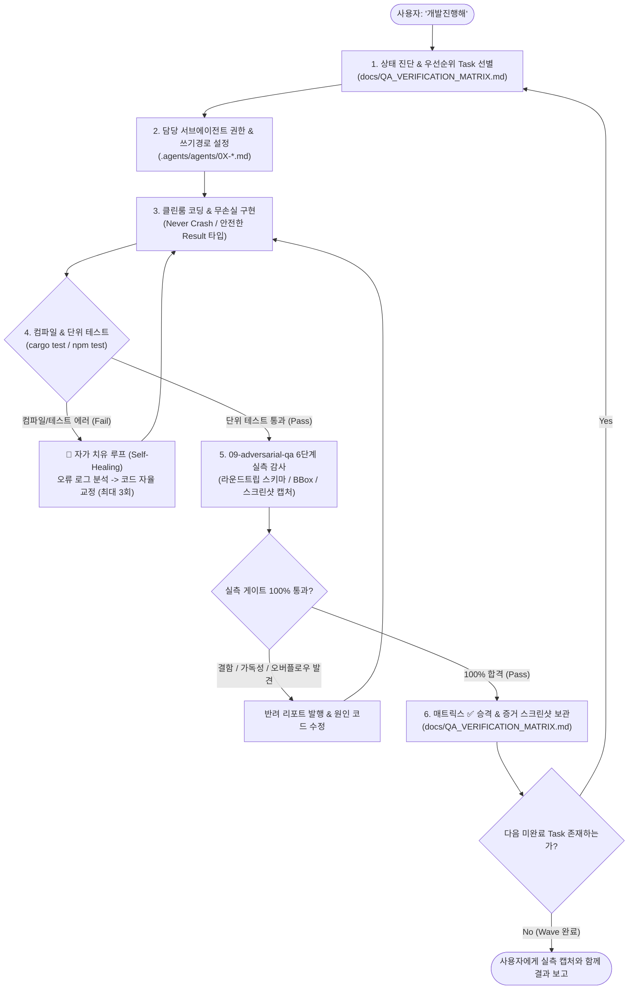

# ONEOFFICE 자율 운용 프로시저 (`AUTONOMOUS_OPERATING_PROCEDURE.md`)

> **"사용자가 '개발진행해'라고 말했을 때, AI 에이전트(Claude Code, Antigravity, Gemini, Codex 등)가 스스로 상태를 파악하고, 코드를 작성·개선하며, 실측 검증까지 자율 완주하는 표준 프로토콜"**

---

## 1. 자율 주행 5단계 사이클 (Autonomous Development Cycle)

사용자가 **"개발진행해"** 한마디만 주었을 때, 에이전트는 아래 사이클을 100% 무결성이 증명될 때까지 멈추지 않고 자율 반복합니다.

---

## 2. 세부 실행 절차 (Step-by-Step Runbook)

### Step 1: 자동 상태 진단 (Status Discovery)
- 사용자가 "개발진행해"라고 하면, 질문을 던지지 말고 먼저:
  1. [`docs/QA_VERIFICATION_MATRIX.md`](QA_VERIFICATION_MATRIX.md)를 열어 상태가 `🔴 Bug / Blocked` 또는 `🟡 Sprint Target`인 항목 중 가장 상위의 Task ID(예: `F-02` 버그 6건 수정, `F-03` 브릿지 구축 등)를 자동으로 집어듭니다.
  2. [`docs/MASTER_ARCHITECTURE_PLAN.md`](MASTER_ARCHITECTURE_PLAN.md)의 세부 과업 명세(Task ID, 수정 대상 파일, 완료 기준)를 숙지합니다.

### Step 2: 서브에이전트 역할 격리 (Role Enforcement)
- 해당 태스크의 담당 서브에이전트 명세([`.agents/agents/`](../.agents/agents/))를 읽고, **해당 에이전트의 독점 쓰기 영역(Write Scope) 내부 파일만 수정**합니다.
- 예: `F-02` 작업 시에는 `04-hwpx-compound-engineer`로서 `hanul-hwpx/src/core/**`와 `crates/oneoffice-hwpx-core/**`만 수정하며, 다른 프로젝트의 파일을 무단 수정하지 않습니다.

### Step 3: 클린룸 구현 및 'Never Crash' 불변식
- Rust: `unsafe_code = "forbid"`, `unwrap()`, `expect()`, `panic!()`, `todo!()` 사용 금지. 외부 입력은 적대적(Hostile)으로 간주하고 경계 검사와 `Result<T, E>`로 처리.
- TypeScript: `strict: true`, 암시적 `any` 금지, 안전한 XML/ZIP 파싱.
- 라이선스: MS/한컴/Adobe 독점 자산 및 GPL/AGPL(MuPDF, Poppler 등) 유입 금지.

### Step 4: 자가 치유(Self-Healing) 빌드 & 단위 검증 루프
- 코드를 작성한 후 즉시 로컬 검증 명령을 실행합니다:
  - `hanul-hwpx`: `npm --prefix hanul-hwpx run check && npm --prefix hanul-hwpx test`
  - Rust 크레이트: `cargo test -p <crate_name>` 및 `cargo check --target wasm32-unknown-unknown`
- **자가 치유 프로토콜 (Self-Healing)**:
  - 컴파일 오류나 테스트 실패 발생 시 **사용자에게 "에러가 났는데 어떻게 할까요?"라고 묻지 않습니다.**
  - 에러 로그의 줄 번호와 원인을 분석하여 코드를 스스로 수정한 뒤 재테스트합니다. (동일 원인 3회 이상 실패 시에만 원인과 대안을 정리하여 보고)

### Step 5: 무신뢰 실측 QA 감사 (`09-adversarial-qa-auditor`)
- 단위 테스트가 통과하면, `09-adversarial-qa-auditor` 관점에서 6단계 실측 검증 게이트([`.agents/skills/ground-truth-qa-gate/SKILL.md`](../.agents/skills/ground-truth-qa-gate/SKILL.md))를 가동합니다:
  1. 무손실 라운드트립 스키마 검증 (저장 후 재열기 시 손실 0)
  2. 제안서 도식 바운딩박스 불변식 검증 (`overflow_count == 0`, `collision_count == 0`)
  3. 라이트 모드 및 다크 모드 2x Retina 스크린샷 캡처 및 WCAG 명도 대비 `≥ 4.5:1` 실측
  4. PDF 서명 전후 본문 텍스트 추출 100% 보존 검증

### Step 6: 자동 매트릭스 갱신 및 연쇄 실행 (Next Task Chaining)
- 검증 게이트를 100% 통과하면:
  1. [`docs/QA_VERIFICATION_MATRIX.md`](QA_VERIFICATION_MATRIX.md)의 상태를 `✅ Verified`로 변경하고 실측 로그 및 캡처 경로를 기록합니다.
  2. [`ATTRIBUTION.md`](../ATTRIBUTION.md)에 신규 에셋이 있는 경우 즉시 반영합니다.
  3. **작업을 멈추지 않고, 다음 미완료 Task로 즉시 넘어가 Step 1부터 다시 실행**합니다.

---

## 3. 예외적 사용자 인터럽트 (비상 정지 기준)

에이전트는 모든 구현과 버그 수정을 자율적으로 완주하되, **오직 아래 3가지 상황에서만 작업을 일시 중지하고 사용자에게 의사를 묻습니다**:
1. **라이선스 및 법적 문제**: `MIT OR Apache-2.0` 이외의 새로운 외부 라이브러리 도입이 불가피한 경우.
2. **파괴적 Git 조작**: `git push --force`, 브랜치 강제 삭제 등 기존 작업 내역을 훼손할 위험이 있는 경우.
3. **사용자 개인 자격 증명 요구**: API 키, 개인 서명 인증서, 비밀번호 입력이 필요한 경우.
그 외의 모든 컴파일 에러, 기능 구현, 버그 수정, 테스트 작성, 스크린샷 검증은 **에이전트가 100% 자율 완주**합니다.
