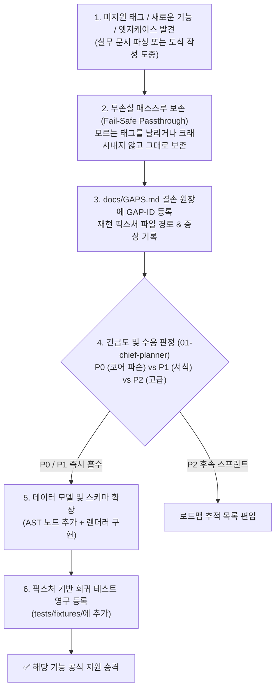

# ONEOFFICE 동적 기능 탐색 및 갭 흡수 프로토콜 (`FEATURE_DISCOVERY_PROTOCOL.md`)

> **"개발 도중 사전 명세에 없던 숨은 기능, 미지원 태그, 실제 실무 문서의 엣지케이스를 발견했을 때, 크래시 없이 시스템에 유연하게 흡수하는 동적 확장 프로토콜"**

---

## 1. 왜 기능 탐색 프로토콜이 필수적인가?

오피스 소프트웨어(한컴오피스 HWPX/HWP, Microsoft Office OOXML, PDF)는 **스펙 문서에 적히지 않은 비공개 태그, 특정 버전에서만 쓰이는 확장 속성, 실제 실무 공문서(공모전 양식, 정부지원사업 신청서, 금융 계약서)에만 등장하는 독특한 서식**이 무수히 존재합니다.

처음부터 모든 기능을 100% 알고 시작하는 것은 불가능하며, 개발 과정에서 **새로운 기능과 결손(Gap)을 발견하는 것은 자연스럽고 필수적인 과정**입니다. 중요한 것은 **새로운 기능을 마주쳤을 때 에이전트가 당황하거나 프로세스를 중단하지 않고, 시스템적으로 이를 흡수하여 제품의 완성도를 지속적으로 높이는 파이프라인**을 갖추는 것입니다.

---

## 2. 미지의 기능 발견 시 5단계 자율 흡수 파이프라인

---

## 3. 세부 원칙 및 행동 지침

### 원칙 1: 절대 크래시 금지 & 무손실 패스스루 (Fail-Safe Passthrough)
- 파서가 모르는 OWPML 태그(예: 신규 `<hp:customExt>`)나 OOXML 엘리먼트를 만났을 때, `unwrap()`으로 패닉하거나 임의로 삭제해서는 안 됩니다.
- 반드시 `passthrough: BTreeMap<String, Vec<u8>>` 스트림에 원본 바이트를 격리 보존하여, 문서를 다시 저장할 때 1바이트의 손실도 없도록 처리합니다.

### 원칙 2: `docs/GAPS.md` 실시간 자동 등재
새로운 기능이나 결손을 발견한 에이전트는 즉시 [`docs/GAPS.md`](GAPS.md)에 다음 항목을 기록합니다:
- **`GAP-ID`**: 예: `GAP-HWPX-07`, `GAP-DIAG-03`, `GAP-PDF-02`
- **발견 맥락**: 어떤 문서(예: `tests/fixtures/kstartup_2026.hwpx`)의 몇 페이지에서 발견되었는가?
- **기능 설명**: 해당 태그/속성이 실제 한컴오피스나 MS Word에서 어떤 시각적/기능적 역할을 하는가?
- **영향도**: `P0`(데이터 유실/크래시), `P1`(레이아웃 왜곡), `P2`(부가 기능)

### 원칙 3: 제안서 도식(`DiagramSpec`)의 신규 시맨틱 패턴 자동 승격
- 제안서를 작성하다가 기존 10종 템플릿으로 표현하기 어려운 고유한 인포그래픽 구조(예: `3단 피라미드 계층`, `4분면 매트릭스`, `밸류체인 화살표`)를 발견하면:
  1. 임의의 깨지는 도형 조합으로 때우지 않습니다.
  2. `crates/oneoffice-diagram`의 `DiagramSpec` 스키마에 새로운 컴포넌트(예: `PyramidStack`, `QuadrantMatrix`)를 제안하고 정식 노드로 등록합니다.
  3. `oneoffice.diagram.list_templates` 카탈로그에 표준 템플릿으로 영구 추가합니다.

### 원칙 4: 정답 픽스처(Golden Fixture) 영구 축적
- 발견된 모든 엣지케이스는 단순 메모로 끝내지 않고, `tests/fixtures/` 디렉토리에 익명화된 최소 재현 문서(`.hwpx`, `.docx`, `.pdf`)로 영구 커밋합니다.
- CI 자동화 테스트(`cargo xtask ci` / `npm test`)에 회귀 테스트 케이스로 추가하여 향후 코드 개선 시 동일 문제가 절대 재발하지 않도록 안전망을 구축합니다.
