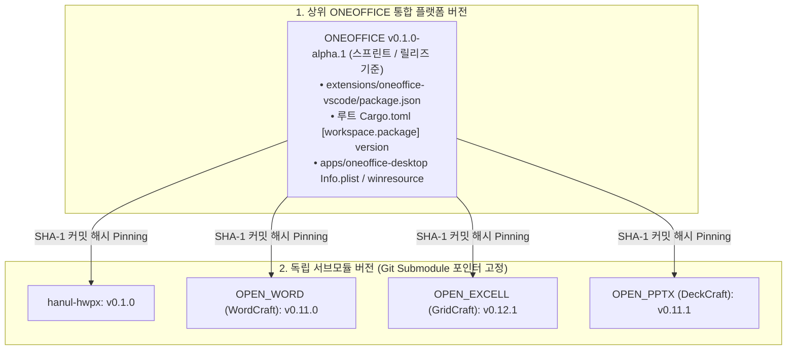
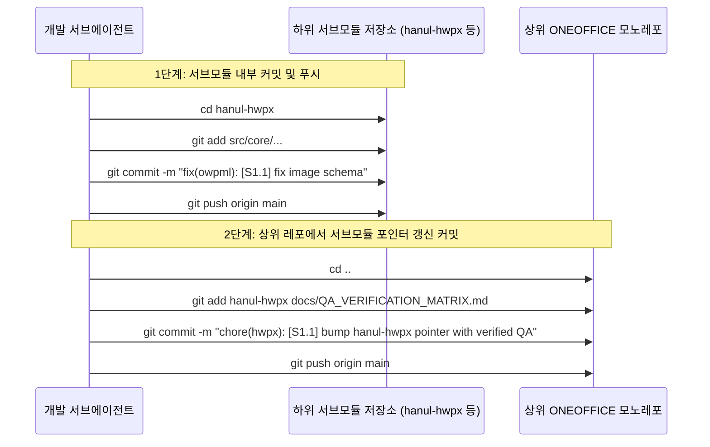

# ONEOFFICE 버전 관리 및 커밋 거버넌스 규정 (`VERSIONING_AND_COMMIT_POLICY.md`)

> **"하이브리드 모노레포와 Git Submodule이 공존하는 환경에서, 버전 번호의 혼선을 없애고 누구나 변경 이력을 추적할 수 있도록 보장하는 소프트웨어 버전 관리 및 커밋 표준"**

---

## 1. 버전 관리 전략 (Dual Semantic Versioning)

ONEOFFICE는 **통합 플랫폼 라이프사이클**과 **하위 전문 엔진의 독립 라이프사이클**이 공존하는 2계층 시맨틱 버저닝(SemVer 2.0.0, `MAJOR.MINOR.PATCH`)을 적용합니다.



### 1.1 통합 플랫폼 버전 명명 규칙
- **Alpha 단계 (Sprint 0 ~ 2)**: `v0.1.0-alpha.N`
  - Submodule 고정, 수식/차트 브릿지, PDF 뷰어 및 서명 기초 구현 단계
- **Beta 단계 (Sprint 3 ~ 4)**: `v0.3.0-beta.N`
  - 제안서 도식화(`DiagramSpec`) 및 HWPX/DOCX 인플레이스 수식 표/서브캔버스 완성 단계
- **Release Candidate (Sprint 5)**: `v0.5.0-rc.N`
  - 통합 MCP 서버 및 AI 폐루프 시각 자가 검증 완주 단계
- **정식 릴리즈 (Sprint 6)**: **`v1.0.0`**
  - 단일 VS Code VSIX 배포 및 macOS / Windows / Linux 3대 OS 네이티브 설치 패키지 출시

### 1.2 단일 진실 공급원 (Single Source of Version)
- 플랫폼 버전은 루트 `Cargo.toml`의 `[workspace.package] version`과 `extensions/oneoffice-vscode/package.json`의 `version`을 100% 일치시킵니다.
- 버전 올림 시 `cargo xtask version <new_version>` 또는 자동화 스크립트로 전역 일괄 갱신합니다.

---

## 2. 커밋 메시지 표준 (Conventional Commits + Task ID)

모든 커밋은 **Conventional Commits 규격**을 따르며, **마스터 계획서 Task ID 또는 결손 GAP-ID를 필수 포함**해야 합니다.

### 2.1 커밋 포맷 규격
```text
<type>(<scope>): [<TASK-ID>] <간결한 한 줄 요약 (50자 이내)>

[선택적 상세 본문]
- 무엇을 왜 변경했는가?
- 실측 검증 결과 (Pass 여부, 캡처 경로 등)

[선택적 푸터]
Closes #이슈번호, Refs #이슈번호
```

### 2.2 허용 Type 목록
| Type | 의미 및 사용 시점 |
| :--- | :--- |
| `feat` | 새로운 기능 추가 (예: `DiagramSpec` 템플릿, PDF 서명 기능) |
| `fix` | 버그 및 결함 수정 (예: OWPML 스키마 누락, 차트 .xlsx 증발 해결) |
| `docs` | 문서 작성 및 수정 (README, 아키텍처 플랜, 헌장, 라이선스 등) |
| `qa` | 실측 검증 스크린샷 캡처 커밋, 회귀 테스트 픽스처 추가 |
| `test` | 단위 테스트, 통합 테스트, 적대적 퍼징 코드 추가 |
| `refactor` | 동작 변경 없는 코드 구조 개선, 레이어 정리 |
| `chore` | 서브모듈 포인터 갱신, Cargo 의존성 락, CI 설정 |

### 2.3 허용 Scope 목록
`hwpx`, `word`, `excel`, `pptx`, `pdf`, `diagram`, `mcp`, `ui`, `packaging`, `deps`, `root`

### 2.4 올바른 커밋 메시지 예시
```text
feat(diagram): [S3.1] implement 3-pass Korean constraint layout solver

- HarfRust-based Korean glyph shaping with Kinsoku line-break rules
- Equalize card heights for comparison card grids
- Verified: overflow_count == 0 on reference proposal fixture

Refs docs/MASTER_ARCHITECTURE_PLAN.md#S3.1
```
```text
fix(hwpx): [GAP-HWPX-01] register hc:img and add content.hpf manifest item

- Replace non-standard hp:img with standard OWPML hc:img
- Automatically append opf:item to Contents/content.hpf
- Tested: round-trip reload in rhwp studio without schema errors

Closes GAP-HWPX-01
```

---

## 3. 서브모듈 환경에서의 2단계 커밋 파이프라인 (2-Step Commit Flow)

하위 서브모듈(`hanul-hwpx`, `OPEN_WORD` 등)의 코드를 수정한 경우, **상위 저장소와 하위 저장소의 이력이 단절되지 않도록 반드시 아래 2단계 순서**로 커밋합니다.



1. **Step 1 (서브모듈 내부 커밋)**:
   - 해당 서브모듈 디렉토리로 이동하여 파일을 `git add`하고 의미 있는 커밋 메시지를 작성한 뒤 서브모듈 원격으로 푸시합니다.
2. **Step 2 (상위 ONEOFFICE 포인터 고정 커밋)**:
   - 상위 루트로 복귀하여 변경된 서브모듈 포인터(`hanul-hwpx`)와 업데이트된 검증 현황판(`QA_VERIFICATION_MATRIX.md`)을 상위 저장소에 커밋합니다.
   - 이렇게 하면 상위 레포지토리를 클론한 누구에게나 **서브모듈의 정확히 검증된 커밋 지점**이 전달됩니다.

---

## 4. 절대 금지 커밋 위생 수칙 (Commit Hygiene & Guardrails)

모든 커밋 전 `cargo xtask ci` 또는 린트 게이트를 거쳐야 하며, 아래 3가지는 엄격히 차단됩니다:

1. **대용량 바이너리 산출물 커밋 금지**:
   - 빌드 산출물인 `*.vsix` (수 MB~수십 MB), `*.dmg`, `*.msi`, `*.AppImage`, 임시 프리뷰 디렉토리(`.preview/`, `target/`)는 절대 git에 올리지 않습니다. (루트 `.gitignore`로 철저 통제)
2. **빌드가 깨진 상태의 커밋 금지 (Never Break Main)**:
   - 컴파일 에러가 발생하거나 기존 단위 테스트가 실패하는 상태에서는 절대 커밋하지 않습니다. 반드시 자가 치유(Self-Healing)를 거쳐 그린(Green) 상태에서만 커밋합니다.
3. **`ATTRIBUTION.md` 누락 에셋 커밋 금지**:
   - 새로운 이미지, 샘플 문서, 폰트, SVG 파일이 추가될 때는 반드시 **동일한 커밋 안에 `ATTRIBUTION.md` 출처/라이선스 기재 행**이 포함되어야 합니다.

---

## 5. 태깅 및 자동 릴리즈 파이프라인 (Tagging & Automated Release)

- **Git 태그 생성**: 마일스톤 또는 릴리즈 달성 시 `git tag -a v0.X.Y -m "Release v0.X.Y"`
- **GitHub Actions 릴리즈 자동화**:
  - `v*` 태그가 푸시되면 CI 파이프라인이 자동 트리거되어:
    1. macOS Universal `.dmg` 및 `/Applications/OneOffice.app` 아티팩트 빌드
    2. Windows `x64` / `ARM64` `.msi` 및 `.exe` 빌드
    3. Linux `x86_64` / `aarch64` `AppImage` 및 `.deb` 빌드
    4. VS Code `oneoffice-vscode-X.Y.Z.vsix` 패키징
    5. `oneoffice-mcp` 크로스플랫폼 바이너리 컴파일
    6. GitHub Releases 페이지에 다운로드 바이너리 및 `CHANGELOG.md` 자동 발행
